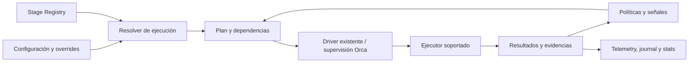
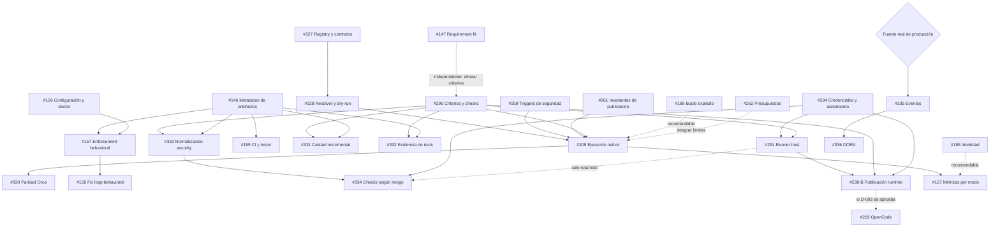

# CodeCycleToolkit 2.0 — estrategia y roadmap aprobado

[← Índice de documentación](README.md) · [Épica de ejecución #326](https://github.com/datacas/code-cycle-toolkit/issues/326)

**Estado:** planificación aprobada, materializada el 26 de octubre de 2026. Este documento no acredita que las capacidades previstas estén implementadas. Las issues conservan los criterios de aceptación y el estado de ejecución; las guías operativas describen el comportamiento disponible actualmente.

**Fuente:** auditoría técnica y arquitectónica, informe de planificación aprobado y cinco ajustes posteriores del propietario. Esta materialización conserva ese backlog; no constituye otra auditoría ni un rediseño. El checkout de referencia de los informes fue `aaba4527bee916d956346ff6c418804d2387305e`.

## 1. Por qué iniciamos esta evolución

CCT ya tiene una base funcional importante: skills portables, revisión independiente, findings estables, resolución y rereview, verificación mediante ejecución, runtime opcional, integración supervisada con Orca, permisos por etapa y telemetría local. La evolución parte de esa base y de las iniciativas existentes; no busca una reescritura.

La planificación identificó tres necesidades principales: expresar qué controles participarán en un ciclo y por qué; completar la relación persistente entre criterios, checks y evidencias; y aportar mediciones comparables de calidad, seguridad y efectividad. La configuración de modelos no expresa por sí misma la profundidad de ejecución. Un resultado declarado tampoco demuestra que se hayan inventariado todos los criterios del issue o verificado el comportamiento afectado.

Hay capacidades pendientes que ya tienen issues: criterios y trazabilidad [#147][i147]/[#290][i290], integración behavioral [#156][i156]–[#159][i159], baseline del comportamiento afectado [#251][i251], garantías de seguridad [#259][i259]/[#294][i294] y cierre verificable [#261][i261]. Completarlas tiene prioridad sobre añadir agentes, subsistemas o controles redundantes. No se añade backlog por la mera existencia de ideas similares en otra herramienta.

## 2. Visión y objetivos

Queremos una plataforma profesional de ingeniería con agentes que sea configurable, segura, medible, reproducible, mantenible y eficiente. Debe conservar la portabilidad entre Claude Code, Codex y las superficies soportadas; la ampliación a OpenCode se valida en [#219][i219], sin dar por aprobadas sus decisiones pendientes. Orca conserva su responsabilidad de ejecución supervisada.

El éxito se mide mediante resultados verificados, calidad del cambio, estabilidad, riesgo y coste. Más código generado, más llamadas de revisión o más scanners no son indicadores suficientes de mejora. Los modos deben permitir distinta profundidad sin rebajar obligaciones aplicables, ocultar incertidumbre ni trasladar costes innecesarios al usuario.

M1–M4 delimitan el candidato principal de CCT 2.0. M5 depende de datos reales de producción y no bloquea ese candidato. M6 es optimización posterior. La confianza de tests mediante mutation [#332][i332] también puede quedar fuera de la entrega inicial si no demuestra valor adicional.

## 3. Principios y prioridades

- **Reutilización antes que creación.** Ampliar skills, contratos, runtime y persistencia existentes. Una nueva responsabilidad lógica no implica otro servicio, agente o etapa.
- **Simplicidad.** Entregas pequeñas o medianas con resultados verificables; evitar abstracciones para necesidades hipotéticas y refactorizaciones generales como prerrequisitos artificiales.
- **Evidencias antes que afirmaciones.** Separar código presente, conexión funcional, tests superados, comportamiento observado y cumplimiento de un criterio. La ausencia de evidencia no prueba automáticamente un defecto.
- **Seguridad y aislamiento.** Conservar permisos por etapa, protección de credenciales, workspaces y revisión humana. Un perfil u override no puede retirar controles obligatorios.
- **Compatibilidad hacia atrás.** Mantener contratos de findings, reviews y verificación; evolucionar esquemas y configuración de forma explícita. Las instalaciones existentes deben seguir teniendo un comportamiento compatible.
- **Calidad incremental.** Comparar base y HEAD; distinguir deuda preexistente y regresiones. No convertir el cambio en una campaña de saneamiento de todo el legacy.
- **Controles proporcionales al riesgo.** Activación determinista cuando sea posible, resultados inconclusos explícitos y herramientas opcionales sin imposición universal.
- **Separación de configuración.** Perfil de ejecución, perfil de modelos y políticas de seguridad tienen responsabilidades distintas. Las etapas se configuran por proyecto y pueden recibir overrides de invocación compatibles.
- **Medición objetiva de efectividad.** Reutilizar telemetría y estadísticas, conservar denominadores, procedencia e incertidumbre, y comparar cohortes de trabajo y riesgo.
- **Independencia de proveedores.** Mantener los proveedores soportados y evitar dependencias propietarias obligatorias o un segundo orquestador divergente.
- **Coste y latencia.** Reducir trabajo redundante sin sacrificar corrección, trazabilidad ni obligaciones. No crear otro reviewer por cada métrica.

## 4. Filosofía sobre skills y herramientas externas

Uncle Bob, SonarSource, Aikido, Snyk y otras fuentes aportan inspiración técnica o integraciones opcionales. No se importan colecciones completas de skills, arquitecturas ni sistemas de gobernanza. Los principios generales de ingeniería se aprovechan mediante las capacidades habituales de los agentes y las revisiones existentes.

Las mediciones objetivas deben proceder de analizadores reproducibles. Las referencias externas pueden mejorar la consistencia de una review, pero no justifican nuevas etapas por sí mismas. Una eventual reutilización de contenido exigiría revisar su licencia; la planificación no autoriza copiarlo. La selección de herramientas debe responder a una carencia demostrada y evitar solapamientos.

## 5. Modos de ejecución

Los cinco modos comparten contratos y planificación. No crean cinco implementaciones del ciclo.

| Modo | Objetivo y límite |
|---|---|
| **Prototype** | Experimentación rápida y salida local, reutilizando `local_only`. No denominar esa salida `READY_FOR_MANUAL_MERGE`. Publicar o pedir aprobación activa las garantías correspondientes. |
| **Standard** | Desarrollo habitual con equilibrio entre profundidad, seguridad, calidad, coste y latencia. |
| **Full** | Todos los controles aplicables y declarados, con mayor profundidad. No significa instalar todas las herramientas del roadmap ni repetir revisiones sin cambios. |
| **Hotfix** | Reproducción del defecto, cambio mínimo y regresión focalizada. No concede una excepción general a seguridad o revisión. |
| **Custom** | Base segura con configuración explícita de etapas. Los overrides no convierten controles omitidos en aprobados ni eliminan obligaciones. |

### Políticas de etapa

| Política | Semántica prevista |
|---|---|
| `disabled` | No solicitar la etapa. Si contradice una obligación aplicable de seguridad o una dependencia necesaria para el resultado solicitado, el plan es inválido y se explica el conflicto. |
| `auto` | Resolver mediante reglas deterministas y señales disponibles. Riesgo desconocido no equivale a ausencia de riesgo. El plan puede conservar una condición pendiente hasta disponer del diff. |
| `enabled` | Programar cuando resulte aplicable. La indisponibilidad se registra; esta preferencia no crea por sí sola una obligación de éxito. Tampoco permite ignorar defectos confirmados o findings bloqueantes. |
| `required` | Cuando aplica, exigir resultado y evidencia suficientes para completar el objetivo. Una herramienta ausente o un resultado inconcluso no satisface la obligación. |

Las obligaciones son monotónicas: el agente puede solicitar controles adicionales, pero no retirar los requeridos. Los conflictos con overrides se rechazan con procedencia visible; no se ignoran silenciosamente. La precedencia concreta de configuración se entrega en [#328][i328], coordinada con [#285][i285], manteniendo separados modelos, ejecución y seguridad.

### Matriz de activación aprobada

`R`: required; `A`: auto; `E`: enabled; `D`: disabled. Las filas incluyen etapas y controles integrados: **una fila no implica otro agente ni otro dispatch**. Las capacidades futuras se habilitan conforme se implementen, no por publicar esta matriz.

| Etapa o control | Prototype | Standard | Full | Hotfix | Custom |
|---|---|---|---|---|---|
| Preflight, permisos, identidad y trazabilidad | R | R | R | R | R |
| Issue readiness | A | A | R | A | Configurable |
| Implementación | R | R | R | R | Configurable |
| Verificación esencial del proyecto | R | R | R | R | R para producir cambio verificado |
| Revisión independiente | D, salida local | R | R | R | Condicionada al objetivo |
| Auditoría de seguridad | A | A | R cuando aplica | A | Nunca por debajo de obligaciones |
| Métricas de calidad | A, ligeras | A, incrementales | E, alcance ampliado | A, cambio focalizado | Configurable |
| Behavioral | A | A | R para flujos aplicables | A, regresión afectada | Configurable |
| Mutation | D | D | A | D | Configurable |
| DAST | D | A | A | A, solo si pertinente | Configurable |
| Resolución de findings | A | A | A | A | Puede detener para intervención |
| Rereview | Condicional; véase regla siguiente | Condicional; véase regla siguiente | Condicional; véase regla siguiente | Condicional; véase regla siguiente | Condicional; véase regla siguiente |
| CI requerida del HEAD | Al publicar | R | R | R | Obligatoria para merge-ready |
| Merge humano | Fuera de salida local | R | R | R | R cuando corresponda |

**Decisión definitiva sobre rereview:** si no hay modificaciones posteriores a la revisión que requieran volver a verificarla, no se ejecuta rereview. Se aplica a Prototype, Standard, Full, Hotfix y Custom. Full no impone una repetición incondicional. Sin correcciones ni cambios que invaliden la evidencia, no se repite la revisión. Los hallazgos abiertos sin correcciones conservan sus bloqueos; no se vuelve a revisar el mismo estado para intentar obtener otro resultado. Ante cambios posteriores, se reevalúan los controles cuya evidencia haya quedado invalidada. Cuando se solicita una nueva aprobación y la revisión anterior ya no es válida, la comprobación correspondiente es obligatoria.

### Dependencias, estados y replanificación

Review necesita un artefacto de implementación y un HEAD identificable. Resolve necesita findings o checks fallidos concretos. Rereview necesita el estado de revisión anterior y cambios relevantes posteriores. La aprobación exige revisión y checks válidos para el mismo HEAD. Los bucles de corrección siguen acotados; no se sustituyen por un DAG ilimitado.

El dry-run inicial es de solo lectura y puede mostrar condiciones pendientes. Tras observar el cambio se genera una revisión del plan; cambiar HEAD o señales relevantes obliga a reconsiderar controles afectados. Reanudar no autoriza a reutilizar evidencia invalidada. [#262][i262] conserva presupuestos a lo largo de replanificaciones y resume.

El contrato distinguirá etapa omitida, bloqueo, error de ejecución, herramienta ausente, cancelación/timeout y resultado inconcluso, separando ejecución de conclusión funcional. Deben mantenerse las distinciones reales entre fallo, no verificado y omitido; no convertir `UNVERIFIED` o `SKIPPED` en éxito. Los nombres definitivos y la compatibilidad del sobre de resultados se resuelven en [#327][i327]/[#290][i290], sin redefinir unilateralmente los contratos actuales.

## 6. Calidad, arquitectura y ciberseguridad

### Calidad incremental y evidencia fiable

[#331][i331] empieza con **un lenguaje y métricas concretas**, utilizando analizadores existentes siempre que sea posible. Compara base y HEAD con versiones, configuración, alcance y procedencia identificables. Debe distinguir deuda preexistente, cambios de medición y regresiones. Los resultados se entregan a las reviews existentes; no se crea otro agente de review ni un analizador universal propio.

| Evidencia | Utilidad | Límite de interpretación |
|---|---|---|
| Complejidad ciclomática | Número de caminos de control; orienta pruebas y revisión de funciones modificadas. | No prueba responsabilidades múltiples ni un defecto funcional. Depende de las convenciones del analizador. |
| Complejidad cognitiva, anidamiento y tamaño | Señalan dificultad de lectura o concentración de lógica; [#191][i191] ofrece una señal sencilla de tamaño. | No son medidas universales ni justifican un bloqueo por sí solas. |
| Duplicación | Identifica fragmentos repetidos y su evolución. | Similitud textual no demuestra duplicación de conocimiento; fixtures y código generado requieren contexto. |
| Acoplamiento, dependencias y ciclos | Evidencian relaciones observables entre módulos; una regla de capas declarada puede comprobarse. | Muchos imports no prueban mal diseño. Un ciclo solo bloquea cuando incumple una regla pertinente y verificable. |
| Cohesión y responsabilidades | Convergencia de señales: dependencias dispares, estados afectados, reglas de dominio y razones de cambio. | SRP, SOLID y cohesión arquitectónica necesitan interpretación; no reciben puntuaciones arbitrarias. |
| Hotspots y deuda | Combinar complejidad con churn y datos fiables de defectos ayuda a priorizar. | Churn no equivale a defectos. No inventar deuda en horas ni ROI a partir de una métrica aislada. |
| Cobertura y mutation acotada | Evidencia adicional sobre tests del cambio, mediante [#332][i332]. | Cobertura no demuestra calidad de aserciones; mutantes equivalentes, entorno y coste limitan la conclusión. |

**Una función con demasiadas responsabilidades no se detecta de manera fiable mediante un único umbral.** Una herramienta puede reproducir su complejidad, dependencias o relaciones de datos; el juicio requiere explicar qué responsabilidades independientes reúne y qué problema concreto produce. Por ejemplo, coordinar persistencia, reglas de negocio y publicación puede ser una orquestación legítima. La review debe examinar el contexto antes de pedir una separación.

Una señal reproducible puede justificar información o una advertencia sobre el cambio. Para elevarla a finding se necesita un argumento contextual verificable: regla arquitectónica acordada incumplida, defecto, riesgo concreto o regresión demostrable. Un bloqueo exige la obligación o severidad aplicable y evidencia suficiente. Longitud, LCOM, número de mocks, un score de mantenibilidad o deuda legacy no justifican automáticamente bloquear. Los umbrales iniciales se calibran con la base del proyecto, sin convertirlos en estándares universales.

[#260][i260] aporta señales sobre verificaciones debilitadas. [#251][i251] conserva el baseline del comportamiento afectado; [#237][i237] selecciona tests sin retirar obligaciones de [#290][i290]. Los metadatos comunes de [#146][i146] son reutilizables sin imponer screenshots o visualización a proyectos backend. La integración behavioral se completa en [#156][i156]–[#159][i159] antes de inventar una verificación paralela.

### Seguridad proporcional y trazable

Primero se consolidan las garantías actuales mediante [#259][i259], [#261][i261] y [#294][i294]. Esta última mantiene prioridad alta y debe preceder a ampliaciones sensibles de aislamiento y credenciales; no bloquea contratos o planificación sin dispatch. Se conservan las decisiones del propietario sobre L1/L2, opt-out explícito por proyecto, validación por sistema operativo y la separación del publisher. Las decisiones H-03/H-05 siguen pendientes en su issue.

Después, [#333][i333] normaliza observaciones y [#334][i334] introduce un piloto de checks declarados según riesgo. SAST, SCA, secretos, contenedores, IaC, SBOM y DAST/API se seleccionan cuando el cambio y el entorno lo justifiquen. No se integran simultáneamente herramientas equivalentes ni se hacen obligatorios todos los scanners. [#291][i291] solo es prerrequisito de la ruta host que lo necesite.

Una observación de scanner no es una vulnerabilidad confirmada. Deben conservarse procedencia, versión, localización, fingerprint, contexto de ejecución y relación base/HEAD para distinguir nueva exposición y hallazgos preexistentes. La review conserva el triage, la justificación del riesgo y el contrato de findings/rereview; las correcciones se verifican con evidencia reproducible. La severidad del proveedor por sí sola no determina un gate. Tampoco se interpreta un scanner ausente como aprobado.

Los controles de ejecución siguen tratando el código, entradas de agentes y dependencias como superficies de confianza distintas. Ninguna integración justifica ampliar permisos, exponer credenciales o sustituir el aislamiento existente sin demostrar su necesidad y respetar [#294][i294].

## 7. Métricas de ciclos y DORA

[#127][i127] amplía mecanismos existentes de telemetría, historial, journal y estadísticas. Se buscan tiempos totales y por etapa, coste por ciclo/cambio verificado, éxito al primer intento, reintentos, rework, findings confirmados frente a falsos positivos, efectividad de review/rereview, intervenciones humanas, defectos escapados cuando sean atribuibles y sobrecoste de verificación.

Las comparaciones deben usar categorías de trabajo, riesgo, modo, proveedor y modelo con cobertura de datos visible. No se generan rankings simplistas de modelos o desarrolladores. Un resultado desconocido no es cero; distinguir costes observados, estimados y ausentes, junto con su base de precios. [#185][i185], [#192][i192] y [#180][i180] mejoran identidad y atribución. El reporting histórico observacional no depende de [#126][i126]; las afirmaciones controladas sí necesitan su diseño experimental.

**Reserva desde el primer contrato:** el ExecutionPlan conserva perfil de ejecución utilizado, versión del contrato, identidad y revisión del plan, procedencia de decisiones, configuración efectiva y motivos de activación y omisión. Así se habilita el análisis posterior por modo de [#127][i127] sin implementar esas métricas en la fase de contratos.

### DORA requiere hechos de producción

| Métrica | Datos necesarios; límite frente a Git/PR |
|---|---|
| Change lead time | Relación atribuible entre cambios y su despliegue satisfactorio en producción. El tiempo de issue o PR no la sustituye. |
| Deployment frequency | Eventos de despliegue satisfactorio en producción, servicio y ventana definidos. Merge o release no son prueba suficiente. |
| Failed deployment recovery time | Despliegue fallido, inicio y restauración verificables y relacionados. Tiempo de resolución de comentarios no es recuperación. |
| Change fail rate | Despliegues fallidos y denominador de despliegues de producción según una semántica acordada. Findings de review no son fallos de producción. |
| Deployment rework rate | Despliegues atribuibles a rework correctivo de producción y denominador explícito. Iteraciones del agente no son ese rework. |

[#335][i335] incorpora importadores explícitos para GitHub Deployments y JSON neutral versionado de incidentes, sin otro servicio; el mapeo explícito de entornos a servicios evita inferir producción. Estas decisiones resuelven la selección inicial de fuente y semántica. La aceptación de #335 sigue condicionada a validar los importadores con eventos reales anonimizados y una configuración comprobable; las pruebas sintéticas no satisfacen esa evidencia. [#336][i336] calcula las cinco métricas con cobertura y limitaciones explícitas, preservando identidad externa y relaciones atribuibles sin forzar un PR a equivaler a un despliegue.

El informe DORA *The ROI of AI-assisted Software Development*, edición 2026.1, se utilizó en la auditoría como referencia sobre baseline, aprendizaje, adaptación del pipeline y coste de verificación. No autoriza estimaciones numéricas de ROI sin datos propios. Aumentar velocidad local puede aumentar el trabajo posterior; por eso se miden resultados, estabilidad, calidad y coste conjuntamente.

## 8. Arquitectura de evolución

Se conserva el driver y el bucle existentes, las skills, los contratos de findings y verificación, la gestión de workspaces/permisos, la supervisión de Orca y la persistencia actual. Cuatro responsabilidades lógicas organizan la extensión:

| Responsabilidad | Límite previsto |
|---|---|
| **Stage Registry** — [#327][i327] | Metadatos estáticos y validados de etapa, skill, rol, workspace, contrato y dependencias. No es una plataforma dinámica de plugins. |
| **Execution Profile Resolver** — [#328][i328] | Resuelve modos, capas y overrides, conservando procedencia. No selecciona modelos ni redefine políticas de seguridad. |
| **Dependency Planner** — [#328][i328]/[#329][i329] | Construye el plan inspeccionable y sus condiciones; revisa el plan al disponer de nuevas señales. Mantiene el bucle de corrección existente. |
| **Policy Engine** — [#328][i328]/[#329][i329] | Evalúa reglas y obligaciones con funciones deterministas; reutiliza seguridad, boundary y CI. No ejecuta comandos ni permite rebajar obligaciones. |

Son responsabilidades, **no cuatro servicios o paquetes obligatorios**. El plan compartido alimenta el runtime nativo y [#330][i330] lo adapta al recorrido supervisado de Orca. Orca conserva Run/Task y las identidades de `OrcaDispatchContext`; un receipt de lanzamiento no equivale al resultado de la tarea.

### Contratos previstos y compatibilidad

- **ExecutionPlan:** contrato versionado, identidad/revisión, objetivo, perfil, configuración efectiva y huellas, políticas, base/HEAD, etapas, obligación, condición, dependencias, motivos y procedencia. Reserva desde el inicio el contexto de análisis por modo.
- **StageResult:** conserva el resultado funcional actual y añade un sobre de ejecución compatible. Separar ejecución, conclusión y findings; no perder estados no verificados.
- **CheckResult:** se alinea con [#290][i290]: identidad, comando, contexto, commit, resultado y evidencia. La selección de tests no puede eliminar una obligación registrada.
- **AnalysisObservation:** medición o candidato de scanner con origen, versión, fingerprint y comparación. Su existencia no lo convierte automáticamente en finding.

Los detalles se cierran en las issues responsables. [#290][i290] conserva pendiente la decisión sobre cuándo CI puede satisfacer una verificación local no ejecutada. [#219][i219] conserva D-001–D-003 pendientes. Esta estrategia no decide esas cuestiones por anticipado.

La migración parte de defaults compatibles, sin exigir herramientas opcionales para la base. Las skills y la configuración instalada no deben quedar divergentes del runtime; [#257][i257] acompaña cada entrega afectada. [#189][i189] permite una extracción acotada y neutral del bucle. Las refactorizaciones [#187][i187]/[#188][i188]/[#190][i190] son precedencias de integración según los archivos modificados, no una reescritura previa obligatoria.

## 9. Roadmap, dependencias y milestones

### Épica e issues nuevas

[#326][i326] coordina exclusivamente las cuatro entregas de modos [#327][i327]–[#330][i330]; no añade implementación propia. Las otras siete issues tienen resultados independientes y se relacionan por contratos y evidencia.

| Issue | Título aprobado | Prioridad |
|---|---|---|
| [#326][i326] | Deliver shared execution profiles across native and Orca cycles | P0, épica |
| [#327][i327] | Define a static stage registry and versioned execution-plan contracts | P0 |
| [#328][i328] | Resolve execution profiles, dependencies and a read-only dry-run plan | P0 |
| [#329][i329] | Execute and replan native cycles under mandatory policy gates | P0 |
| [#330][i330] | Use the shared execution plan in supervised Orca cycles | P0 |
| [#331][i331] | Produce comparable incremental code-quality evidence for existing reviews | P1 |
| [#332][i332] | Assess changed-test confidence with coverage and bounded mutation evidence | P1, opcional |
| [#333][i333] | Normalize incremental security observations into review evidence | P1 |
| [#334][i334] | Run declared security checks proportionally to change risk | P1 |
| [#335][i335] | Import attributable production deployment and incident events | P2, condicionada |
| [#336][i336] | Report the five DORA metrics with explicit data coverage | P2, condicionada |

### Dependencias estrictas

- Camino habilitante: **[#327][i327] → [#328][i328] → [#329][i329] → [#330][i330]**.
- [#259][i259], [#261][i261] y [#290][i290] bloquean la integración completa de [#329][i329]. Se desarrollan en paralelo al planner.
- [#146][i146] + [#156][i156] → [#157][i157] → [#158][i158]. [#146][i146] + el núcleo [#155][i155], ya completado al planificar, → [#159][i159]. #159 no tiene que esperar a #158.
- [#290][i290] + los metadatos comunes de [#146][i146] → [#331][i331], [#332][i332] y [#333][i333]. Esto no exige hacer obligatoria la captura visual de #146.
- [#333][i333] + [#294][i294] → [#334][i334]. [#294][i294] + [#290][i290] → [#291][i291].
- [#335][i335] → [#336][i336]. Los adaptadores y la semántica de servicio/entorno están decididos; antes de completar #335 y empezar #336 debe verificarse al menos una integración con eventos reales anonimizados.
- [#185][i185] → [#186][i186] mientras esa extracción conserve el alcance que usa la identidad común.

### Precedencias recomendadas, condiciones y trabajo paralelo

[#147][i147] es independiente de los modos; puede adelantarse o desarrollarse en paralelo con #290 para alinear criterios. **No bloquea #327 ni #328.** [#294][i294] es prioritaria antes de nuevas superficies sensibles de ejecución, **no bloquea #327/#328 sin dispatch**.

[#189][i189] es recomendable antes de integrar #329, sin dependencia estricta. No se exige completar toda la cadena de refactorización #186–#190. #187 ayuda antes de cambios extensos en `CycleRecorder.stage`; #188 antes de migraciones simultáneas; #190 se coordina con #219 según los archivos afectados. Se preserva la decisión histórica del propietario sobre rollback transaccional del worktree en #189.

[#260][i260] es recomendable antes de ampliar test intelligence/scanners. [#262][i262] debe acotar consumo antes de activar mutation automáticamente o campañas costosas; no bloquea importar evidencias ya producidas. [#185][i185]/[#192][i192] son precedencias de integración para agregaciones complejas. #127 necesita el contexto de planes para comparar modos, sin convertir todas las mejoras de identidad en bloqueos generales.

[#291][i291] solo bloquea la ruta host de #334. La fase **#238-A** conserva capacidades de proveedores y puede adelantarse. La fase **#238-B**, publicación desde runtime, conserva la decisión L-5 del propietario: después de [#288][i288]/[#290][i290]/[#291][i291]/[#293][i293]/[#294][i294]; #288 y #293 ya estaban completadas al planificar. No se aplica esa dependencia a toda #238. Solo si se aprueba D-003 de #219 con publicación desde runtime se convierte esa relación condicionada en una dependencia de su entrega.

### Grafo principal

Flechas continuas: bloqueos del alcance indicado. Flechas discontinuas: recomendaciones o condiciones explícitas. El nodo #238-B representa **una fase**, no un bloqueo global de #238. La flecha hacia #127 representa la disponibilidad necesaria del plan para el análisis por modo, no un bloqueo del reporting histórico independiente.

### Secuencia de integración recomendada

El orden no es una cola estrictamente serial ni una estimación de duración. Las dependencias anteriores prevalecen sobre el orden de llegada de los PR. Los criterios completos permanecen en cada issue.

| Orden | Issue / prioridad | Motivo y resultado que habilita | Paralelo |
|---|---|---|---|
| 0 | [#326][i326] / P0 | Seguimiento y aceptación común; sin implementación propia. | Todo |
| 1 | [#294][i294] / P0 | Aislamiento y credenciales para ampliar ejecución con seguridad. | Planner y skills |
| 2 | [#259][i259] / P0 | Triggers reutilizables por políticas obligatorias. | #294 y planner |
| 3 | [#147][i147] / P0 | Criterios escritos y experimentos E1/E2; mejora independiente. | Seguridad y planner |
| 4 | [#327][i327] / P0 | Contrato común sin alterar todavía la ejecución. | Seguridad |
| 5 | [#328][i328] / P0 | Resolver y dry-run de cinco modos, tras #327. | #261 y #290 |
| 6 | [#261][i261] / P0 | Invariantes externas antes de nuevas transiciones. | #290 |
| 7 | [#290][i290] / P0 | Criterios → checks → resultados; resolver sus decisiones pendientes. | #328 |
| 8 | [#189][i189] / P0 recomendada | Extracción neutral y acotada del bucle para reducir riesgo de integración. | Contratos puros |
| 9 | [#329][i329] / P0 | Modos nativos reales, tras #328/#259/#261/#290. | Contratos de artefactos |
| 10 | [#330][i330] / P0 | Paridad de decisiones y contratos con Orca, tras #329. | #262 y #285 |
| 11 | [#262][i262] / P0 | Presupuestos recuperables a través de plan y resume. | #285 |
| 12 | [#285][i285] / P0 | Overrides de invocación con precedencia acordada con #328. | #262 |
| 13 | [#146][i146] / P1 | Metadatos comunes reutilizables; visualización opcional. | #156 y #191 |
| 14 | [#156][i156] / P1 | Configuración y doctor sobre el núcleo #155 existente. | Calidad |
| 15 | [#157][i157] / P1 | Enforcement behavioral, tras #146/#156 y alineado con plan/#290. | #159 |
| 16 | [#158][i158] / P1 | Findings y rerun behavioral dentro del fix loop, tras #157. | #159 |
| 17 | [#159][i159] / P1 | CI, conservación y lector; coordinar #145. | #158 |
| 18 | [#191][i191] / P1 | Warning sencillo de tamaño, sin refactorización general. | Behavioral |
| 19 | [#260][i260] / P1 | Señales de checks debilitados para review. | #331 |
| 20 | [#144][i144], [#183][i183] / P1 | Reconnaissance y aclaraciones independientes. | Calidad |
| 21 | [#251][i251] / P1 | Baseline afectado y E4, sin esperar a #144 o behavioral para backend. | #331 |
| 22 | [#331][i331] / P1 | Evidencias incrementales de calidad, tras #290 y metadatos de #146. | #333 |
| 23 | [#237][i237] / P1 | Selección de tests conservando obligaciones; definiciones en su issue. | Normalización security |
| 24 | [#332][i332] / P1 opcional | Cobertura/mutation acotada; presupuesto antes de automatizar mutation. | Scanners |
| 25 | [#333][i333] / P1 | Observaciones security comparables y trazables. | Runner host |
| 26 | [#291][i291] / P1 | Ruta host con grants ya decididos, tras #294/#290. | #333 |
| 27 | [#334][i334] / P1 | Piloto de checks por riesgo, tras #333/#294 y #291 solo en ruta host. | Proveedores |
| 28 | [#238-A][i238] / P0–P1 | Capacidades reales de proveedores; puede adelantarse desde la primera tanda. | Planner y seguridad |
| 29 | [#238-B][i238] / P1 | Publicación desde runtime siguiendo la secuencia del propietario. | Analytics |
| 30 | [#219][i219] / P1 | OpenCode y plan común, con D-001–D-003 aún pendientes. | Proveedores si no hay conflicto |
| 31 | [#257][i257] / P1 | Coherencia skill/runtime en cada superficie cambiada. | Cada entrega |
| 32 | [#185][i185] / [PR #204](https://github.com/datacas/code-cycle-toolkit/pull/204) / P2 | Integrar identidad común sin duplicar el trabajo abierto al planificar. | Modos y calidad |
| 33 | [#192][i192] / P2 | Referencias cualificadas e identidad para atribuir outcomes. | #180 |
| 34 | [#180][i180] / P2 | Piloto operacional; #172/#174 ya completadas al planificar. | #127 |
| 35 | [#127][i127] / P2 | Efectividad por modo/cohorte; #126 solo para afirmaciones controladas. | Evaluación DORA |
| 36 | [#335][i335] / P2 condicionada | Eventos reales tras implementar GitHub Deployments, JSON neutral de incidentes y el mapeo explícito servicio/entorno. | Analytics local |
| 37 | [#336][i336] / P2 condicionada | Cinco métricas con cobertura explícita, tras #335. | No bloquea el núcleo 2.0 |

### Correcciones intercaladas y deuda independiente

| Trabajo existente | Posición aprobada |
|---|---|
| [#275][i275], [#325][i325] | Validar al principio; corregir antes del piloto de evidencia/Orca afectado si se reproducen. |
| [#284][i284] | Investigar antes de declarar estable la publicación del piloto; coordinar con #261. |
| [#245][i245] | Reproducir recuperación/respuestas sobre el runtime vigente antes de ampliar canales. |
| [#246][i246] | Reproducir antes de añadir verificaciones que generen archivos; no duplicar el mecanismo scratch existente. |
| [#282][i282] | Resolver atribución/colisión antes de usar esas revisiones en métricas de eficacia. |
| [#199][i199] | Entrega independiente temprana de trazabilidad. |
| [#145][i145] + [#231][i231] | Acordar alcance por política y entregar un único retry acotado por SHA/check. Conservar esperas estrictas donde correspondan; coordinar #159. |
| [#226][i226] | Antes de usar monitorización concurrente como evidencia del piloto; no bloquea agregados SQLite independientes. |

La cola de refactorización #186–#190 se integra según necesidad, sin bloqueo general de modos. [#184][i184] llega después de estabilizar cambios de skills #147/#260 y referencias. Las demás issues abiertas conservan su planificación independiente: no todas son necesarias para 2.0 ni quedan obsoletas por no aparecer en el camino principal. No se cierra ni fusiona ninguna automáticamente; #145/#231 se coordinan sin borrar su contexto histórico.

### Milestones y criterios de salida

La asignación de una issue a un milestone expresa el objetivo de planificación, no convierte condiciones ni recomendaciones en bloqueos. No se fijan fechas.

| Milestone | Contenido y criterio de salida |
|---|---|
| [M1 — Safe, inspectable execution](https://github.com/datacas/code-cycle-toolkit/milestone/1) | #327–#330, #259/#261/#290/#294, presupuestos #262 y overrides #285; #326 coordina. Cinco perfiles resolubles, plan inspeccionable, ejecución nativa/Orca coherente, controles obligatorios no reducibles y resume trazable. #147 es independiente y #189 recomendable. Correcciones operativas asignadas siguen condicionadas a reproducción. |
| [M2 — Evidence-based quality and verification](https://github.com/datacas/code-cycle-toolkit/milestone/2) | #146, #156–#159, #191, #260, #251, #331 y #237 refinada; apoyo de #144/#183, CI #145/#231 y trazabilidad #199. Reviews consumen evidencia comparable, behavioral funciona dentro del ciclo y legacy/desconocidos conservan su estado. #332 es opcional. |
| [M3 — Supported execution surfaces and DevSecOps pilot](https://github.com/datacas/code-cycle-toolkit/milestone/3) | #219, #238-A y #238-B según su secuencia; #333/#334, #291 donde haga falta y #257; #246/#282 condicionadas. Matriz de ejecutores/proveedores declarada y validada, y piloto security sin nuevas vías de privilegio. |
| [M4 — Measured cycle effectiveness](https://github.com/datacas/code-cycle-toolkit/milestone/4) | #185, #192, #180 y #127. Tiempos, costes, rework, findings e intervenciones por cohortes con cobertura de datos visible. |
| [M5 — Production delivery analytics](https://github.com/datacas/code-cycle-toolkit/milestone/5) | #335/#336. Cinco métricas DORA sobre eventos reales y atribuibles; ninguna sustituida por métricas de PR. Condicionado a datos de producción; opcional para el candidato principal. |
| [M6 — Evidence-led optimization](https://github.com/datacas/code-cycle-toolkit/milestone/6) | #126/#128 y únicamente otras iniciativas P3 seleccionadas deliberadamente. Mejoras con evidencia suficiente y sin degradar garantías. Evolución posterior. |
| [M7 — Runtime hardening and UX](https://github.com/datacas/code-cycle-toolkit/milestone/7) | F0 follow-ups #197/#198/#201, the F1/F2 refactor queue (#181, #184, #186–#188, #190) and cycle UX (#202, #225, #263, #264, #265, #267, #300, #321, #323). Fewer runtime stops and fewer interruptions, integrated as needed. Does not block M1–M4. |
| [M8 — Live monitoring](https://github.com/datacas/code-cycle-toolkit/milestone/8) | #161–#169. Read-only monitoring of cycles and workspaces. After the main candidate M1–M4; #226 lands first. |
| [M9 — Repository knowledge](https://github.com/datacas/code-cycle-toolkit/milestone/9) | #207–#217 and #250. Four-phase discovery and validation of repository knowledge with a measured pilot. After the main candidate M1–M4. |

M6 also holds the model registry and discovery issues #121–#125 and #129, which feed the routing recommendations of #128.

### Priority labels and triage

- Every issue carries one milestone and one label: `P0` (critical path of 2.0), `P1` (needed for 2.0 after it), `P2` (measurement or conditional) or `P3` (deliberate or deferred). The labels mirror the integration sequence above.
- `priority: urgent` is separate from the milestone: it marks a defect that blocks cycles today (at the time of writing #338, #342 and #348, all in M1) and is removed once fixed. A milestone is not used for "critical" because an issue has only one milestone and an urgent fix must keep the one that describes its outcome.
- A new issue without a milestone is untriaged; see "Issue planning" in `AGENTS.md`.

### Primera tanda aprobada

1. **[#294][i294]** — garantías de credenciales y aislamiento; en paralelo con planner/review.
2. **[#259][i259]** — triggers de seguridad que las políticas deben respetar; en paralelo con #294.
3. **[#147][i147]** — criterios escritos y E1/E2; independiente de seguridad y modos.
4. **[#327][i327]** — registro y contrato sin dispatch; no espera a #147/#294.
5. **[#328][i328]** — resolver y dry-run tras #327; en paralelo con #261/#290.
6. **[#261][i261]** — invariantes externas; en paralelo con #290.
7. **[#290][i290]** — obligaciones verificables; en paralelo con #328, preservando sus decisiones pendientes.
8. **[#189][i189]** — extracción neutral recomendable para integración, sin exigir toda F2.
9. **[#329][i329]** — primera capacidad nueva ejecutable, tras sus dependencias estrictas.
10. **[#330][i330]** — paridad con Orca tras #329.

[#326][i326] coordina esta tanda y no cuenta como otra implementación. #262/#285 siguen inmediatamente después; #146/#156 y la señal sencilla de #191 pueden comenzar en paralelo conforme estén disponibles sus entradas. La integración no sigue el orden de llegada de PR.

## 10. Qué no queremos construir

- Una reescritura del toolkit, otro orquestador o implementaciones divergentes por modo/proveedor.
- Otra base de datos, servicio, interfaz gráfica o framework genérico de plugins sin necesidad demostrada.
- Un analizador universal frontend/backend mantenido por CCT o analizadores propios para multitud de stacks.
- Importaciones completas de skills o sistemas externos de gobernanza; tampoco una nueva skill o agente por cada métrica.
- Scores arbitrarios de SRP, SOLID o calidad arquitectónica; bloqueos por longitud, LCOM, número de mocks o deuda legacy sin evidencia contextual.
- Refactorizaciones masivas de legacy no relacionadas con el cambio.
- Cobertura, mutation testing, contract testing o scanners indiscriminados como requisito universal.
- Integrar simultáneamente todos los scanners o basar gates únicamente en la severidad del proveedor.
- Convertir hipótesis, ausencia de evidencia u observaciones de scanner en defectos o vulnerabilidades confirmados.
- DORA inventado desde merges, releases, fixes de PR, iteraciones o velocidad del agente; ROI numérico sin datos.
- Adaptación automática de modelos o controles antes de disponer de comparativas fiables.
- Otra fase de regresiones si #251 y los controles actuales resuelven el problema de forma proporcionada.

Los renderers, las iniciativas independientes de knowledge/learning y otras mejoras secundarias no son prerrequisitos tácitos de 2.0. Pueden conservar valor propio sin ampliar el núcleo de esta entrega.

## 11. Cómo tomar decisiones durante el desarrollo

Ante una propuesta nueva, responder y dejar evidencia proporcional:

1. ¿Qué problema real resuelve?
2. ¿Ya existe una capacidad equivalente?
3. ¿Hay evidencia de que hace falta?
4. ¿Es necesaria para el objetivo de la issue?
5. ¿Aumenta innecesariamente la complejidad?
6. ¿Afecta a seguridad o contratos existentes?
7. ¿Qué verificaciones demostrarán que funciona?
8. ¿Qué coste añade en ejecución y mantenimiento?
9. ¿Puede implementarse de forma incremental?
10. ¿Debe formar parte de 2.0 o quedar para una evolución posterior?

**Si una recomendación contradice este documento, debe justificarse y documentarse la decisión antes de cambiar el rumbo.** El roadmap es estable, pero no inmutable. Los cambios deliberados deben enlazar su motivo, evidencia y aprobación cuando corresponda desde la issue/PR y actualizar esta referencia cuando alteren la estrategia. Una decisión explícita del propietario no se sustituye por una recomendación de auditoría.

Las issues mantienen el alcance y criterios ejecutables; las guías operativas se actualizan en el mismo PR que cambie comportamiento, configuración o esquema. Este documento no sustituye esos contratos ni autoriza a implementar funcionalidades durante su materialización.

## 12. Registro de decisiones y asuntos abiertos

### Decisiones aprobadas

| Decisión | Motivo y responsabilidad |
|---|---|
| Evolucionar la base existente y reutilizar reviews, evidencias y persistencia. | Evitar una reescritura y responsabilidades duplicadas. |
| Cinco modos y un plan compartido, separados de perfiles de modelos. | Configurar profundidad con decisiones inspeccionables y paridad nativo/Orca; #326–#330. |
| Rereview solo tras modificaciones posteriores relevantes que invaliden evidencia, también en Full. | Evitar repetición sin información nueva; los findings sin corregir conservan sus bloqueos; #326/#328/#329/#330. |
| #147 independiente y paralela, sin bloquear #327/#328. | La revisión de criterios aporta valor temprano sin constituir un prerrequisito del planner. |
| #294 con prioridad alta antes de nuevas superficies sensibles, sin bloquear contratos/planificación pura. | Proteger aislamiento y credenciales sin serializar trabajo independiente. |
| Reservar contexto de modo, versión, identidad/revisión, procedencia, configuración y motivos desde ExecutionPlan. | Habilitar #127 posteriormente sin implementar métricas en la primera entrega de contratos. |
| Calidad incremental con analizadores existentes, un lenguaje inicial y base/HEAD. | Evidencia reproducible y coste acotado; sin scores arbitrarios de SRP/SOLID, analizador universal ni otro reviewer; #331. |
| Mantener #189 como precedencia recomendable y respetar su rollback transaccional aprobado. | Reducir riesgo de integración sin exigir toda la cadena de refactorización ni cambiar la decisión del propietario. |
| Conservar #238-A/#238-B y la secuencia L-5 del propietario para la fase B. | No ampliar publicación desde runtime antes de sus garantías; no bloquear la entrega independiente de capacidades de proveedores. |
| Conservar decisiones de #294 sobre L1/L2, opt-out explícito y validación de plataformas. | La materialización no cambia políticas ya acordadas ni resuelve H-03/H-05. |
| M1–M4 candidato principal; M5 condicionado y M6 posterior; #332 opcional. | Priorizar capacidad funcional verificable antes que optimización o analytics sin datos. |

### Propuestas pendientes y decisiones que requieren datos

- **#219:** D-001, D-002 y D-003 siguen pendientes de aprobación. La publicación desde runtime no se presume decidida.
- **#237:** conservar sus definiciones y decisiones pendientes; la selección no elimina checks obligatorios de #290.
- **#290:** resolver en su issue cuándo evidencia CI puede satisfacer un check local no ejecutado, sin convertir desconocidos en éxitos.
- **#294:** H-03/H-05 y validaciones pendientes permanecen en la issue; no se resuelven al crear milestones.
- **#331/#332/#334:** selección inicial de lenguaje, analizador/checks y calibración concreta dentro de sus alcances; no se considera elegido todo el catálogo de herramientas estudiado.
- **#335/#336:** fuente real, atribución y semántica de producción antes de calcular DORA.
- **#127/#126:** conclusiones de efectividad y optimización dependen de muestras y comparativas adecuadas; no hay ROI garantizado.

### Hipótesis y dependencias condicionadas

Los experimentos E1–E4 de la auditoría no se ejecutan ni se dan por demostrados por este roadmap: E1 comprueba un criterio omitido; E2, el tratamiento de un cambio adicional legítimamente autorizado; E3, una conexión rota que mocks podrían ocultar; E4, una regresión del comportamiento previamente válido. La carencia de contrato puede estar identificada sin que un fallo operativo representativo haya sido observado.

La regla de alcance no debe convertir cualquier archivo adicional en defecto. Primero se comprueba el alcance vigente, autorizaciones y necesidad técnica. Una desviación material no justificada puede convertirse en finding; el experimento E2 precede a la corrección puntual prevista en #147, sin otro sistema de permisos.

La ruta host de #334 depende de #291; otras rutas no heredan ese bloqueo. #238-B solo condiciona #219 si se aprueba la decisión que lo requiere. Las correcciones operativas intercaladas requieren reproducción/atribución. La disponibilidad de datos de producción condiciona M5. Estas condiciones no se transforman en bloqueos generales al asignar milestones.

## 13. Referencias

- [Épica #326][i326], [issues del repositorio](https://github.com/datacas/code-cycle-toolkit/issues) y [milestones](https://github.com/datacas/code-cycle-toolkit/milestones). Las definiciones completas, tests, riesgos y exclusiones de las once issues están enlazadas en la tabla de la sección 9.
- Guías vigentes: [workflows](workflows.md), [configuración](configuration.md), [routing y modelos](routing.md), [proveedores](provider-contract.md), [review lifecycle](review-cycle.md), [verificación](verification.md) y [telemetría](telemetry.md).
- Garantías y diseño: [workspace por rol](role-workspace-policy.md), [permisos](host-permissions.md), [preparación de dependencias](dependency-preparation.md), [instrumentación](instrumentation.md) y [contribución](../CONTRIBUTING.md).
- Iniciativas relacionadas e independientes: [Repository Knowledge & Learning](repository-knowledge-learning-design.md) y [Knowledge Discovery backlog](repository-knowledge-discovery-backlog.md). No se importan como prerrequisitos de este roadmap.
- DORA: [definiciones de métricas](https://dora.dev/guides/dora-metrics/) y [ROI calculator](https://dora.dev/ai/roi/calculator). Informe utilizado: *The ROI of AI-assisted Software Development*, Google Cloud/DORA, edición **2026.1**, PDF de 60 páginas aportado por el propietario (`dora-roi-of-ai-assisted-software-development-2026.pdf`, copia local no incorporada por este PR). La auditoría utilizó especialmente pp. 4/30 sobre baseline y verificación, y pp. 24/35 sobre retorno e inversión.
- Inspiración evaluada, sin importación: [Uncle Bob skills](https://robert-hoffmann.github.io/uncle-bob/skills/), [fuentes originales](https://github.com/robert-hoffmann/uncle-bob), [SonarSource](https://www.sonarsource.com/developers/), [Aikido](https://www.aikido.dev/) y [Snyk](https://snyk.io/es/).
- Herramientas consideradas como opciones, no como una selección aprobada conjunta: [Semgrep](https://semgrep.dev/docs/), [Trivy](https://trivy.dev/), [Gitleaks](https://github.com/gitleaks/gitleaks), [OSV-Scanner](https://google.github.io/osv-scanner/), [Checkov](https://www.checkov.io/), [Syft](https://github.com/anchore/syft) y [OWASP ZAP](https://www.zaproxy.org/).

[i126]: https://github.com/datacas/code-cycle-toolkit/issues/126
[i127]: https://github.com/datacas/code-cycle-toolkit/issues/127
[i128]: https://github.com/datacas/code-cycle-toolkit/issues/128
[i144]: https://github.com/datacas/code-cycle-toolkit/issues/144
[i145]: https://github.com/datacas/code-cycle-toolkit/issues/145
[i146]: https://github.com/datacas/code-cycle-toolkit/issues/146
[i147]: https://github.com/datacas/code-cycle-toolkit/issues/147
[i155]: https://github.com/datacas/code-cycle-toolkit/issues/155
[i156]: https://github.com/datacas/code-cycle-toolkit/issues/156
[i157]: https://github.com/datacas/code-cycle-toolkit/issues/157
[i158]: https://github.com/datacas/code-cycle-toolkit/issues/158
[i159]: https://github.com/datacas/code-cycle-toolkit/issues/159
[i180]: https://github.com/datacas/code-cycle-toolkit/issues/180
[i183]: https://github.com/datacas/code-cycle-toolkit/issues/183
[i184]: https://github.com/datacas/code-cycle-toolkit/issues/184
[i185]: https://github.com/datacas/code-cycle-toolkit/issues/185
[i186]: https://github.com/datacas/code-cycle-toolkit/issues/186
[i187]: https://github.com/datacas/code-cycle-toolkit/issues/187
[i188]: https://github.com/datacas/code-cycle-toolkit/issues/188
[i189]: https://github.com/datacas/code-cycle-toolkit/issues/189
[i190]: https://github.com/datacas/code-cycle-toolkit/issues/190
[i191]: https://github.com/datacas/code-cycle-toolkit/issues/191
[i192]: https://github.com/datacas/code-cycle-toolkit/issues/192
[i199]: https://github.com/datacas/code-cycle-toolkit/issues/199
[i219]: https://github.com/datacas/code-cycle-toolkit/issues/219
[i226]: https://github.com/datacas/code-cycle-toolkit/issues/226
[i231]: https://github.com/datacas/code-cycle-toolkit/issues/231
[i237]: https://github.com/datacas/code-cycle-toolkit/issues/237
[i238]: https://github.com/datacas/code-cycle-toolkit/issues/238
[i245]: https://github.com/datacas/code-cycle-toolkit/issues/245
[i246]: https://github.com/datacas/code-cycle-toolkit/issues/246
[i251]: https://github.com/datacas/code-cycle-toolkit/issues/251
[i257]: https://github.com/datacas/code-cycle-toolkit/issues/257
[i259]: https://github.com/datacas/code-cycle-toolkit/issues/259
[i260]: https://github.com/datacas/code-cycle-toolkit/issues/260
[i261]: https://github.com/datacas/code-cycle-toolkit/issues/261
[i262]: https://github.com/datacas/code-cycle-toolkit/issues/262
[i275]: https://github.com/datacas/code-cycle-toolkit/issues/275
[i282]: https://github.com/datacas/code-cycle-toolkit/issues/282
[i284]: https://github.com/datacas/code-cycle-toolkit/issues/284
[i285]: https://github.com/datacas/code-cycle-toolkit/issues/285
[i288]: https://github.com/datacas/code-cycle-toolkit/issues/288
[i290]: https://github.com/datacas/code-cycle-toolkit/issues/290
[i291]: https://github.com/datacas/code-cycle-toolkit/issues/291
[i293]: https://github.com/datacas/code-cycle-toolkit/issues/293
[i294]: https://github.com/datacas/code-cycle-toolkit/issues/294
[i325]: https://github.com/datacas/code-cycle-toolkit/issues/325
[i326]: https://github.com/datacas/code-cycle-toolkit/issues/326
[i327]: https://github.com/datacas/code-cycle-toolkit/issues/327
[i328]: https://github.com/datacas/code-cycle-toolkit/issues/328
[i329]: https://github.com/datacas/code-cycle-toolkit/issues/329
[i330]: https://github.com/datacas/code-cycle-toolkit/issues/330
[i331]: https://github.com/datacas/code-cycle-toolkit/issues/331
[i332]: https://github.com/datacas/code-cycle-toolkit/issues/332
[i333]: https://github.com/datacas/code-cycle-toolkit/issues/333
[i334]: https://github.com/datacas/code-cycle-toolkit/issues/334
[i335]: https://github.com/datacas/code-cycle-toolkit/issues/335
[i336]: https://github.com/datacas/code-cycle-toolkit/issues/336
