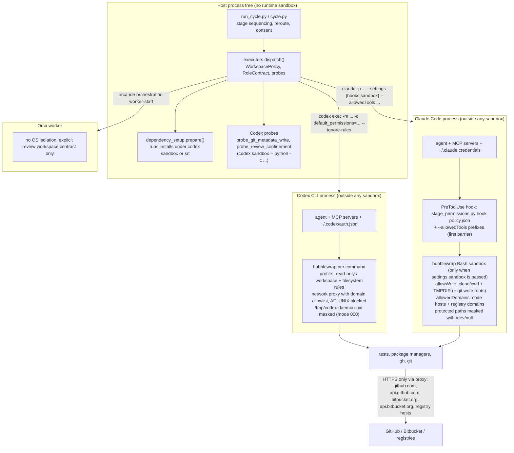
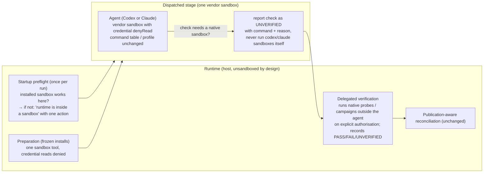

# Isolation architecture audit: sandboxes, executors and recovery

**Repository:** `datacas/code-cycle-toolkit`  
**Audit date:** 2026-10-20  
**Baseline:** `main` at `310d706` (`feat(runtime): prepare Node stages and honor project tool choices (#287)`), clean tree except the untracked `docs/research/` directory.  
**Host:** Ubuntu 22.04.5 on WSL2 (kernel 6.18.33.2), uid 1000. Codex CLI 0.163.0, Claude Code 2.1.304, `@anthropic-ai/sandbox-runtime` (`srt`) 0.0.81, bubblewrap 0.9.0, socat, ripgrep 15.2.0, Node 22.23.2, Python 3.10.  
**Scope:** research, diagnosis, reproducible experiments and an architectural recommendation. No repository file, branch, PR, host policy or persistent configuration was changed. Temporary directories created for experiments were removed. One side effect remains: experiment E5 wrote preparation evidence and an npm cache under `~/.local/state/code-cycle-toolkit/preparation/`, the runtime's ordinary evidence location.

A note on names. In this repository "Orca" is the optional `orca-ide` executor (`OrcaAdapter`, `scripts/executors.py:2717`), which launches workers in Orca-managed worktrees and provides no OS-level isolation of its own. The component that dispatches stages, applies policy and recovers from failures is the runtime (`scripts/run_cycle.py`, `scripts/cycle.py`, `scripts/executors.py`). This report uses "runtime" for what the audit request calls "Orca".

---

## A. Executive summary

The premise under investigation was that the toolkit stacks a runtime sandbox on top of the native Codex and Claude sandboxes, and that the resulting double isolation is what breaks nested Codex, dependency installation and the Claude review suite. The code and the experiments do not support that premise.

**There is no runtime OS sandbox.** Every dispatched command runs under exactly one OS-enforced sandbox: the executor's own (Codex's bubblewrap permission profile, or Claude Code's bubblewrap Bash sandbox). The runtime adds policy, not isolation: a per-stage command table and `PreToolUse` hook for Claude, permission-profile arguments and `--ignore-rules` for Codex, a disposable detached clone for read-only stages, a per-dispatch `TMPDIR`, before/after fingerprints, publication-aware reroute, and person-only sensitive grants. Removing any of them removes a guarantee (publication control, read-only enforcement, duplicate-publication prevention), not a redundant layer.

**The "nested Codex" failure is a property of the vendor sandboxes, not of the toolkit, and it is universal.** Reproduced on this host with no toolkit code involved: `codex sandbox -- codex sandbox -- true` fails because Codex overmounts `/tmp/codex-daemon-1000` with a read-only mode-000 tmpfs for the commands it runs (E1, E2). Every other nesting also fails: Codex inside Claude's sandbox (no user namespaces), Codex inside `srt` (missing synthetic-mount temp directory), `srt` inside Codex, `srt` inside Claude, `srt` inside `srt` (Unix-socket `listen EPERM`). A nested native verification is therefore not an architectural option under any of the four candidate architectures. It only ever arises when the work item itself requires running a native sandbox, which so far has meant one thing: this toolkit implementing and validating itself (#142, #268, #279/#288). Ordinary projects never hit it.

**The "Claude needs `srt`" prerequisite is toolkit-made.** PR #287 made Claude-side dependency preparation call the standalone `srt` binary (`scripts/dependency_setup.py:103`). Claude Code's built-in Bash sandbox needs only bubblewrap and socat; the #274 reproduction ran it on 2026-10-19, before `srt` existed on this host. The prerequisite is real but it belongs to `dependency_setup`, and the owner's decision on #288 (install `srt` and `rg` user-locally without confirmation) already resolves it.

**Both native sandboxes let verification code read credential stores**, including SSH private keys, `~/.config/gh/hosts.yml`, `~/.codex/auth.json` and `~/.claude/.credentials.json`, while publishing and review profiles allow HTTPS to `github.com` and `api.github.com` (E3, E4, E7). The `gh` token exposure is a documented, accepted risk; the SSH, Codex and Claude credentials are not needed by any sandboxed command and both sandboxes can deny them (verified for Codex `=none` rules and `srt` `denyRead`; documented for Claude). This is the one place where the audit found isolation that is weaker than it needs to be, and it is a configuration gap, not a layering problem.

**Recommendation: KEEP the current architecture and fix defects.** Treat #268 as correctly closed; fix #274 in the test suite; refine #288 by dropping the Codex socket-directory "prerequisite" (nothing on the host can satisfy it) and adding a one-time "runtime launched inside a sandbox" preflight; implement `UNVERIFIED` as a durable check status plus runtime-delegated native verification; add credential read-denial to every stage sandbox and to the Codex preparation profile; then specify #289 on top of the existing consent store. Do not build a runtime-owned sandbox (Architecture C): it would re-implement, for two moving vendor CLIs, exactly the mechanisms those vendors maintain today, and it does not make nesting work either (E3).

---

## B. Current architecture map



Trust boundaries, from most to least trusted:

1. **Runtime process** (`run_cycle.py`): trusted; holds the cycle state, the consent store and the policy. It runs on the host with the user's full permissions. It must run *outside* any vendor sandbox because its own probes and preparation spawn `codex sandbox` and `srt` (finding F-08).
2. **Executor agent process** (`codex`, `claude`): trusted with the user's API credentials, MCP servers, plugins and hooks. These run outside the command sandbox on both vendors (`docs/role-workspace-policy.md:26`), which is why MCP tools are reported rather than confined.
3. **Sandboxed commands**: untrusted. This is where PR code, tests, package-manager hooks and `gh` run. The OS sandbox is the only boundary between repository content and the host. Its reach today: read almost everything, write cwd/clone/TMPDIR (+ Git write roots for writers), network to the allowlisted hosts.
4. **Remote code host**: writes there are controlled by the stage command table (Claude) or by the prompt and the publication-aware reconciliation (Codex, which has no command table: `docs/host-permissions.md`, "Limitations").

Isolation nesting as observed on this host (E2, E3, E4):

| Outer \ Inner | `codex sandbox` | `srt` (Claude's runtime) |
|---|---|---|
| `codex sandbox` | fails: `app-server socket directory must be a user-owned directory with mode 0700` (socket dir masked) | fails: `listen EPERM` on `srt-mux-*.sock` (AF_UNIX blocked) |
| Claude Code Bash sandbox | fails: `bwrap: No permissions to creating new namespace` | fails: `listen EPERM` on `scratch/claude-1000/srt-mux-*.sock` |
| `srt` | panics: `failed to resolve synthetic mount registry temp directory /tmp/claude` | fails: `listen EPERM` on `/tmp/claude/srt-mux-*.sock` |

No cell works. The runtime never creates these situations itself; they occur only when a dispatched agent runs a vendor sandbox as part of its task, or when the runtime is started from inside a sandboxed agent session.

---

## C. Component inventory

| File | Symbol | Responsibility | Depends on |
|---|---|---|---|
| `scripts/cycle.py:103` | `ROLE_CONTRACTS` | Fixed workspace policy and publication permissions per role (`implement`/`resolve` write+publish; `review`/`rereview` read-only+comment; `issue_review`, `security`, `bootstrap`, `coordinate` read-only; `verify`, `run` disposable) | `executors.WorkspacePolicy` |
| `scripts/cycle.py:602` | writer probe gate | Runs `CodexAdapter.probe_git_metadata_write` before a publishing Codex writer stage | `executors` |
| `scripts/cycle.py:819-870` | blocker and reroute gate | Turns an agent-reported `environment_blocker` or a hook-denied Docker command into `environment_restricted`; decides one reroute via `reroute.reconcile` | `environment_recovery`, `reroute`, `grants` |
| `scripts/executors.py:2969` (read-only routing at 3184-3215) | `dispatch()` | Validates kwargs against the workspace policy; routes Claude read-only stages to `_isolated_review_dispatch`; routes Codex read-only stages to a review clone after `probe_review_confinement` | adapters |
| `scripts/executors.py:1122-1316` | `NativeAdapter.dispatch` | Policy preflight, dependency preparation, scratch `TMPDIR`, run, classification | `dependency_setup`, `stage_permissions` |
| `scripts/executors.py:132-193` | `_native_review_scratch` | Per-dispatch `code-cycle-tmp-*` directory outside the checkout; adds it to the Codex filesystem rule or `--add-dir`; sets `TMPDIR`; wraps `policy_files` | `tempfile` |
| `scripts/executors.py:1482-1987` | `CodexAdapter` | Builds `codex exec` argv: `-s workspace-write`/`read-only`, or named permission profiles (`code_cycle_publish_*`, `code_cycle_registry_*`, `code_cycle_review_read`, `code_cycle_write`) with `features.network_proxy`, domain allowlists, filesystem rules protecting the common Git dir (#229); `--ignore-rules`; probes; `dangerously_allow_all_unix_sockets` only under the `docker_host` grant | Codex CLI ≥ 0.138 |
| `scripts/executors.py:2389-2683` | `ClaudeAdapter` | Builds `claude -p` argv: `--permission-mode acceptEdits|default`, `--allowedTools` from the stage table, `--settings` carrying the hook and, when the stage verifies or needs registries, `review_sandbox_settings`; refuses dispatch when user settings would widen the sandbox | Claude Code, `stage_permissions` |
| `scripts/executors.py:2239-2386` | `_isolated_review_dispatch` | Detached clone without remotes at the reviewed HEAD; before/after HEAD, status and remote-ref comparison; `read_only_mode` `detected`/`enforced` | git |
| `scripts/executors.py:2717-2915` | `OrcaAdapter` | Worker launch receipt; no OS isolation; review only with an explicit workspace contract | `orca-ide` |
| `scripts/stage_permissions.py:108-190` | `StagePolicy` | Immutable per-stage policy: role, repo, PR, base branch, test/verify commands, `tools`/`commands`/`integrations`/`registry_domains` user choices, `tmpdir`, `docker` | — |
| `scripts/stage_permissions.py:1109-1156` | `allowed_tool_patterns` | First barrier: `Bash(prefix:*)` patterns, `Edit`/`Write` rules for `TMPDIR` helpers (incl. `claude-<uid>` subdirectory, #280/#283) | `StagePolicy` |
| `scripts/stage_permissions.py:1171-1176` | `hook_settings` | `PreToolUse` hook on Bash and file-edit tools | — |
| `scripts/stage_permissions.py:1322` | `SANDBOX_WIDENING_KEYS`, `sandbox_override` | Refuses dispatch when user/project settings widen the sandbox (`allowWrite`, `excludedCommands`, `allowUnsandboxedCommands`, Unix sockets, `enableWeakerNestedSandbox`) | Claude settings merge semantics |
| `scripts/stage_permissions.py:1467-1484` | `REVIEW_SANDBOX_DOMAINS`, `review_sandbox_settings` | Claude Bash sandbox: `failIfUnavailable`, no unsandboxed fallback, write to clone+TMPDIR, code-host and registry domains | Claude ≥ 2.1.246 for settings-scope merge |
| `scripts/stage_permissions.py:96` | `DENY_ADVICE`, `prompt_note` | Tells the agent to prefer a permitted equivalent, never to bypass a forbidden operation (#279 decision) | — |
| `scripts/dependency_setup.py:79-116` | `sandbox_command` | Codex branch: `codex sandbox` profile with registry domains; Claude branch: standalone `srt` with `denyRead` of `~/.ssh`, `~/.aws`, `~/.config/gh` (raises if `srt` is missing) | `codex`, `srt` |
| `scripts/dependency_setup.py:226-388` | `prepare` | Frozen, script-disabled install in a staged copy, cache keyed by lockfile+manager+platform, evidence under `~/.local/state/code-cycle-toolkit/preparation` | `sandbox_command` |
| `scripts/environment_recovery.py:19-55` | `ENVIRONMENT_RECOVERY_GUIDANCE`, `sandbox_blocker` | Prompt text and strict parser for `environment_blocker` (`sandbox_local_access`, `sandbox_network_access`, `sandbox_filesystem_access`); names the nested-Codex limit | — |
| `scripts/grants.py:94-125` | `DOCKER_HOST`, `ConsentStore`, `ConsentBroker` | Person-only sensitive grants with `cycle`/`persistent`/`deny` answers, scope fingerprint, non-interactive `permission_required` stop | — |
| `scripts/reroute.py:111-126` | `reconcile` | Stops a reroute on `evidence_unavailable`, `dirty_workspace`, `workspace_changed`, `remote_changed`, `publication_changed` (own-account publications only, #277) | `gh` |
| `scripts/user_choices.py` | `load` | Validated `code_cycle.user_choices` (`tools`, `commands`, `integrations`, `registry_domains`) carried into every stage | `stage_permissions.parse_command` |
| `scripts/host_permissions.py`, `skills/cc-host-permissions` | global opt-in | Conservative interactive-session permissions; explicitly not needed by dispatched stages | — |

---

## D. Confirmed findings

Severity reflects impact on the decision being made (architecture) and on security, not code quality.

**F-01 · High · The toolkit applies one OS sandbox per process, never two.**  
Evidence: `CodexAdapter.argv` and `ClaudeAdapter.argv` only pass vendor flags and settings; `_native_review_scratch` adds a scratch directory to the vendor's own rules; `OrcaAdapter.enforces_read_only = False` (`scripts/executors.py:2730`). The only places where the runtime itself invokes a sandbox binary are its own probes (`probe_git_metadata_write`, `probe_review_confinement`) and `dependency_setup.sandbox_command`, and those run on the host, outside the agent. Consequence: the "double sandbox" hypothesis in the audit request does not describe the normal path. The complexity that exists is policy complexity around a single sandbox, plus the three host-side helpers.

**F-02 · High · Vendor sandboxes cannot nest, in any combination, on this host.**  
Evidence: experiments E2, E3, E4 (table in section B). Causes differ per pair (masked socket directory, user-namespace denial, missing synthetic-mount directory, AF_UNIX listen denied), so no single workaround exists, and none of them is caused by the runtime. Consequence: any design that asks a sandboxed agent to run another vendor sandbox is infeasible. Native verification must be delegated to a process outside the agent's sandbox (the runtime already has that pattern: the Codex probes and `dependency_setup.prepare` ran successfully on the host today, E1 and E5).

**F-03 · High · Codex deliberately masks `/tmp/codex-daemon-<uid>`; the toolkit's `TMPDIR` and profiles are not involved.**  
Evidence: `codex sandbox -- sh -c 'ls -ld /tmp/codex-daemon-1000; grep /tmp /proc/self/mountinfo'` from a plain shell shows `d--------- 2 user user 40 ... /tmp/codex-daemon-1000` and the mount line `/tmp/codex-daemon-1000 ro,nosuid,nodev,relatime tmpfs rw,mode=000,uid=1000,gid=1000` (E1); the rest of `/tmp` and `$TMPDIR` are visible and the same command exits 0 on the host. Consequence: #268's root cause (documented in PR #277 and `docs/routing.md:147-153`) is confirmed independently of agent logs; #288's acceptance criterion 3 ("root cause confirmed and documented, including its relation to #268") is satisfied by this evidence and the issue's refinement already dropped the 0700-directory remedy.

**F-04 · Medium · The `srt` prerequisite comes from the toolkit's own preparation step, not from Claude Code.**  
Evidence: `scripts/dependency_setup.py:103-105` raises `Claude dependency preparation needs the installed srt sandbox runtime`; Claude Code's documentation requires only bubblewrap and socat for the built-in Bash sandbox, and `ripgrep` only for the standalone runtime; the #274 reproduction ran Claude's sandbox on 2026-10-19 when `srt` was absent (#288, 2026-10-20: "`which srt` finds nothing"). Consequence: the prerequisite is legitimate (the standalone runtime is the documented way to sandbox a helper process) but it is a runtime dependency to detect, install user-locally and report, exactly as the #288 refinement decided. It is not evidence of a layering conflict.

**F-05 · High (security) · Sandboxed commands can read credential stores in every stage, and reach GitHub over HTTPS in publishing and review stages.**  
Evidence: under `codex sandbox` (default read-only) the probe read the first byte of `~/.ssh/<key>`, `~/.config/gh/hosts.yml`, `~/.codex/auth.json`, `~/.claude/.credentials.json` (E7, secrets probe); under Claude's review sandbox the same stores tested readable and `curl https://api.github.com` returned 200 while `example.com` was denied (E4); under `srt` with the toolkit's preparation `denyRead` list, `~/.ssh` and `~/.config/gh` were denied but `~/.codex/auth.json` and `~/.claude/.credentials.json` stayed readable (E3). `docs/host-permissions.md` ("Reviewers verify in a confined clone") documents and accepts the `gh` credential exposure. Consequence: untrusted verification code (tests, package-manager hooks when enabled, the PR's own scripts) has a working exfiltration channel: read a key, send it with an authenticated GitHub API call. The SSH keys and the two agent credential files are not needed by any sandboxed command (the agent processes read their own credentials outside the sandbox; pushes go through HTTPS with the `gh` helper, and raw SSH is not proxied at all, see #284). Both sandboxes can deny them: Codex `permissions.<p>.filesystem={"~/.ssh"="none"}` hid the directory and denied `hosts.yml` in the experiment; `srt` `denyRead` did the same; Claude documents `sandbox.filesystem.denyRead`.

**F-06 · Medium · #274 is caused by Claude's protected-path masking plus a test that copies the whole clone.**  
Evidence: inside the review sandbox `ls -la .claude` lists `agents`, `commands`, `hooks`, `launch.json` as `crw-rw-rw- nobody nogroup 1, 3` (character devices bound from `/dev/null`), likewise `.bashrc`, `.gitconfig`, `.mcp.json` in the clone root; `cat .claude/settings.json` fails with EACCES (E4). This matches the Claude Code documentation ("Protected paths") and #274's diagnosis. Consequence: the fix belongs to `tests/test_validate_package.py` (`copy_package` should copy tracked files only) and to the one executor test that assumes a writable temp parent exists; `review_sandbox_settings` must not change.

**F-07 · Medium · Dependency preparation has two sandbox code paths with asymmetric protection.**  
Evidence: `sandbox_command` builds a Codex profile string for the Codex executor and an `srt` JSON for Claude; only the `srt` branch denies credential reads; the Codex branch repeats profile-building logic that `CodexAdapter.argv` also has. Consequence: the preparation step (which runs package managers on lockfiles from the PR) is better protected under Claude than under Codex, for no security reason. Either add `=none` rules to the Codex branch or run preparation under one tool regardless of executor (section J, phase 3).

**F-08 · Medium · No preflight detects a runtime started inside a vendor sandbox.**  
Evidence: `run_cycle.py` is launched by the orchestrator skill from the user's interactive session; its Codex probes and `dependency_setup.prepare` spawn `codex sandbox` and `srt`, which fail inside any sandbox (F-02). PR #277 records the Codex-session case as residual risk; the Claude-session case (user enables `sandbox.enabled` in `~/.claude/settings.json`, currently `false` on this host per `claude sandbox status`) is undocumented. Consequence: the failure would surface mid-cycle as `precondition`/`environment_restricted` rather than as a one-line startup diagnosis. The probe already exists (`probe_review_confinement` is cached per adapter); it needs to run once at cycle start and name the single action ("start the runtime from a terminal, not from inside a sandboxed agent session").

**F-09 · Medium · Sandbox-restriction classification is runtime-observed for Claude and agent-reported for Codex.**  
Evidence: for Claude, `ClaudeAdapter.extra_artifacts` collects `permission_denials` and hook denials from the stream, and `denied_docker_blocker` turns a hook denial into a grant request without trusting the agent; for Codex, only the agent's `environment_blocker` JSON exists (`sandbox_blocker`), validated for shape and treated as a routing hint that never grants anything. Consequence: #289's "detection" requirement is already half built; the Codex half needs a runtime-observed signal (the session events parser `_session_events` already reads Codex rollouts) before persistent grants can be requested automatically with confidence.

**F-10 · Low · Current reroute policy on `environment_restricted` conflicts with the owner's newer decisions.**  
Evidence: `scripts/cycle.py:837-870` reroutes an `environment_restricted` attempt to the profile's fallback executor once (after `reroute.reconcile`); #289 decision 2 says a sandbox limitation is never a reason to switch executor; #288 decision 2 says degrade to `UNVERIFIED` first and reroute only when nothing else remains. Consequence: a product decision, not a defect; recorded in section L.

**F-11 · Low · `UNVERIFIED` is a skill-level word, not a runtime state.**  
Evidence: `grep -lw UNVERIFIED scripts/*.py` finds nothing; `unverified` appears in three scripts as prose and in ten skills. Consequence: #288's "recorded durably per stage" needs a field in the stage result or telemetry (a check status), not a new cycle state. The existing cycle states (`BLOCKED`, `NEEDS_REFINEMENT`, `HUMAN_INTERVENTION`) are used within their scope.

---

## E. Unconfirmed hypotheses

| ID | Hypothesis | Status | Test that would settle it |
|---|---|---|---|
| H-01 | Codex can run as an agent *inside* a runtime-owned `srt` sandbox using its `ExternalSandbox` policy (full disk access, honours external network setting), as a basis for Architecture C. | Not tested. The policy exists in `codex-rs/protocol` and `--dangerously-bypass-approvals-and-sandbox` is documented as "intended solely for environments that are externally sandboxed", but the app-server daemon needs an AF_UNIX socket under `/tmp/codex-daemon-<uid>` and `srt` blocked `listen` on Unix sockets in E3. | `srt --settings <allow /tmp/codex-daemon-1000 write, allow api.openai.com + chatgpt.com> -- codex exec --dangerously-bypass-approvals-and-sandbox 'print ok'` with `--no-daemon` if available; expect either a daemon socket error or a working run. Requires one model call. |
| H-02 | Claude Code's built-in Bash sandbox works with no `srt` binary on PATH. | Inferred from vendor documentation and the dated #274 reproduction; not re-executed because `srt` is now installed and removing it from PATH for the test would alter the host's state. | `PATH=<without nvm bin> claude -p ... --settings <review_sandbox_settings>` running `true`; expect success. |
| H-03 | Raw SSH (`git@github.com:`) never works from inside a stage sandbox, so denying `~/.ssh` reads loses nothing. | Supported by #284 ("failed SSH push") and by the Codex proxy design (HTTP(S) and SOCKS5 only); not executed. | `codex exec` publish profile running `ssh -T git@github.com`; expect connection failure. Repositories with SSH remotes would need an HTTPS remote or `gh` credential helper first. |
| H-04 | If the runtime posted review comments on the agent's behalf, review sandboxes could deny `~/.config/gh` and all network except registries. | Design question, not tested. | Prototype: stage writes `$TMPDIR/pr-comment.md`, runtime calls `gh pr comment --body-file` after the stage exits and reconciles the result. |
| H-05 | Codex's unreadable (`=none`) filesystem rule behaves identically in `codex exec` profiles and in `codex sandbox`. | Verified only through `codex sandbox` (E7 secrets probe). | Dispatch a Codex `issue_review` stage whose task is `head -c1 ~/.ssh/<key>` with the rule set; expect denial. One model call. |
| H-06 | The `.claude/.cc-writes` directory observed inside the review clone during E4 is created by Claude Code's sandbox bookkeeping, not by the toolkit. | `grep cc-writes scripts/*.py` finds nothing; origin not traced further. | Inspect Claude Code's sandbox implementation or run the sandbox on an empty directory. |

---

## F. Security matrix

Columns: current control, and what each candidate architecture would do to it. A = keep current; B = native-only (drop runtime policy layers); C = runtime-owned sandbox with vendor sandboxes disabled; D = adaptive hybrid.

| Threat | Current control | Residual risk today | A | B | C | D |
|---|---|---|---|---|---|---|
| Malicious code in a PR runs during verification | Vendor OS sandbox per command; writes limited to clone/cwd/TMPDIR; network allowlist | Reads credentials (F-05); exfiltration via allowed hosts | Keep; add `denyRead` | Same sandbox, same gap | Equivalent if `srt` is configured identically; new maintenance surface | Same as A |
| Malicious instructions in repository files (prompt injection) | Command table + hook (Claude); permission profile + `--ignore-rules` (Codex); clone discarded; publication reconciliation | Codex has no command table; MCP tools run outside | Keep | Loses the table and the reconciliation | Unchanged (prompt-level) | Same as A |
| Dependency install scripts | `prepare()` runs frozen installs with lifecycle scripts disabled, in a staged copy, under `codex sandbox`/`srt` with registry-only network | Codex branch lacks credential `denyRead` (F-07) | Keep; unify | Agents would install ad hoc inside their stage sandbox | Same step, same tool | Same as A |
| Access to local credentials (SSH, `gh`, Codex, Claude) | None for reads in stage sandboxes; `srt` prep denies three stores | Readable (F-05) | Add `denyRead`/`=none` in every profile | Same gap | Same, if configured | Same as A |
| Reads outside the workspace | Vendor default: read everywhere (Codex `:root = Read`; Claude "allow reads everywhere") | Accepted for source trees; secrets as above | Optional `blockReadsOutsideWorkingDirectories`-style narrowing | Same | Same | Same |
| Writes outside authorised directories | bubblewrap `--ro-bind / /` with explicit binds; Git common dir read-only (#229); Claude protected paths | None observed; `write HOME: denied`, `write /tmp: denied` (E3, E4, E7) | Keep | Keep | Must be re-implemented | Keep |
| Local network / internal services | Network namespace removed; proxy with domain allowlist; `allowLocalBinding=false` (srt); Codex blocks local IP literals unless allowlisted | None observed | Keep | Keep | Re-implemented via `srt` proxy | Keep |
| Outbound exfiltration | Allowlist (code hosts, registries); `example.com` denied in all three sandboxes | Allowed hosts are exfiltration-capable with the `gh` token | Keep; H-04 would close it for reviews | Same | Same | Same |
| Docker daemon access | `docker_host` grant, person-only; Codex Linux opens *all* AF_UNIX sockets when granted; Claude limits to `docker compose up/down/ps/logs/build` | Grant scope on Codex is wide, and the question says so | Keep | Keep | `srt` can allow single Unix sockets (finer than Codex) | Keep |
| Privileged Unix sockets, privilege escalation | AF_UNIX blocked (Codex proxy mode), `PR_SET_NO_NEW_PRIVS` + seccomp, `--unshare-user/pid` | None observed | Keep | Keep | `srt` equivalent | Keep |
| Unauthorised branch/PR/comment changes | Claude: table + hook (no push/merge beyond role); Codex: prompt + reconciliation; `reroute.reconcile` on own-account publications; #261 pending | Codex writers can publish anything the user can within allowed hosts | Keep; #261 adds post-stage invariant checks | Loses hook and reconciliation | Unchanged | Keep |
| Interference between concurrent cycles | Per-dispatch `TMPDIR`, disposable clones, fingerprints, `--ignore-rules` | None observed | Keep | Partially lost | Keep | Keep |
| Re-use of authorisations across stages | `ConsentStore` persistent grants keyed by scope fingerprint; `user_choices` per project | #289 lifecycle incomplete | Keep; specify #289 | — | — | Keep |

Fundamental constraint respected: none of the recommendations below weakens isolation against untrusted code; the only isolation change proposed tightens it (credential read-denial).

---

## G. Architecture comparison

### Architecture A: keep the current isolation

What it is: one vendor OS sandbox per process, runtime policy around it, host-side probes and preparation. Known problems and their fixes: F-05 (add read-denial), F-06 (test suite), F-07 (unify or align preparation profiles), F-08 (startup preflight), F-11 (check status). Nothing in the known failures requires removing a layer.

### Architecture B: isolation exclusively native

What it would drop: the command table and hook, the disposable clone, the fingerprints, the reroute reconciliation, the grants. What is lost: Claude has no read-only mode and no per-command network policy outside the sandbox settings the runtime passes; Codex has no command table at all, so publication control would be prompt-only; duplicate publications would be undetectable. Neither vendor offers a "publish only this comment" guarantee. Not viable without lowering guarantees.

### Architecture C: isolation centralised in the runtime

What it would be: the runtime starts each agent inside its own `srt` (or bubblewrap) sandbox and tells the agent to disable its native sandbox (Claude: `sandbox.enabled=false` plus `--dangerously-skip-permissions`; Codex: `--dangerously-bypass-approvals-and-sandbox` or the `ExternalSandbox` policy). Vendor support: documented for Claude (`npx @anthropic-ai/sandbox-runtime claude`); present but not CLI-documented for Codex (H-01). What changes:

- The agent process, its credentials, MCP servers, plugins and hooks move *inside* the sandbox. Today those run outside the command sandbox; inside, their credentials must be readable by the sandboxed commands (Claude's own documentation says to allow writes to `~/.claude` and `~/.claude.json`). Net security effect: neutral to negative.
- Per-command semantics are lost: Codex's per-command profile switching (`code_cycle_review_read` for a reviewer, `code_cycle_publish_write` for a writer, Git common-dir protections, `--ignore-rules`) and Claude's protected-path masking would have to be re-expressed as one static `srt` policy per stage, maintained by the toolkit as the CLIs change.
- Nesting is not solved: a sandboxed agent still could not run a vendor sandbox (E3: `codex sandbox` inside `srt` panics), so the toolkit's self-validation case remains delegated.
- Prerequisites grow: every host needs `srt` (and `rg`) for every executor, plus bubblewrap and socat, plus the daemon-socket allowances for Codex.

Verdict on C: rejected. It replaces vendor-maintained isolation with toolkit-maintained isolation, adds prerequisites, moves trusted processes into the untrusted zone and leaves the nesting problem where it is.

### Architecture D: adaptive hybrid

What it would be: uniform runtime contracts (`RoleContract`, `WorkspacePolicy`, publication permissions, `StagePolicy`) with the compatible mechanism per executor, verification delegated to a separate process when the agent cannot run it, preparation owned by the runtime, explicit handling of extra permissions, no silent degradation. This is a description of the code that exists today, plus the two delegation patterns already present (Codex probes; `dependency_setup.prepare`). The "D changes" that are not yet there are: a formal `UNVERIFIED` check status, the runtime-run native campaign for toolkit-style work items, and consistent credential denial. These are additions to A, not a different architecture.

### Comparative assessment

Ratings are qualitative (strong / adequate / weak) with the reason; "n/e" means no evidence either way.

| Dimension | A (keep + fixes) | B (native only) | C (runtime-owned) | D (hybrid = A + delegation) |
|---|---|---|---|---|
| Security vs untrusted code | adequate → strong after F-05 fix | weak (no publication control) | adequate; moves credentials inside | same as A |
| Compatibility (Codex, Claude, future) | strong: vendor flags only | strong | weak: Codex `ExternalSandbox` untested (H-01) | same as A |
| Reliability (cycles complete) | adequate; failures seen were dogfooding and test-suite issues | n/e | weak initially (new mechanism) | adequate → strong with delegation |
| Autonomy | adequate; improves with #288/#289 | lower (more human checks of publications) | n/e | strong |
| Simplicity | 1 OS layer + ~11 policy mechanisms | fewer mechanisms, fewer guarantees | +1 OS layer owned by toolkit, −2 vendor layers, same policy mechanisms | A + 1 status field + 1 delegated runner |
| Maintainability | adequate: vendor changes surface as flag changes | adequate | weak: bwrap/proxy semantics tracked per vendor | same as A |
| Portability (Linux, WSL2, macOS, Windows) | strong: vendors cover Seatbelt and Windows | strong | weak: `srt` Windows needs an elevated install; macOS Seatbelt fine | same as A |
| Performance | one sandbox start per command (vendor) | same | one long-lived sandbox per stage (cheaper per command) | same as A |
| Recovery | adequate; reroute reconciliation exists | weak | n/e | strong with `UNVERIFIED` + delegated reruns |
| Testability | strong: probes exercise the installed sandbox; 13 test files cover the policy | weaker | weak until a probe suite exists | same as A |
| Extensibility (unknown tools) | adequate: `user_choices` carried into tables and profiles | adequate | adequate | same |
| Migration risk | low (targeted changes) | high | high | low |

---

## H. Experimental results

All executed experiments ran on 2026-10-20 on the host above, from an unsandboxed shell, with the versions listed in the header. Commands are reproducible as written. "Executed" means the command ran and its output is quoted; "not executed" means a procedure is given but was not run; "inferred" means a conclusion drawn from documentation plus adjacent evidence.

### E1 · Codex sandbox on the host (executed)

```
cd /tmp
codex sandbox --permission-profile p -c 'permissions.p.extends=":read-only"' -- /usr/bin/true ; echo rc=$?
codex sandbox -- sh -c 'ls -ld /tmp/codex-daemon-1000; grep -E " /tmp( |/)" /proc/self/mountinfo; id; echo TMPDIR=$TMPDIR'
```
Observed: `rc=0`; inside the sandbox `d--------- 2 user user 40 ... /tmp/codex-daemon-1000` and mount `/tmp/codex-daemon-1000 ro,nosuid,nodev,relatime tmpfs rw,mode=000,uid=1000,gid=1000`; `/tmp/.X11-unix` read-only; `$TMPDIR` (the caller's) visible; uid 1000. On the host the same directory is `drwx------`.  
Conclusion: Codex itself masks the directory for its sandboxed commands; the toolkit's `TMPDIR` plays no role.

### E2 · Nested Codex (executed)

```
codex sandbox -- codex sandbox -- /usr/bin/true
codex sandbox --permission-profile p -c 'permissions.p.extends=":workspace"' -- \
  codex sandbox --permission-profile q -c 'permissions.q.extends=":read-only"' -- /usr/bin/true
```
Observed (both): `WARNING: proceeding, even though we could not create PATH aliases: Read-only file system`, then `error building bubblewrap command: app-server socket directory must be a user-owned directory with mode 0700`, exit 1. `codex sandbox --help` offers no daemon, socket or nested option.  
Conclusion: the #268/#288 failure reproduces with no stage, profile, `TMPDIR` or model involved.

### E3 · `srt` standalone, and cross-vendor nesting (executed)

Settings file: `allowedDomains: [api.github.com]`, `allowWrite: [<base>/scratch]`, `denyRead: [~/.ssh, ~/.aws, ~/.config/gh]`, `allowLocalBinding: false` (the toolkit's preparation shape).
```
srt --settings srt.json -- sh -c '<read/write/network probe>'
srt --settings srt.json -- codex sandbox -- /usr/bin/true
codex sandbox -- srt --settings srt.json -- /usr/bin/true
srt --settings srt.json -- srt --settings srt.json -- /usr/bin/true
```
Observed: `srt` works (`write scratch: WRITABLE`, `write clone: denied`, `write HOME: denied`, `example.com` → `403 from proxy after CONNECT`, `api.github.com` → `200`, Docker socket → connection refused). Credential probe under `srt`: `ssh entries visible: 0`, `gh hosts content: denied`, `codex auth content: READABLE`, `claude creds content: READABLE`. Nesting: Codex inside `srt` panics with `failed to resolve synthetic mount registry temp directory /tmp/claude` (exit 101); `srt` inside Codex: `Error: listen EPERM: operation not permitted .../srt-mux-2-0.sock` (exit 1); `srt` inside `srt`: same `listen EPERM` (exit 1).  
Conclusion: `srt` provides the guarantees the toolkit relies on for preparation; no vendor sandbox nests inside another.

### E4 · Claude review sandbox (executed, one `claude-haiku-5-5` call)

Set-up as in #274's reproduction, with a short base path: `B=$(mktemp -d /tmp/ccsbx.XXXX)`, `git clone <repo> $B/clone`, `mkdir $B/scratch`, settings from `stage_permissions.review_sandbox_settings(("$B/clone","$B/scratch"))`, then
```
env -u CLAUDECODE TMPDIR=$B/scratch claude -p "Run exactly this one Bash command ...: sh $B/scratch/probe.sh" \
  --model claude-haiku-5-5 --permission-mode default \
  --allowedTools "Bash(sh $B/scratch/probe.sh:*)" --settings "$SET" --output-format json
```
Observed: `is_error false`, no permission denials. Inside the sandbox: `.claude/agents`, `.claude/commands`, `.claude/hooks`, `.claude/launch.json`, `.bashrc`, `.gitconfig`, `.mcp.json` appear as `crw-rw-rw- nobody nogroup 1, 3` (character devices); `cat .claude/settings.json` → EACCES; `~/.ssh`, `~/.claude.json`, `~/.codex/auth.json`, `~/.config/gh/hosts.yml` readable; `write TMPDIR: WRITABLE`, `write clone: WRITABLE`, `write HOME: denied`; `example.com` denied (`sandbox_violations: deny network-outbound example.com:443`), `api.github.com` → 200; nested `codex sandbox` → `bwrap: No permissions to creating new namespace`; nested `srt` → `listen EPERM` on `scratch/claude-1000/srt-mux-49-0.sock`; `/tmp/codex-daemon-1000` visible as `drwx------` (Claude does not mask it).  
Conclusion: the review sandbox starts and confines writes and network as designed; #274's placeholder cause is confirmed; credentials are readable (F-05); nothing nests inside it.

### E5 · Dependency preparation under both executors (executed, no model call)

A throwaway Git repository with `package.json` depending on `is-odd@3.0.1` and an npm lockfile; then `dependency_setup.prepare(root, "codex", "codex")` and `prepare(root, "claude", "claude")` from the checkout.  
Observed: both `status prepared`; attempts `npm --version` (exit 0) and `npm ci --ignore-scripts --no-audit --no-fund --cache ~/.local/state/code-cycle-toolkit/preparation/cache/<key>` (exit 0); Codex attempts ran under `codex sandbox` with `features.network_proxy` and the registry allowlist (Node printed the `EnvHttpProxyAgent` warning, i.e. it used the proxy); Claude attempts ran under `srt`.  
Conclusion: runtime-owned, host-side preparation works for both executors with registry-only network and no agent involvement. The same pattern can carry delegated verification.

### E6 · Delegated verification (executed as part of E1 and E5; design confirmed)

The runtime's own Codex probes (`probe_git_metadata_write`, `probe_review_confinement`) and `prepare()` are already "verification by a separate process outside the agent". E1 shows the probe form (`codex sandbox ... -- python -c <script>`) succeeding on the host where the nested form fails. Not executed: a full runtime-run `tests/native_dependency_campaign.py` (opt-in, needs registry access and both native tools; procedure: `python3 -m unittest tests.native_dependency_campaign` from the host).

### E7 · Negative security controls (executed)

Under `codex sandbox` (default, read-only) from `/tmp/cc-audit-ws`: `write HOME: denied`, `write cwd: denied`, `write /tmp: denied`, `.git` creation → `Read-only file system`, `example.com` → DNS resolution fails (network namespace removed), Docker socket → connection refused; reads of `~/.ssh`, `~/.codex/auth.json`, `~/.claude.json` → readable. With `permissions.p.filesystem={"$HOME/.ssh"="none","$HOME/.config/gh"="none"}`: `ssh entries visible: 0`, `gh hosts content: denied`.  
Conclusion: write, network and socket denials hold on all three sandboxes; read denial is available but unused in stage profiles (F-05).

### Not executed

- H-01 (Codex under external `srt`), H-02 (Claude without `srt` on PATH), H-03 (SSH from inside a stage), H-05 (`=none` under `codex exec`): procedures in section E. H-01 and H-05 each need one model call; H-02 needs a PATH change; H-03 needs an SSH-capable test.
- A full cycle on a host without `srt` (acceptance criterion 1 of #288): would require uninstalling `srt` or masking PATH for the runtime.

### Tool versions used

Codex CLI 0.163.0 (bundled bwrap under `codex-resources/`, host bwrap 0.9.0 preferred), Claude Code 2.1.304, `srt` 0.0.81, Node 22.23.2, Python 3.10.12, `user.max_user_namespaces` 79955 (unprivileged user namespaces available on the host; they are what Claude's inner bwrap could not create from inside the outer one).

---

## I. Recommended architecture

Keep the single-OS-sandbox-per-process model and make the delegation that already exists explicit.



Why this is preferable:

- It changes no boundary that protects the host from repository code, and it tightens the one boundary that was looser than necessary (credential reads).
- It resolves the nesting class of failures by never nesting, which is the only option the experiments leave open, and it reuses a pattern the runtime already exercises on every Codex writer dispatch and every Node project (probes, preparation).
- It keeps vendor-maintained isolation where the vendors maintain it. Breaking changes in Codex or Claude surface as flag or settings changes, not as bubblewrap regressions in the toolkit.
- It needs no new state machine. `UNVERIFIED` is a check status inside a stage result; the stage outcome vocabulary stays as it is.

Known drawbacks of the recommendation, stated plainly:

- Credential read-denial can break a repository whose remote is SSH-only or whose tests legitimately read `~/.config/gh` (rare; detectable by the stage's denied-command evidence). It needs a documented opt-out through `user_choices`-style configuration, not a silent exception.
- Delegated verification runs on the host under the runtime's permissions; it must stay opt-in per check, show the exact command, and be recorded as host execution, exactly as #288's refinement 1 requires. It is not a general escape hatch and must not be reachable from an agent's report alone.
- Toolkit self-development remains the hardest case: its acceptance campaigns require both native sandboxes and therefore always need the delegated path or a person.

---

## J. Implementation plan

Phases are independent unless stated; each is compatible with the current architecture and can be compared against the previous behaviour with the existing fake-runner tests plus the probes above.

### Phase 0 · Evidence and preflight (small)

- Objective: stop the nesting class from surfacing mid-cycle; close #288 AC3 with host-independent evidence.
- Components: `scripts/run_cycle.py` (startup), `scripts/executors.py` (`probe_review_confinement` reused), `docs/routing.md` (add the cross-vendor nesting table from section B), `scripts/environment_recovery.py` (guidance already names the limit; extend to "never run `codex`/`claude` sandboxes inside a stage; report the check as unverified").
- Dependencies: none.
- Risks: a false positive on hosts where bubblewrap is genuinely unavailable; mitigate by distinguishing "cannot create namespaces inside a sandbox" from "bubblewrap missing" using the existing `SANDBOX_UNAVAILABLE_MARKERS`.
- Regression tests: fake-runner test for the startup probe outcomes; existing `test_environment_recovery`.
- Acceptance: starting the runtime from inside `codex sandbox -- python3 run_cycle.py ...` stops at startup with one named action; from a terminal it proceeds.
- Rollback: independent revert.
- Advance when: the probe is cached once per run and appears in the decisions record.

### Phase 1 · #274 and #280 (small, independent of architecture)

- Objective: the full suite passes inside the Claude review sandbox.
- Components: `tests/test_validate_package.py` (`copy_package` copies tracked files only or skips unreadable untracked entries), the one `test_executors` case that assumes a writable temp parent exists.
- Risks: none to isolation; `review_sandbox_settings` unchanged by acceptance criterion.
- Tests: the #274 reproduction command; host suite.
- Rollback: independent.

### Phase 2 · `UNVERIFIED` check status and delegated native verification (#288) (medium)

- Objective: a check that cannot run inside the stage is recorded as `UNVERIFIED` with command, reason and attempts; the runtime offers host execution on explicit authorisation and records the real result.
- Components: stage result/telemetry schema (new check-status field, no new cycle state), `scripts/cycle.py` (post-stage handling), the skills' `ORCHESTRATION_RESULT` contract, `scripts/grants.py` (reuse the consent question shape for "run on host"), `tests/native_dependency_campaign.py` as the first delegated runner.
- Dependencies: Phase 0 (so the agent is told not to nest).
- Risks: an agent could misreport a real failure as `UNVERIFIED`; mitigate by requiring the failing command and observed error, as `sandbox_blocker` already does, and by never counting `UNVERIFIED` as passed (#288 AC "missing evidence never becomes a passing check").
- Tests: both prerequisites missing / each alone / both present (already listed in #288); a fake stage that reports `UNVERIFIED` and a fake host runner that returns PASS, FAIL, timeout.
- Acceptance: #288 acceptance criteria 1, 2, 4, 5, 6.
- Rollback: independent; schema version bump makes old records readable.

### Phase 3 · Credential read-denial and one preparation sandbox (medium)

- Objective: no stage sandbox and no preparation sandbox can read `~/.ssh`, `~/.aws`, `~/.codex/auth.json`, `~/.claude/.credentials.json`, `~/.claude.json`; `~/.config/gh` stays readable only in stages whose role publishes.
- Components: `CodexAdapter.argv` (`=none` entries in every profile; verify H-05 first), `stage_permissions.review_sandbox_settings` (`denyRead`), `dependency_setup.sandbox_command` (add the same denials to the Codex branch, or run preparation under `srt` for both executors; the second removes one code path and the duplicated profile logic, at the cost of making `srt` a prerequisite on Codex-only hosts, which #288's decision 3 already allows the runtime to install user-locally).
- Dependencies: H-03 and H-05 answered; a documented opt-out for SSH-only remotes.
- Risks: breaking pushes on SSH remotes (opt-out), breaking a test that reads a credential file (surfaces as a denied read in evidence).
- Tests: extend `probe_review_confinement` with read-denial checks so the installed sandbox proves it; fake-runner tests for argv.
- Acceptance: E7's secrets probe reports `denied` for all five stores under every stage profile; `gh hosts content` readable only in publishing roles.
- Rollback: independent per executor.

### Phase 4 · #289 grant lifecycle and reroute policy (medium, product decisions first)

- Objective: one request per grant per project; stored, listable, revocable; sandbox restrictions never trigger an executor switch unless the owner decides otherwise.
- Components: `scripts/grants.py` (`ConsentStore` already persists by repository and scope fingerprint; add list/revoke), `scripts/cycle.py:837-870` (reroute on `environment_restricted` gated by the decision in L-3), runtime-observed Codex denial signal (F-09).
- Dependencies: decisions L-1 and L-3; Phase 2's status field.
- Risks: widening grants by accident; mitigate by keeping the person-only rule and the scope fingerprint.
- Tests: `test_grants` across two fake issues; a Codex and a Claude restriction producing a grant request, not a reroute.
- Rollback: independent.

Order: 0 and 1 immediately and in parallel; 2 next; 3 after H-03/H-05; 4 after the decisions in L. Isolation, permissions, publication, reroute and states are never changed in the same phase.

---

## K. Implications for the issues

- **#268 (closed by PR #277):** correct and complete. The cause is now reproduced without agent logs (E1, E2). Suggested follow-up inside Phase 0: extend `docs/routing.md:147` with the cross-vendor nesting table so the limit is not read as Codex-specific.
- **#274 (open):** a test-suite defect plus a documented Claude feature; proceed independently (Phase 1). No architectural dependency. Do not widen `review_sandbox_settings`.
- **#279 (closed by PR #287):** the delivered design is sound (runtime-owned, registry-only, scripts disabled, evidence recorded; E5 passes for both executors). Two residues belong elsewhere: the `srt` prerequisite (to #288) and the asymmetric credential denial in `sandbox_command` (Phase 3).
- **#288 (open):** keep it open, refine once more, then implement (Phase 2). Changes to the text: (1) the Codex socket directory is not a host prerequisite and no preflight can "satisfy" it; replace that item with the startup "runtime inside a sandbox" probe and with the agent instruction never to nest; (2) AC3 is met by this report's E1/E2; (3) keep `srt`/`rg` detection and user-local installation as decided; (4) make `UNVERIFIED` a check status in the stage result, not a cycle state. It does **not** need an architectural decision first.
- **#289 (open):** build on `grants.py` and `user_choices`; specify the runtime-observed detection for Codex (F-09); settle L-3 before design. It needs the product decisions in section L, not an architecture change.
- **#261 (open):** unaffected; still the right place for post-stage publication invariants. H-04 (runtime-side publication) would make it simpler but is a separate decision.
- **#284, #280, #253, #265, #267, #285:** unaffected by this audit's conclusion; #280 is already partly addressed by PR #283 and is bundled with Phase 1.

Resolution order: #274 and #288 individually; #289 after L-1/L-3; #268 and #279 stay closed.

---

## L. Pending decisions (human)

- **L-1 · Deny credential reads in all stage and preparation sandboxes** (Phase 3). Security tightening with a compatibility cost for SSH-only remotes and tests that read credential files. Recommendation: yes, with a documented per-project opt-out.
- **L-2 · Run dependency preparation under one tool (`srt`) for both executors, making `srt` a runtime prerequisite the toolkit installs user-locally**, versus keeping two code paths and adding denials to the Codex path. Recommendation: one tool, because it removes duplicated profile logic and the asymmetry at once and #288 already authorises the install.
- **L-3 · Reroute on `environment_restricted`.** Today the runtime may switch executors once; #289 says never for sandbox limits; #288 says degrade first. Recommendation: degrade to `UNVERIFIED` and request a grant first; keep the single reroute only for `capacity`, `transport`, `timeout`, `quota`.
- **L-4 · Runtime-side publication of review comments** (H-04). Would allow review sandboxes with no `gh` credentials and no network beyond registries, and would simplify #261. Larger change; not required by any open issue. Recommendation: evaluate after Phases 0–3.

---

## M. Final verdict

**KEEP.** Maintain the current layering and correct specific defects.

Justification: the audit found one OS isolation layer per process, not two; the failures attributed to "layer conflicts" are (a) nesting, which no combination of the available sandboxes supports and which only toolkit self-validation triggers, (b) a toolkit-introduced `srt` prerequisite that the owner has already decided how to handle, (c) a test-suite incompatibility with a documented Claude feature, and (d) a credential-read gap that is fixed by configuration inside the existing layers. SIMPLIFY would remove guarantees rather than redundancy; HYBRID is the current design; REDESIGN (Architecture C) would add toolkit-owned isolation without solving nesting. Evidence is sufficient for this verdict; the open hypotheses (H-01 to H-06) affect the details of Phase 3 and the optional L-4, not the verdict.

---

## Final question

**Is CodeCycleToolkit using more isolation layers than necessary, and if so, what is the minimal simplification that removes the current incompatibilities without weakening its guarantees?**

No. Each dispatched command runs under exactly one OS sandbox, the executor's own; the runtime adds policy layers that each carry a guarantee no vendor sandbox provides (publication scope, read-only enforcement for Claude, duplicate-publication prevention, scoped grants). The incompatibilities seen in #268, #274, #279 and #288 are not caused by stacked isolation:

- The nested-Codex failure is Codex masking its own socket directory, and nesting fails for every vendor pair on this host. The remedy is not a layer change but a rule: an agent never runs a vendor sandbox inside its stage; checks that need one are reported `UNVERIFIED` and run by the runtime outside the agent, on explicit authorisation. Only this toolkit's own acceptance campaigns have ever needed that.
- The `srt` prerequisite was introduced by the toolkit's preparation step and is handled by detecting and installing it, as already decided.
- The review-suite failure is a test that copies files Claude's sandbox masks on purpose; fix the test.

What must be kept: both native sandboxes, the per-stage command table and hook, the disposable clone and fingerprints, the per-dispatch `TMPDIR`, the publication-aware reroute, the person-only grants, the runtime-owned preparation. What should change: add credential read-denial to every sandbox profile (the one place isolation is weaker than it needs to be), run preparation under one sandbox tool, add a startup probe that refuses to run the runtime from inside a sandbox, and give `UNVERIFIED` a durable place in stage results. None of these is an exception added to work around a layer; each is a correction inside the layer that owns it.

---

## Appendix: complexity measurement

Counted on `main` at `310d706`.

| Measure | Value | Notes |
|---|---|---|
| OS isolation layers per dispatched command | 1 | Vendor sandbox only (F-01) |
| Runtime-owned sandbox invocations | 3 call sites | `probe_git_metadata_write`, `probe_review_confinement`, `dependency_setup.sandbox_command` (2 branches) |
| Permission/policy mechanisms | 11 | Codex permission profiles; Codex `--ignore-rules`; Claude `--allowedTools`; Claude `PreToolUse` hook; Claude `--settings sandbox`; Claude `--permission-mode`; `grants.py` consent; `user_choices`; `host_permissions.py` (interactive sessions only); `TMPDIR` helper-file rules; disposable clone + fingerprints |
| Reroute/stop reason tokens | 11 | `evidence_unavailable`, `dirty_workspace`, `workspace_changed`, `remote_changed`, `publication_changed`, `retry_exhausted`, `calibration`, `no_fallback`, `fallback_unavailable`, `permission_required`, `environment_restricted` |
| Executor-specific adaptations | Codex: profiles, Git write roots (#229), unix-socket grant, `--ignore-rules`, session-event fallback. Claude: hook, allowed-tools patterns, sandbox settings, widening check, `claude-<uid>` TMPDIR subdirectory (#280) | Each is tied to a vendor behaviour verified by a test or a probe |
| Special-case references in `scripts/` | `#229` 5, `docker_host` 17, `unix_sockets` 5, `nested` 6, `codex-daemon` 1, `srt` 6, `bubblewrap` 2 | `grep -c` per token |
| Points where a stage can stop before the model runs | 6 | policy preflight (`hook_override`, `tool_check_mods`, `sandbox_override`), Codex writer probe, Codex review-confinement probe, isolated-clone preparation, no scratch parent, dependency preparation error (non-fatal) |
| Nested-sandbox special cases | 1 guidance paragraph + 1 test + 1 docs paragraph | After PR #277 |
| Tests touching sandbox terms | 13 of 45 files, 13,155 lines | `grep -l -i 'sandbox|bwrap|srt|codex-daemon|tmpdir|grant' tests/*.py` |
| Cost of a new native executor | 1 `NativeAdapter` subclass (`argv`, `publication_access`, `auth_evidence`, markers), optional probes, 1 entry in the grant-options maps, 1 branch in `sandbox_command` (0 after L-2), stage-table patterns if the executor has a hook mechanism | Policy contracts (`RoleContract`, `StagePolicy`) are reused unchanged |

Accidental complexity identified: the duplicated profile construction between `CodexAdapter.argv`/`probe_*` and `dependency_setup.sandbox_command`; the asymmetric credential denial between the two preparation branches. Everything else maps to a verified vendor behaviour or to an owner decision.

## Sources and evidence index

- Repository code at `310d706`: files and symbols cited inline (1-based line numbers).
- GitHub: issues #141, #142, #229, #239, #253, #261, #265, #266, #267, #268, #274, #279, #280, #284, #285, #288, #289; PRs #277, #283, #287 (bodies and comments retrieved 2026-10-20).
- Codex CLI 0.163.0: `codex --help`, `codex exec --help`, `codex sandbox --help`; `codex-rs/linux-sandbox/README.md` (bubblewrap behaviour, proxy mode, AF_UNIX blocking), `codex-rs/protocol` (`SandboxPolicy::ExternalSandbox`), `codex-rs/config` (`sandbox_workspace_write`, permission profiles), `codex-rs/uds` (0700 socket directory), via Context7 `/openai/codex`.
- Claude Code 2.1.304: `claude --help`, `claude sandbox status`; docs "Sandboxing" (protected paths, placeholders, `denyRead`/`allowRead`, `enableWeakerNestedSandbox`, Linux prerequisites), "Settings reference", "Sandbox environments" (`srt` launch, `ripgrep`), via Context7 `/websites/code_claude`.
- `@anthropic-ai/sandbox-runtime` 0.0.81 README (dual isolation model, Linux Unix-socket proxy bridge).
- Experiments E1–E7 as recorded in section H.

---

## N. Cross-check with the parallel audit (`auditoria-aislamiento-sandboxes-2026-10-20.md`)

A second audit of the same question was produced the same day from inside a Codex session. The two reports were written independently and reach the same substantive recommendation (keep the native sandboxes, move native campaigns out of the agent, fix #274 in the tests, no runtime-owned sandbox, no executor switch for sandbox limits); it labels the verdict HYBRID where this one says KEEP. They complement each other as follows.

Confirmed here by code reading, missing from this report's section D:

- **AR-004 (High)**: after a consent answer the same target reruns without `reroute_gate()`; `scripts/cycle.py:909-912` only reconciles when `consent_decision is not decision`. A stage that published before the grant can be repeated blind. This belongs in Phase 4 (or earlier) as an imprescindible fix: apply the effect guard to every full rerun.
- **AR-005 (Medium)**: `ConsentBroker.granted()` (`scripts/grants.py:290`) reads only `granted_ids`; the persistent store is consulted inside `request()`, after a blocker. A stored grant avoids the second question but not the first failed attempt. Hydrate applicable grants before the first dispatch (#289).
- **AR-008 detail**: the `checks` key in the stage result already carries CI counts (`run_cycle.py` `_checks`); #288's per-check status needs an additive field, not that key.

Provided here, not executable from inside that session (its E1, E3, E4, E5 and E7-OS are marked NOT EJECUTADO):

- The host-side runs: `codex sandbox` works on the host (E1), `srt` works on the host (E3), Claude's review sandbox starts and masks protected paths (E4), `dependency_setup.prepare` completes for both executors (E5, answering its H-04), and the OS-level negative controls with real credential paths (E7). Its AR-002 ("installed prerequisites do not make preparation start inside the outer sandbox") is the nesting effect, not a defect of preparation.
- The full nesting matrix (all four vendor pairs fail) and the credential-read exposure with the verified remedies (Codex `=none`, `srt` `denyRead`).

One stale statement in the parallel report: it says the GitHub snapshots are kept as `issue-*.json`/`pr-*.json` "in this directory"; they are in `/tmp/cct-isolation-audit-20261020/`, together with its scripts and logs, and will disappear with `/tmp`.
