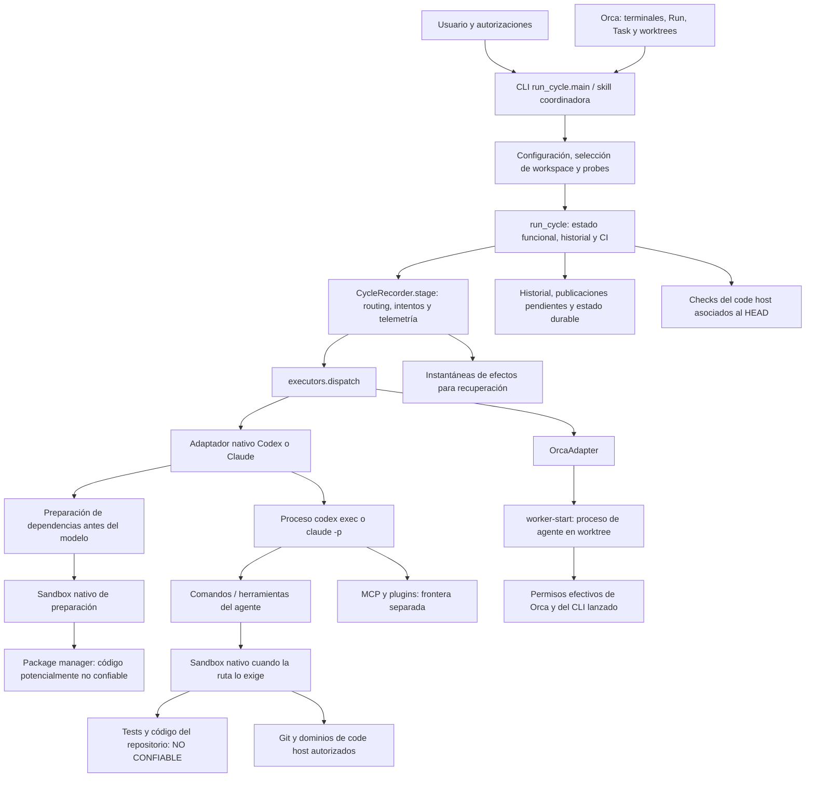
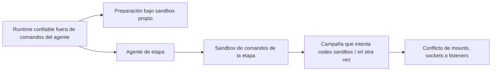
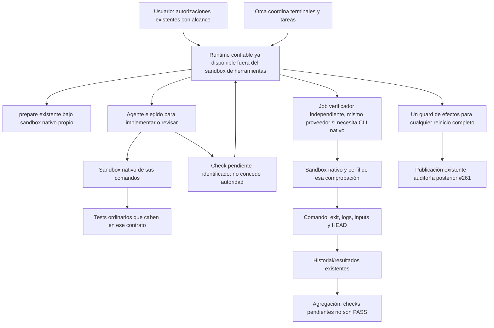

# Auditoría arquitectónica de aislamiento y ejecución de Code Cycle Toolkit

**Fecha:** 20 de octubre de 2026. **Repositorio:** `datacas/code-cycle-toolkit`. **Commit inspeccionado:** `310d7067864ac9d09a864a46bb4a62d8e78a0eb2`. Entorno experimental: Linux WSL2, UID 1000, dentro del sandbox de comandos de esta sesión Codex. Issues y PRs consultadas directamente en GitHub; su instantánea se conserva en los archivos `issue-*.json` y `pr-*.json` de este directorio.

Este informe sustituye, para esta auditoría, la investigación preliminar. Distingue **hechos observados**, **hechos de implementación**, **evidencia histórica** e **inferencias**. Las pruebas no efectuadas desde un host independiente no se presentan como verificadas. La única adición al repositorio original es este informe, guardado en `docs/research` por petición explícita del usuario. No se ha modificado código, creado commits o ramas allí, publicado resultados en GitHub, instalado paquetes ni modificado políticas persistentes del host. Los clones, fixtures y registros están en `/tmp/cct-isolation-audit-20261020`.

## A. Resumen ejecutivo

**Veredicto: HYBRID, con una modificación mínima de la topología de ejecución; conservar los sandboxes nativos.** No hay evidencia de un sandbox de seguridad propio de Orca equivalente al de Codex o Claude. Sus worktrees separan checkouts; no confinan por sí mismos filesystem, red o credenciales. El toolkit también lo reconoce y rechaza workers Orca para revisiones que requieren verificación confinada.

Sí existe anidamiento problemático cuando una campaña o el runtime entero se ejecuta desde una herramienta ya confinada por Codex. Se ha reproducido con Codex 0.163.0: el directorio del daemon aparece como `tmpfs`, modo `000`, de solo lectura, y el Codex hijo falla antes de ejecutar el comando. El código upstream de esa versión aplica deliberadamente el enmascaramiento para proteger RPC privilegiado. Cambiar TMPDIR o crear otro directorio 0700 no soluciona esa frontera. También se ha reproducido que `srt` 0.0.81, instalado, no puede crear su socket dentro de la frontera exterior. La preparación Codex con proxy falla además al reservar listeners locales.

Estos resultados no justifican suprimir aislamiento. Justifican que el runtime coordinador lance preparación y verificaciones nativas como trabajos hermanos, cada uno bajo su sandbox correspondiente, en vez de iniciar un nuevo sandbox desde la herramienta confinada de otro agente. La preparación ordinaria ya está situada antes del modelo de la etapa: debe conservarse, no reescribirse.

#274 es principalmente un problema de fixtures y temporales: una copia indiscriminada del checkout encuentra placeholders protegidos. Se ha reproducido ese mecanismo sintéticamente. Pasan 511 tests dirigidos y 70 tests del validador en un clone temporal Git, bajo la frontera exterior actual; esto no equivale a pasar dentro del sandbox Claude.

Se han encontrado dos problemas independientes de recuperación: un consentimiento puede repetir la etapa completa después de cambios de publicación, y los consentimientos persistentes no se aplican antes del primer dispatch del nuevo broker. Ambos se han demostrado con fixtures, sin publicaciones ni concesiones reales.

La recomendación es corregir esos defectos, cumplir las decisiones actuales de #288/#289, conservar los controles no equivalentes y evitar un nuevo framework de políticas. Centralizar todo el aislamiento en Orca exigiría implementar y demostrar una frontera externa que hoy no está acreditada. No es la simplificación mínima.

## B. Mapa de arquitectura actual

### B.1. Flujo y límites de confianza



**No hay una caja «sandbox de Orca» en el diagrama:** no la configura el adaptador ni se ha demostrado su existencia. La [documentación primaria de Orca](https://github.com/stablyai/orca/blob/main/docs/site/content/docs/agents/supported.mdx) advierte que el worktree no es un sandbox de seguridad y documenta defaults que omiten aprobaciones/sandbox de los CLIs. No se han inspeccionado los overrides efectivos de una instalación Orca: el ejecutable no está en el PATH de esta sesión.

Los límites relevantes son: coordinador/runtime confiable frente a datos del repositorio; agente frente a sus comandos confinados; código de tests/dependencias frente al host; herramientas MCP frente al proceso del agente; y cliente local frente al code host. El sandbox de comandos de Codex no equivale a confinar todo el proceso del agente y sus servidores MCP. El sandbox Bash de Claude tampoco cubre automáticamente cualquier herramienta externa.

La separación normal y el anidamiento accidental son distintos:



Preparación y agente son secuenciales en el runtime normal. Pasan a estar anidados si el runtime mismo se inició dentro de `S`. Orca como coordinador no cambia automáticamente esta relación de procesos.

### B.2. Inventario real de etapas y roles

El driver automatiza cinco roles funcionales: `issue_review`, `implement`, `review`, `resolve`, `rereview`. Los puntos de reanudación CLI son `implement`, `review`, `resolve`, `rereview`; `issue_review` se inserta según su modo de readiness. Hay otros cinco contratos de rol disponibles que no constituyen cinco etapas automáticas adicionales. [Contratos]($HOME/www/code-cycle-toolkit/scripts/cycle.py:103), [skills del driver]($HOME/www/code-cycle-toolkit/scripts/run_cycle.py:173), [inicios]($HOME/www/code-cycle-toolkit/scripts/telemetry.py:122).

| Rol | Iniciador y selección del agente | Workspace lógico | Publicación permitida por contrato |
| --- | --- | --- | --- |
| `issue_review` | Driver; perfil reviewer o senior_reviewer; puede escalar una vez | READ_ONLY | Ninguna; tampoco comentar la issue |
| `implement` | Driver; cheap_coder o deep_coder según señales | WORKSPACE_WRITE; por defecto workspace de tarea | Comentar, crear PR, push de rama de trabajo |
| `review` | Driver; reviewer o senior_reviewer | READ_ONLY del origen; verificación en clone desechable | Solo comentario de revisión |
| `resolve` | Driver tras findings; perfil coder, esfuerzo y escalado controlados | WORKSPACE_WRITE de la implementación existente | Comentar y push; no crear otra PR |
| `rereview` | Driver tras resolución; perfil reviewer/senior | Igual que review, sobre el HEAD vigente | Solo comentario |
| `security` | Llamada auxiliar explícita; perfil security | READ_ONLY | Ninguna |
| `bootstrap` | Skill/llamada auxiliar; auxiliary_tool | READ_ONLY | Ninguna |
| `verify` | Skill/llamada auxiliar; auxiliary_tool | DISPOSABLE | Ninguna |
| `run` | Skill/llamada auxiliar; auxiliary_tool | DISPOSABLE | Ninguna |
| `coordinate` | Coordinador; perfil coordinator | READ_ONLY | Ninguna |

El modelo concreto procede de perfiles efectivos y señales, no del nombre de la etapa. En esta configuración, por ejemplo, deep_coder apunta a Codex y reviewer a Claude; no es una propiedad universal del producto. [Selector]($HOME/www/code-cycle-toolkit/scripts/router.py:372). Un contrato READ_ONLY describe protección del workspace original; no implica que ningún archivo pueda escribirse: se permite scratch y, para verificar, un clone descartable.

### B.3. Procesos, recursos y fallos por familia de ejecución

| Familia | Proceso efectivo | Lectura/escritura | Red, IPC, temporales y requisitos |
| --- | --- | --- | --- |
| Codex escritor | `codex exec -m <modelo> -c model_reasoning_effort=<esfuerzo>` con perfil | Workspace y raíces Git concretas; metadata sensible protegida; TMPDIR propio | Perfil de red por publicación/registros; proxy cuando corresponde; sockets Unix solo por grant. CLI y sandbox Linux operativos |
| Codex lector | `codex exec` read-only o perfil derivado; en review clone + scratch escribibles | Origen protegido; lectura no equivale a ocultar todas las credenciales | Sin ruta code-host por defecto si no publica; review publicadora tiene dominios de code host. Necesita directorio reservado del daemon accesible al constructor del sandbox |
| Claude escritor | `claude -p … --output-format stream-json --verbose`, `acceptEdits` | Tabla/hook si política activa; sandbox añadido con dominios de registro; no confinamiento Bash universal por rol escritor | Permisos heredados y settings efectivos importan; Git/gh usan identidad del usuario |
| Claude review/rereview con verificación | `claude -p` en clone, settings por dispatch | Clone y TMPDIR; `failIfUnavailable`, sin fallback no confinado; conflictos de settings bloquean | Dominios code-host + registros autorizados. Linux requiere bwrap/socat; detección de rutas protegidas usa rg; sandbox puede necesitar sockets/proxies propios |
| Preparación de dependencias | `codex sandbox … -- <manager>` o `srt --settings … -- <manager>` | Scratch de fuentes, manifests/lock protegidos, outputs publicados tras validar | Registro solamente, scripts deshabilitados, entorno reducido y HOME temporal; srt externo requerido por esta ruta del toolkit |
| Worker Orca | `orca orchestration worker-start --from … --run … --task … --agent … --model … --effort … --worktree path:… --json` | Workspace contratado, no frontera OS acreditada | Receipt asíncrono; no tabla nativa equivalente. No elegible para verificación que exige clone confinado |

Para todas las etapas: prerrequisitos de autenticación/trust y ausencia de capacidad pueden impedir dispatch; una preparación incompleta se adjunta como evidencia y no cancela por sí sola la inspección útil. Un sandbox de revisión no acreditado actualmente puede detener toda la review. Recuperación automática no puede conceder permisos ni eliminar restricciones por diagnóstico del agente. El runtime distingue disponibilidad, fallo del proceso y resultado funcional.

Si el proceso puede seguir vivo, no se redispatcha: los nativos usan grupos de procesos POSIX y terminación acotada; los receipts Orca no prueban por sí mismos que el trabajo terminó. Publicación o cambios de workspace/remote obligan a reconciliar antes de otro intento; AR-004 documenta una excepción defectuosa en el reintento con consentimiento.

### B.4. Finalización, publicación y reanudación

`run_cycle` interpreta el resultado estructurado, registra findings/verificación y decide el siguiente rol. Readiness no confirmada escala como máximo una vez o se detiene antes de implementar. Tras implementar se revisa; findings válidos llevan a resolve/rereview dentro de los límites de iteración y progreso. Aprobación requiere contrato de revisión limpio y la política de CI aplicable; el resultado final es preparación para merge manual, no un merge automático.

Al reanudar se identifica workspace/PR, se sincroniza historial de autores confiables y se conservan los intentos con publicación pendiente. Hay recuperación de resultados ausentes mediante evidencia publicada y una verificación estructurada: no supone que cualquier comentario implica éxito. Un lock SQLite por máquina y PR evita dos drivers locales simultáneos; no es un lock distribuido entre hosts. `--continue` exige trabajo existente y el checkout correcto. Los cursores de estado observan progreso; no son checkpoints de una instrucción concreta del agente.

## C. Inventario de componentes y mecanismos

### C.1. Código inspeccionado

Los enlaces abren la primera línea del símbolo; los intervalos describen su extensión en el commit auditado.

| Archivo / símbolo | Líneas | Responsabilidad y dependencias |
| --- | --- | --- |
| [run_cycle.main]($HOME/www/code-cycle-toolkit/scripts/run_cycle.py:3941) | 3941–4151 | CLI, configuración, broker de consentimiento, telemetría y ejecución/interrupción |
| [select_workspace]($HOME/www/code-cycle-toolkit/scripts/run_cycle.py:1506) | 1506–1628 | Worktree por tarea o workspace actual; no sandbox de seguridad |
| [run_cycle]($HOME/www/code-cycle-toolkit/scripts/run_cycle.py:2131) | 2131–3234 | Máquina funcional, historial, dispatch y CI |
| [check_continuation]($HOME/www/code-cycle-toolkit/scripts/run_cycle.py:1747) | 1747–1779 | Evita continuar en checkout equivocado o sin trabajo |
| [recovery_evidence]($HOME/www/code-cycle-toolkit/scripts/run_cycle.py:1897) | 1897–1982 | Recuperación desde publicaciones/receipts confiables y HEAD correspondiente |
| [clean_review_problem]($HOME/www/code-cycle-toolkit/scripts/run_cycle.py:3650) | 3650–3680 | SHA completo revisado, findings legibles y ausencia explícita de bloqueos |
| [_test_outcome / _checks]($HOME/www/code-cycle-toolkit/scripts/run_cycle.py:3528) | 3528–3595; 3600–3625 | Distingue evidencia de tests de afirmaciones; checks del code host y SHA |
| [CycleRecorder.stage]($HOME/www/code-cycle-toolkit/scripts/cycle.py:403) | 403–988 | Routing, contratos por rol, hasta tres intentos, reconciliación, grants y telemetría |
| [executors.dispatch]($HOME/www/code-cycle-toolkit/scripts/executors.py:2969) | 2969–3251 | Readiness, capacidades, policy activa y selección de aislamiento |
| [NativeAdapter.dispatch]($HOME/www/code-cycle-toolkit/scripts/executors.py:1122) | 1122–1316 | Preparación previa al agente, stream, resultado y evidencias |
| [CodexAdapter.argv]($HOME/www/code-cycle-toolkit/scripts/executors.py:1799) | 1799–1876 | Perfiles de filesystem/red, raíces Git y socket grant |
| [probe_git_metadata_write]($HOME/www/code-cycle-toolkit/scripts/executors.py:1603) | 1603–1757 | Verifica acceso real a Git en linked worktrees antes de dispatch |
| [probe_review_confinement]($HOME/www/code-cycle-toolkit/scripts/executors.py:1878) | 1878–1946 | Pruebas positivas/negativas del clone y scratch; no basta argv |
| [ClaudeAdapter.policy_preflight]($HOME/www/code-cycle-toolkit/scripts/executors.py:2434) | 2434–2461 | Detecta hooks/mods/settings que invalidan la política |
| [ClaudeAdapter.policy_files]($HOME/www/code-cycle-toolkit/scripts/executors.py:2476) | 2476–2531 | Copia política/hook fuera del workspace y añade settings de sandbox |
| [ClaudeAdapter.argv]($HOME/www/code-cycle-toolkit/scripts/executors.py:2592) | 2592–2643 | Herramientas permitidas, modos de permiso y proceso Claude |
| [OrcaAdapter.dispatch]($HOME/www/code-cycle-toolkit/scripts/executors.py:2749) | 2749–2895 | Worker asíncrono, contexto requerido y receipt/modelo efectivo |
| [_native_review_scratch]($HOME/www/code-cycle-toolkit/scripts/executors.py:132) | 132–193 | TMPDIR aislado por dispatch, fuera del checkout; limpieza y perfiles |
| [_isolated_review_dispatch]($HOME/www/code-cycle-toolkit/scripts/executors.py:2239) | 2239–2386 | Clone sin hardlinks, HEAD exacto, detección de efectos y limpieza |
| [_publication_preflight]($HOME/www/code-cycle-toolkit/scripts/executors.py:680) | 680–728 | Credenciales y push dry-run sin alterar remoto; no prueba transporte desde el sandbox |
| [StagePolicy / check]($HOME/www/code-cycle-toolkit/scripts/stage_permissions.py:108) | 108–190; 399–421 | Contexto inmutable y validación de sintaxis, argumentos y redirecciones |
| [_check_words]($HOME/www/code-cycle-toolkit/scripts/stage_permissions.py:477) | 477–511 | Git/gh/Docker antes de herramientas elegidas; preserva invariantes explícitas |
| [review_sandbox_settings]($HOME/www/code-cycle-toolkit/scripts/stage_permissions.py:1470) | 1470–1484 | Filesystem y red del sandbox Bash Claude |
| [dependency_setup.prepare]($HOME/www/code-cycle-toolkit/scripts/dependency_setup.py:226) | 226–388 | Frozen installs, copia scratch, cache, dos intentos transitorios, logs y detección de builds pendientes |
| [sandbox_command]($HOME/www/code-cycle-toolkit/scripts/dependency_setup.py:79) | 79–116 | Wrappers Codex/srt; no fallback a install no confinado |
| [user_choices.load]($HOME/www/code-cycle-toolkit/scripts/user_choices.py:15) | 15–42 | Herramientas, comandos, integraciones y registros declarados sin enumerar ejecutables en código |
| [sandbox_blocker]($HOME/www/code-cycle-toolkit/scripts/environment_recovery.py:57) | 57–90 | Solo un BLOCKED estructurado completo y sin requiere-humano activa recuperación |
| [effect_snapshot / reconcile]($HOME/www/code-cycle-toolkit/scripts/reroute.py:47) | 47–127 | Workspace, remoto y publicaciones atribuibles; fallo cerrado si falta evidencia |
| [ConsentStore / ConsentBroker]($HOME/www/code-cycle-toolkit/scripts/grants.py:163) | 163–215; 270–358 | Consentimiento fuera del checkout; fingerprint de alcance, decisiones y propagación |
| [CycleHistoryStore.acquire]($HOME/www/code-cycle-toolkit/scripts/cycle_history.py:234) | 234–258 | Lock local por PR; SQLite |
| [expect_publication]($HOME/www/code-cycle-toolkit/scripts/cycle_history.py:524) | 524–571 | Publicación pendiente y confirmación idempotente del registro, no ejecución exactly-once |
| [telemetry.create_dispatch_attempt]($HOME/www/code-cycle-toolkit/scripts/telemetry.py:1388) | 1388–1440 | Intentos e identidad de ejecución durables; updates en 1624–1793 |
| [CycleStatusWriter]($HOME/www/code-cycle-toolkit/scripts/cycle_status.py:618) | 618–1018 | Progreso, workspace observado, estado atómico y cursores |
| [issue_review.assess]($HOME/www/code-cycle-toolkit/scripts/issue_review.py:368) | 368–406 | READY solo con resultado coherente, evidencia e identidad correctas |

### C.2. Qué protege cada mecanismo; qué se perdería al retirarlo

| Mecanismo | Amenaza, aplicador y garantía real | Equivalencia/conflictos | Impacto de retirarlo; evidencia relevante |
| --- | --- | --- | --- |
| Clone/worktree desechable | Toolkit/Orca separa archivos de trabajo y revisiones | Complementa sandbox; no impide leer host ni usar red | Se pierde separación de revisores y recuperación limpia. Tests de dispatch y SHA |
| Filesystem nativo Codex | CLI/bwrap limita escrituras y protege metadata | No lo sustituye tabla ni clone; puede ocultar rutas al hijo | Retirarlo permite escrituras del código revisado con acceso del proceso. Probes reales existentes y E2 |
| Sandbox Bash Claude | Claude/SRT limita comandos bajo reglas de filesystem y red | No cubre automáticamente Edit/MCP; arrays heredados pueden ampliar settings | Sin él, tests podrían escribir fuera del clone. Fail-closed y pruebas de settings |
| Namespaces, mounts y seccomp | Implementaciones nativas separan vistas y restringen syscalls | Varias técnicas internas son complementarias, no capas de política redundantes | Quitar máscaras/sockets puede abrir RPC privilegiado. Upstream 0.163 y mountinfo E2 |
| Proxy/reglas de red | CLI/SRT median dominios; no dan autorización semántica a una API | Un dominio de GitHub admite lecturas y escrituras; raw TCP/proxy tienen compatibilidad distinta | Quitar proxy amplía exfiltración y red interna. E5 muestra que su bootstrap también puede fallar |
| Tabla `allowedTools` Claude | CLI decide herramientas que el agente puede invocar sin nueva aprobación | Prefijos solos no validan todos los argumentos | Retirarla cambia autonomía/aprobaciones, no reemplaza confinamiento |
| Hook de argumentos/edición | Toolkit valida comando, destino y TMPDIR en cada llamada soportada | Segunda barrera con propósito distinto de la tabla; no observa syscalls del test | Retirarlo deja operaciones peligrosas dentro de prefijos permitidos. 73 métodos de test de policy y E7 |
| Scratch por dispatch | Toolkit evita colisiones y escrituras de auxiliares en el checkout | No protege contenido si otro proceso tiene permisos amplios | Retirarlo reintroduce mezcla de ciclos. Pruebas de concurrencia y #141/#266 |
| Grants informados | Usuario + broker autorizan capacidades sensibles por alcance | No pueden conceder lo que deniega el ancestro OS; Codex y Claude tienen alcances distintos | Retirarlos o autoaceptarlos vulnera #239. Tests de grants y E9 |
| Snapshots de efectos | Toolkit decide si un reintento es seguro tras ejecutar/publicar | Detección posterior, no prevención ni rollback | Retirarlos permite redispatch ciego. Tests de reroute y E8 |
| Historial/publicación pendiente | Runtime conserva identidad, receipts, HEAD y autores confiables | Complementa snapshots; no es sandbox ni garantía universal exactly-once | Retirarlo pierde recuperación/reanudación verificable |
| Protección de credenciales | Parcial: preparación Claude niega rutas concretas; HOME/entorno de preparación reducidos | Revisión publicadora sigue accediendo a credenciales y dominios necesarios; MCP aparte | No hay una protección completa redundante que pueda eliminarse. Riesgo reconocido en documentación |

## D. Hallazgos confirmados

Las severidades expresan impacto arquitectónico/operativo. Un hallazgo de control no significa que se haya explotado una vulnerabilidad real en producción.

### AR-001 — Alta: el constructor Codex no es composable dentro de su propia frontera de comandos

**Archivo/símbolo:** upstream Codex 0.163.0, `bwrap.rs` construcción del sandbox y `append_daemon_socket_masks`, líneas 436–437 y 869–897; `uds/src/daemon_directory.rs`, líneas 12–38. Toolkit: [ENVIRONMENT_RECOVERY_GUIDANCE]($HOME/www/code-cycle-toolkit/scripts/environment_recovery.py:19).

**Causa:** el directorio reservado es fijo respecto a `/tmp` y UID; no depende de HOME/TMPDIR/CODEX_HOME. El constructor verifica propietario y modo 0700. El sandbox exterior lo oculta con tmpfs modo 000 y remount read-only, deliberadamente. El constructor interior encuentra esa vista y falla.

**Evidencia:** `environment.json` muestra el mount y PermissionError; `E2-codex-minimal-readonly.json` conserva exit 1 y el error exacto. El [código de máscara fijado a la versión](https://github.com/openai/codex/blob/rust-v0.163.0/codex-rs/linux-sandbox/src/bwrap.rs#L869) y el [directorio reservado](https://github.com/openai/codex/blob/rust-v0.163.0/codex-rs/uds/src/daemon_directory.rs#L12) explican el resultado.

**Consecuencia:** el fallo no identifica permisos incorrectos del host. Es incorrecto intentar repararlo con chmod, otro TMPDIR o un grant genérico de sockets. Evitar el anidamiento conserva la protección del daemon. No se ha demostrado una opción soportada de 0.163.0 que permita un sandbox interior equivalente sin retirar la máscara exterior.

### AR-002 — Alta operativa: tener instalados los prerrequisitos no hace arrancable la preparación dentro del sandbox exterior

**Archivos/símbolos:** [sandbox_command]($HOME/www/code-cycle-toolkit/scripts/dependency_setup.py:79), [prepare.run]($HOME/www/code-cycle-toolkit/scripts/dependency_setup.py:281).

**Causa/evidencia:** srt 0.0.81 está instalado y falla con `listen EPERM … srt-mux-….sock` en E3 y E5-Claude. E5-Codex falla reservando listeners del proxy administrado antes de ejecutar `npm --version`. Todos los intentos se mantienen dentro de la frontera exterior original. El bloqueo del socket es observado; atribuir cada syscall concreta a un filtro determinado sin tracing adicional sería una inferencia.

**Consecuencia:** instalar srt/rg o permitir un dominio no basta para esta topología. Hay incompatibilidad de bootstrap de IPC/listeners. Cambiar de modelo no cambia esas restricciones. No se ha ejecutado ningún install ni código descargado.

### AR-003 — Media: fixtures del toolkit dependen de una vista del checkout sin placeholders y de temporales adicionales

**Archivos/símbolos:** [ValidatePackageTests.copy_package]($HOME/www/code-cycle-toolkit/tests/test_validate_package.py:22), líneas 22–31; [test_scratch_never_uses_a_temp_parent_inside_the_checkout]($HOME/www/code-cycle-toolkit/tests/test_executors.py:2810), líneas 2810–2818; [_native_review_scratch]($HOME/www/code-cycle-toolkit/scripts/executors.py:132), líneas 132–193.

**Causa:** copytree ignora `.git`/pycache pero copia también placeholders ajenos a los datos que necesita el validador. Otro test simula TMPDIR dentro del checkout y supone que existe otro padre escribible; ese supuesto deja de cumplirse bajo escritura restringida a clone/scratch.

**Evidencia:** E4 crea solo en el clone temporal un `settings.local.json` ilegible y obtiene `shutil.Error` con Permission denied, sin modificar el código. Es una reproducción sintética del mecanismo de copia, no una sesión Claude. [#274](https://github.com/datacas/code-cycle-toolkit/issues/274) documenta los 62 errores y el fallo de temporales históricos. La baseline actual pasa 70 tests del validador y los tests dirigidos fuera de esa frontera Claude.

**Consecuencia/solución:** fixtures mínimos o copia de entradas necesarias/tracked, más un padre temporal controlado por el test. No ampliar los permisos de review. No afirmar que el número histórico de fallos sigue siendo exactamente 62 en el HEAD actual.

### AR-004 — Alta: el reintento con grant al mismo ejecutor puede omitir la reconciliación de publicación

**Archivo/símbolo:** [CycleRecorder.stage]($HOME/www/code-cycle-toolkit/scripts/cycle.py:903), líneas 903–938; comparar `reroute_gate`, líneas 763–775.

**Causa:** después de una respuesta de consentimiento se calcula `safe` con salida del proceso, no-asíncrono y ausencia de requisito humano. La llamada a `reroute_gate()` solo se añade cuando `consent_decision is not decision`. Para el mismo target, un efecto ya observado no veta repetir la etapa.

**Evidencia:** E8 utiliza `RestrictedAdapter`, broker sintético y snapshots CLEAN → publicación cambiada. Resultado: **2 dispatches**, primero sin grant y segundo con `docker_host`, aun existiendo el cambio. No hay ejecutor real, publicación ni acceso Docker. El resultado prueba una ruta de repetición, no que se haya creado una PR duplicada real.

**Consecuencia/solución:** riesgo de repetir efectos tras consentimiento. Aplicar la barrera de efectos a todo reinicio completo; si ya hubo efectos, continuar la operación pendiente de forma explícita o dejarla sin verificar. Un grant de acceso no autoriza implícitamente repetir publicaciones.

### AR-005 — Media: los grants persistentes se recuperan tarde para evitar el primer fallo de un ciclo nuevo

**Archivo/símbolo:** [ConsentBroker]($HOME/www/code-cycle-toolkit/scripts/grants.py:270), líneas 270–358; [CycleRecorder.stage]($HOME/www/code-cycle-toolkit/scripts/cycle.py:692), obtención de grants antes de dispatch.

**Causa:** `granted_ids` empieza vacío y `granted()` solo consulta ese conjunto. El store/preautorización/respuestas se consultan en `request()`, una vez detectado el bloqueo. No existe hidratación equivalente antes del primer dispatch en esa ruta.

**Evidencia:** E9 guarda un allow en un store temporal para `audit/synthetic-only`: `granted('codex')` devuelve `[]`; `request()` devuelve `persistent`; después devuelve `['docker_host']`. No se ha escrito el store real del usuario.

**Consecuencia/solución:** una autorización anterior puede evitar otra pregunta, pero no evita necesariamente el primer intento fallido ni la repetición completa. Resolver grants aplicables antes de dispatch, conservando fingerprint y alcance; implementar listado/revocación en el mecanismo existente, no otro sistema paralelo. Esto es parte de #289.

### AR-006 — Alta, límite de seguridad conocido: las fronteras actuales no garantizan aislamiento completo de credenciales/publicación frente al código revisado

**Archivos/símbolos:** [CodexAdapter.argv]($HOME/www/code-cycle-toolkit/scripts/executors.py:1799), [review_sandbox_settings]($HOME/www/code-cycle-toolkit/scripts/stage_permissions.py:1470), [tabla/hook]($HOME/www/code-cycle-toolkit/scripts/stage_permissions.py:477), [limitaciones documentadas]($HOME/www/code-cycle-toolkit/docs/host-permissions.md:168).

**Causa:** permitir gh y dominios del code host con las credenciales del usuario permite publicar; restringir el comando que escribe el agente no intercepta una llamada API que haga el código de un test o una integración. Las herramientas preaprobadas y MCP mantienen otra frontera. Además, la política activa cubre GitHub/GitHub nativo; otros proveedores/workers tienen un techo distinto.

**Evidencia:** código y documentación reconocen esas rutas; no se han leído credenciales ni ejecutado una exfiltración. Es un límite confirmado del modelo, no una explotación demostrada.

**Consecuencia:** ni A/B actuales ni D mínimo deben prometer protección absoluta frente a PRs hostiles o prevención absoluta de merge/force-push. Reemplazar sandboxes por un worktree empeoraría la situación. Una separación fuerte de credenciales/publicación sería trabajo adicional y debe tener un caso de uso de seguridad explícito.

### AR-007 — Media/alta según operación: reconciliación de reintentos no sustituye una auditoría después de cada etapa publicadora exitosa

**Archivos/símbolos:** [reroute.effect_snapshot/reconcile]($HOME/www/code-cycle-toolkit/scripts/reroute.py:47), [CycleRecorder.stage]($HOME/www/code-cycle-toolkit/scripts/cycle.py:403).

**Causa:** la comparación de efectos sirve para decidir reintentos de fallos concretos. No implementa las tres comprobaciones de #261 después de toda etapa exitosa: PR sin merge/cierre, avance fast-forward de la rama propia y ausencia de cambios prohibidos/deleciones de refs protegidas.

**Evidencia:** inspección del flujo de éxito y de los consumidores de snapshots; [#261 permanece abierta](https://github.com/datacas/code-cycle-toolkit/issues/261). El preflight `git push --dry-run` comprueba preparación de publicación, no efectos posteriores. El uso de `--is-ancestor` en selección de workspace no constituye esa auditoría.

**Consecuencia:** conservar el guard de #268 y completar #261 son responsabilidades separadas. No añadir rollback automático ni confundir detección con prevención. El alcance de Bitbucket debe seguir marcado sin verificar cuando no haya capacidad.

### AR-008 — Media: recuperación actual difiere de las decisiones vigentes de #288/#289

**Archivos/símbolos:** [sandbox_blocker]($HOME/www/code-cycle-toolkit/scripts/environment_recovery.py:57), [CycleRecorder.stage]($HOME/www/code-cycle-toolkit/scripts/cycle.py:833), [gating de review]($HOME/www/code-cycle-toolkit/scripts/executors.py:3191), [_checks]($HOME/www/code-cycle-toolkit/scripts/run_cycle.py:3600).

**Causa:** el runtime reconoce BLOCKED estructurado como señal de recuperación y puede cambiar de ejecutor ante `environment_restricted`. Si no acredita confinamiento de review, detiene la revisión completa. Las decisiones actuales exigen no reroute por sandbox, resultados por check y continuación estática solo si sigue siendo segura.

**Evidencia:** código y tests dirigidos pasan porque verifican el comportamiento existente; #288 y #289 están abiertas. En el contrato actual `checks` de raíz ya es un objeto de conteos de CI: sustituirlo por el array ilustrativo de #288 descartaría esa evidencia en `_checks`.

**Consecuencia/solución:** adaptar política y agregación por check; usar un campo aditivo sin colisión, por ejemplo dentro de `tests`. No tratar una review estática como ejecución de tests ni dejar que un check indispensable pendiente se convierta en aprobación final. El bloqueo actual sin confinamiento preserva seguridad hasta que exista una alternativa estática acreditada.

## E. Hipótesis no confirmadas

| ID | Hipótesis | Estado y prueba necesaria |
| --- | --- | --- |
| H-01 | El daemon del host del incidente #288 tenía modo/propietario correctos exactamente al fallar | Evidencia histórica afirmativa; no observación host de esta auditoría. Comparar stat/mountinfo simultáneos desde host autorizado y desde etapa |
| H-02 | La instalación Orca concreta aplica además un contenedor/sandbox externo | No acreditado. Obtener receipt, launch arguments y cadena de procesos/mount namespaces de esa instalación; worktree no basta |
| H-03 | Claude 2.1.304 reproduce exactamente todos los placeholders y el total de fallos de #274 | No se inició una sesión Claude de review. Ejecutar su comando real con mismo HEAD y settings; comparar con E4 y baseline |
| H-04 | Preparación cold de dependencias funciona hoy para ambos nativos desde un runtime exterior | No ejecutada satisfactoriamente aquí: los wrappers fallan antes de npm. Campaña existente desde runner independiente, con logs/HEAD y controles negativos |
| H-05 | Un sandbox externo único ofrece garantías iguales o superiores y menor coste total | No existe backend comparado. Prototipo con pruebas adversariales de fs/red/sockets/secretos y medición de arranque/preparación; no basta arrancar agentes |
| H-06 | Delegar una comprobación concreta completaría automáticamente el run histórico | No demostrado: puede seguir necesitando binarios, red, sesión o una autorización. Validar la comprobación original bajo las mismas garantías y commit |
| H-07 | El error EPERM de srt procede de un filtro concreto de AF_UNIX, y no de otra restricción del ancestro | Compatible con política y syscall fallida; sin tracing individual no se atribuye a una regla exacta. Un probe de syscalls en laboratorio puede precisarlo sin abrir sockets privilegiados |
| H-08 | Las decisiones actuales de permisos funcionan igual en Linux, WSL2, macOS y Windows | Solo WSL2 observado. Ejecutar matriz de plataformas; no extrapolar bwrap/AF_UNIX a Seatbelt o al sandbox Windows |

## F. Matriz de seguridad y amenazas

Activos: checkout original, otros ciclos, Git/refs, credenciales, datos del host, red interna, sockets privilegiados y veracidad de evidencias. Adversarios: PR/dependencia/instrucción de repo maliciosa; herramienta/integración comprometida; agente inducido a actuar fuera del encargo. El runtime y las decisiones explícitas del usuario son parte de la base confiable; el contenido del PR no debe otorgarse autoridad por aparecer en un prompt o archivo.

En la matriz, **A** significa conservar las rutas actuales; **B** normalizar aislamiento nativo; **C** un backend externo real todavía no implementado; **D** la propuesta mínima de este informe. Las garantías de C son requisitos, no resultados experimentales.

| Amenaza | Control actual y límite | A / B | C | D recomendado |
| --- | --- | --- | --- | --- |
| PR maliciosa ejecutada como test | Clone + sandbox de comandos; secretos/red de publicación siguen siendo un riesgo | Mantienen protección parcial, no equivalencia total entre proveedores | Debe probar confinamiento de todo código y aislamiento de secretos | Mantiene nativos; evita ejecutar tests si su frontera no está acreditada |
| Prompt injection en repo | Contratos, validación, archivos protegidos y barreras OS | No hacen confiable al modelo; mismas limitaciones MCP | Puede limitar efectos aunque el modelo siga la instrucción | Diagnósticos tratados como datos; nunca conceden permisos |
| Scripts de instalación | Frozen install; lifecycle deshabilitado; scratch y entorno reducido | Conservar; builds necesarios quedan incompletos hasta ruta aislada | Debe preservar restricciones de preparación | Reutilizar prepare; no instalar en host para recuperar |
| Claves SSH / tokens GitHub | Preparación reduce entorno y niega rutas en Claude; review publicadora mantiene acceso relevante | Riesgo residual de lectura/uso por código o herramientas | Debe aislar credenciales o mediar operaciones | No empeora; separación fuerte de publicación queda explícitamente fuera del mínimo |
| Lectura fuera del workspace | Read-only no implica deny-read global | Lecturas externas siguen posibles según perfil | Requiere roots de lectura y secretos excluidos comprobados | No promete aislamiento de lectura que hoy no existe |
| Escritura fuera de rutas autorizadas | Filesystem nativo en rutas confinadas, scratch independiente | Conservada; Claude escritor no es universalmente confinado por toolkit | Debe impedir también symlinks y rutas absolutas | Conservada; no sustituirla por un hook |
| Red local / servicios internos | Namespace/proxy y reglas por perfil; grants pueden ampliar | Compatibilidad con servicios no garantizada | Egress/loopback deben imponerse desde frontera confiable | Pendiente de autorización/capacidad concreta; sin bypass implícito |
| Exfiltración saliente | Dominios limitados, pero GitHub permitido también puede ser canal | Riesgo residual con credenciales y dominios autorizados | Debe limitar destinos y autoridad semántica si pretende eliminarlo | Igual límite actual, documentado; no afirmar seguridad absoluta |
| Daemon Docker | Denegado por defecto; grant informado #239 | Codex puede abrir todos los Unix sockets; no es solo Docker | Acceso al socket debe considerarse capacidad privilegiada | No concederlo para reparar Codex anidado |
| Sockets Unix privilegiados / RPC Codex | Máscara daemon y restricción de creación/conexión | Mantener; explica la incompatibilidad anidada | No montar sockets privilegiados al workload | Separar jobs antes de máscara, sin exponer daemon al código |
| Escalada de privilegios | Sandbox OS, caps/syscalls y protección de metadata | No equivale a garantía frente a vulnerabilidad del kernel/CLI | Debe reducir capabilities y evitar escape por montajes/sockets | No amplía capabilities ni usa nested-weaker por defecto |
| Merge, force-push, eliminación no autorizados | Hook de comandos Claude; contrato/prompt; auditoría #261 pendiente | Código ejecutado/MCP puede eludir la tabla | Frontera fs/red sola tampoco distingue métodos GitHub | Conservar hook y completar #261, además de guard de repetición |
| Duplicación tras publicación | Snapshot e historial/receipts; AR-004 muestra hueco | Corregir en ambas; sandbox no aporta idempotencia | Tampoco se resuelve con contenedor | Reconciliar todo reinicio; continuar check identificado |
| Interferencia concurrente | Clone y TMPDIR únicos; lock por PR/máquina | Reduce colisiones; no impide otro host o credenciales compartidas | Debe aislar rutas y recursos entre jobs | Reutiliza mecanismos; no inventa lock distribuido sin caso real |
| Reutilizar autorizaciones en contexto distinto | Store por repo y fingerprint efectivo; grant genérico actual limitado | No equivale aún a permisos host por check/commit | Debe mantener alcance y revocación fuera del workload | Conservar fingerprint, añadir contexto a grants de checks sin heredar autoridad ilimitada |
| Resultado falso PASS / commit equivocado | Contratos estructurados, evidencia, full SHA, CI/receipts | Conservan controles; evidencia de agente sigue siendo autorreportada | Necesita el mismo contrato: sandbox no prueba resultados | Cada check conserva comando/exit/HEAD y ausencia de ejecución no pasa |

**Conclusión de seguridad:** hay controles distintos y complementarios, junto a huecos conocidos. No se ha demostrado una capa redundante que pueda retirarse y preserve por sí sola todas estas propiedades. Sí se ha demostrado una ubicación innecesariamente anidada de determinados trabajos.

## G. Comparativa arquitectónica y complejidad

### G.1. Alternativas examinadas

**A — Mantener lo actual.** Significa conservar los controles de orquestación y perfiles nativos reales, no añadir una capa Orca inexistente. Requiere corregir #274, AR-004/005 y la recuperación de #288/#289. Mantener también la capacidad de iniciar el runtime desde cualquier comando confinado conserva las incompatibilidades observadas.

**B — Aislamiento exclusivamente nativo.** Es muy próximo a la ruta nativa ordinaria actual: cada proveedor aplica filesystem/red, y el toolkit conserva contratos, autorización de herramientas, consentimiento y publicación. Normalizar que el runtime esté fuera de los comandos del agente evita anidamiento. No iguala por sí solo Claude escritor, review, Codex y MCP; necesita comprobar capacidades por rol. No debe eliminar el hook por considerar que «todo es nativo».

**C — Aislamiento centralizado en Orca.** Técnicamente posible como integración nueva, no acreditado como capacidad actual. OpenAI documenta [uso dentro de contenedor que aporta la frontera](https://learn.chatgpt.com/docs/agent-approvals-security) y [externalSandbox en App Server](https://learn.chatgpt.com/docs/app-server), pero el toolkit utiliza `codex exec`: son interfaces distintas. Claude puede ejecutarse sin sandbox Bash añadido; hacerlo seguro depende de la frontera externa. No se ha probado desactivar ninguno. C requiere backend, filesystem/red/IPC verificables, identidad de credenciales y adaptación de perfiles. No es simplemente cambiar un flag.

**D — Híbrido acotado por operación.** Conservar los nativos para agentes/herramientas donde ya funcionan; mantener preparación en el runtime; ejecutar campañas que necesitan un sandbox nativo desde un job independiente del mismo proveedor. La selección se basa en capacidades y contratos existentes, no en un sistema que relaje aislamiento al detectar fallos. No cambiar Codex por Claude para eludir un sandbox. Esta variante elimina anidamiento accidental sin introducir un backend general nuevo. Tiene coste de describir y persistir la comprobación pendiente; no se presenta como solución universal.

### G.2. Comparación razonada

Las valoraciones son cualitativas y condicionales. No hay datos de una campaña comparativa para asignar probabilidades o puntuaciones numéricas.

| Dimensión | A: actual | B: nativos normalizados | C: externo Orca nuevo | D: híbrido acotado |
| --- | --- | --- | --- | --- |
| Seguridad | Controles útiles pero desiguales; huecos AR-004/006/007 | Conserva controles; equivalencia exige gates por rol | Potencial de frontera uniforme, todavía sin demostrar | Conserva controles; una comprobación pendiente no ejecuta código sin frontera |
| Compatibilidad | Fallos anidados observados | Buena para jobs nativos desde runtime exterior; campañas aún deben ubicarse correctamente | Debe integrar CLIs, mounts, sesiones, MCP y plataforma | Evita los dos bootstraps anidados observados; requiere runner disponible |
| Fiabilidad | 581 tests seleccionados pasan, pero campañas nativas fallan bajo ancestro | Reduce una causa estructural, no arregla fixtures/publicación | Desconocida hasta prototipo; introduce fallos de backend nuevos | Mejoría causal plausible para checks anidados; no se ha medido tasa de ciclos completos |
| Autonomía | BLOCKED y reroute pueden interrumpir trabajo | Menos conflictos de bootstrap; autorizaciones siguen necesarias | Puede preparar entorno antes de agentes; no elimina consentimiento | Check independiente y evidencia durable reducen repetición; requiere completar #288/#289 |
| Simplicidad | Sin backend nuevo; ramas de recuperación acumuladas | Menor cambio conceptual; conserva adaptadores | Mayor trabajo inicial: nueva frontera y adaptadores | Añade continuación de check, pero reutiliza dispatch/prepare/grants/history |
| Mantenibilidad | Depende de cambios de dos CLIs y excepciones de topología | Sigue dependiendo de proveedores, con límites más claros | Añade mantenimiento OS/container y su integración con CLIs | Proveedores siguen separados; evita remedios especiales TMPDIR/socket por modelo |
| Portabilidad | Diferencias documentadas por OS; esta auditoría solo WSL2 | Mantiene tecnologías nativas de cada plataforma | No hay backend multiplataforma probado | Mantiene nativos; disponibilidad de runner exterior debe verificarse por plataforma |
| Rendimiento | Datos solo de tests y fallos de arranque, no benchmark end-to-end | Evita intentos destinados a fallar; ahorro no cuantificado | Contenedores/VM y preparación pueden añadir o amortizar coste; desconocido | Job/receipt adicional puede costar; evita repetir toda la etapa si se implementa bien |
| Recuperación | Snapshots, receipts y límites ya disponibles; AR-004 | Mismos mecanismos, sin raíz de anidamiento ordinario | Debe conectar lifecycle externo al historial existente | Recupera unidad pequeña identificada; no reejecuta publicación completa |
| Testabilidad | Buenas fixtures; faltan campañas nativas reproducibles en runner apropiado | Reutiliza suite y probes nativos | Exige suite de equivalencia y pruebas adversariales nueva | Suite actual + contratos de check independiente y no-duplicación |
| Extensibilidad | Elecciones del usuario #279; policy nativa GitHub y grants limitados | Nuevos proveedores requieren demostrar capacidades | Potencial de reutilizar una frontera común, a costa de nuevo backend | Nuevos agentes mantienen adaptador; checks reutilizan ejecución determinista cuando basta |
| Riesgo de migración | Bajo cambio inmediato, alto riesgo de perpetuar incompatibilidad | Bajo/moderado si se conserva comportamiento | Alto: cambia la base de confianza y la configuración de ambos proveedores | Bajo/moderado por fases; vigilar alcance de grants, SHA y receipts |

No se concluye que D sea mejor por ser «adaptativo». Un híbrido que pruebe combinaciones, desactive restricciones o cambie ejecutores de forma oportunista sería más complejo y contradice #289. La recomendación se limita a separar trabajos que ya tienen contratos de aislamiento distintos.

### G.3. Medición reproducible de complejidad

Conteo AST de archivos completos en `complexity.json`. Son medidas de superficie, no complejidad ciclomática ni una estimación de líneas eliminables.

| Módulo | Líneas | Funciones/métodos | Nodos `if` | Nodos `try` |
| --- | ---: | ---: | ---: | ---: |
| cycle.py | 1262 | 23 | 110 | 6 |
| executors.py | 3251 | 110 | 310 | 48 |
| run_cycle.py | 4155 | 128 | 426 | 57 |
| reroute.py | 127 | 7 | 16 | 0 |
| environment_recovery.py | 155 | 6 | 9 | 2 |
| grants.py | 397 | 22 | 31 | 3 |
| stage_permissions.py | 1540 | 62 | 227 | 9 |
| dependency_setup.py | 388 | 15 | 38 | 4 |
| user_choices.py | 42 | 1 | 7 | 0 |
| issue_review.py | 406 | 12 | 55 | 1 |
| **Total de estos módulos** | **11723** | **386** | **1229** | **130** |

`CycleRecorder.stage` concentra 586 líneas, 70 `if` y 4 `try`; `run_cycle` 1104 líneas, 130 `if` y 15 `try`. No todo responde a sandbox: incluye routing, esfuerzo/modelos, telemetría, publicación y estado funcional. Eliminar un sandbox no eliminaría legítimamente todo ese código.

La profundidad ordinaria es **un sandbox de workload por rama**, después de preparación independiente. Puede pasar a **dos políticas nativas anidadas** con una campaña interior, o sumar otra si el runtime completo nace dentro de un agente ya confinado. No se añade una capa OS por el mero hecho de usar Orca. SRT puede usar internamente varios namespaces/procesos para red y seccomp; eso no demuestra redundancia de políticas.

Hay seis familias de decisión que conviene contar separadas: contrato de rol; tabla de herramienta; validación de argumentos/ediciones; reglas OS de filesystem/red; consentimiento sensible; reconciliación de efectos. Dentro de filesystem/red hay dos implementaciones principales y varios perfiles. Tabla y hook duplican parte de las expresiones de herramientas, pero realizan comprobaciones diferentes; #279 ya amplía su generación desde elecciones del usuario.

La recuperación contiene como mínimo estas salidas distintas: proceso sin salida probada; acción humana; no iniciado; sin efectos; evidencia ausente; workspace sucio/cambiado; remoto cambiado; publicación cambiada; sin fallback; mismo sandbox; fallback no disponible; calibración; intentos agotados; permiso pendiente/contestado. `reconcile` tiene siete retornos de bloqueo más el retorno permitido. Es complejidad de seguridad y estado, no toda accidental.

En siete archivos centrales de regresión se cuentan **193 métodos de test**: recuperación de entorno 19, reroute 10, grants 17, permisos 73, preparación 19, dispatch 32 y Git sandbox 23. No equivale a 193 pruebas nativas reales: gran parte son fixtures. La suite ejecutada de 511 casos incluye otros módulos y subtests; el validador añade 70 casos.

**Complejidad necesaria:** preservar aislamiento del código, SHA, permisos informados, salida probada, no-duplicación, scratch y evidencia. **Complejidad accidental demostrada:** usar un job confinado como supervisor de otro sandbox, copiar placeholders en fixtures y volver a fallar antes de aplicar un grant conocido. **Consolidación justificada:** un solo guard para reinicios completos y reutilizar `grants.py`/historial para checks pendientes. **No justificado:** borrar adaptadores, crear un motor nuevo de políticas o estimar ahorros de mantenimiento sin prototipo.

## H. Resultados experimentales y procedimientos

### H.1. Entorno, trazabilidad y seguridad de los experimentos

| Elemento | Valor observado |
| --- | --- |
| Kernel | `6.18.33.2-microsoft-standard-WSL2`, x86_64, glibc 2.35 |
| Codex CLI | `0.163.0` |
| Claude Code | `2.1.304` |
| sandbox-runtime / srt | `0.0.81`, package instalado verificado |
| bwrap en PATH | `0.9.0`; no se presume que sea el binario interno usado por Codex |
| socat | `1.7.4.1` |
| rg | `15.2.0`; ruta de la distribución Codex en este PATH |
| Node / npm | `v22.23.2` / `10.9.8` |
| Orca | No encontrado en PATH; no se inició worker |
| Proceso exterior | PID namespace con `codex` como PID 1; `NoNewPrivs:1`, `Seccomp:2`, `CapEff:0` |
| Daemon dentro de la frontera | `/tmp/codex-daemon-1000`, UID 1000, modo 000; mount tmpfs read-only |

Los experimentos nativos se ejecutaron mediante la herramienta de shell con sus restricciones vigentes. **No se recurrió a MCP, otro servicio ni escalación para ejecutarlos fuera de esa frontera.** Solo la recopilación de GitHub necesitó acceso de red exterior autorizado tras fallar dentro del sandbox; `audit.py collect` se limita a lecturas de GitHub y logs locales, no ejecuta experimentos. No se consultaron ni imprimieron valores de tokens.

Los scripts conservados son [audit.py](/tmp/cct-isolation-audit-20261020/audit.py), [probe.py](/tmp/cct-isolation-audit-20261020/probe.py), [focused_experiments.py](/tmp/cct-isolation-audit-20261020/focused_experiments.py), [policy_controls.py](/tmp/cct-isolation-audit-20261020/policy_controls.py), [test_runner.py](/tmp/cct-isolation-audit-20261020/test_runner.py) y [validator_tests.py](/tmp/cct-isolation-audit-20261020/validator_tests.py). `audit.py` registra argv, cwd, timeout, exit, stdout/stderr completos y duración en JSON. Sus prints resumidos no sustituyen esos logs.

### H.2. E1–E7: resultados y límites

**E1 — Codex normal desde host independiente: NO EJECUTADO.** La sesión actual ya está dentro de Codex; lanzar aquí otro `codex sandbox` es E2, no E1. Se intentó el perfil de laboratorio de solo lectura, con una única ruta escribible y una credencial sintética denegada; el comando no llegó al probe. Configuración y argv exactos en `E1-E2-codex-native-corrected.json`.

Procedimiento reproducible para un runner exterior, sujeto a autorización si implica salir de la frontera actual:

```bash
rtk proxy mkdir -p /tmp/cct-isolation-host-validation
rtk proxy cp /tmp/cct-isolation-audit-20261020/audit.py /tmp/cct-isolation-host-validation/audit.py
rtk proxy cp /tmp/cct-isolation-audit-20261020/probe.py /tmp/cct-isolation-host-validation/probe.py
rtk proxy python3 -B /tmp/cct-isolation-host-validation/audit.py metadata
rtk proxy env CCT_AUDIT_INCLUDE_MANAGED=1 python3 -B /tmp/cct-isolation-host-validation/audit.py native
```

No se propone ejecutar el código del repo sin sandbox: el runner solo lanza los wrappers nativos. La variable del procedimiento pendiente añade `--include-managed-config` para conservar requisitos administrados al resolver el perfil explícito; no se utilizó ni se probó ese modo host en esta auditoría. Si los requisitos prohíben el perfil, la prueba debe detenerse, no omitirlos. Esperado: escritura permitida en `writable`, escritura denegada al sibling, lectura denegada al secreto sintético, ejecución real del probe y código de salida correcto. La mera creación de sockets no demuestra bloqueo de egress: todavía haría falta una prueba de red contra un endpoint controlado.

**E2 — Codex anidado: EJECUTADO, fallo reproducido.** Etapa equivalente: comando dentro de un agente Codex; proveedor interior Codex. Comando mínimo:

```bash
rtk proxy codex sandbox -P :read-only -- python3 -B -c 'print("native sandbox command reached")'
```

Esperado por el mecanismo documentado: fallo antes del marcador. Observado: exit 1, sin marcador, `error building bubblewrap command: app-server socket directory must be a user-owned directory with mode 0700`. `environment.json` muestra dos entradas de máscara sobre esa ruta después de binds. Conclusión: mecanismo de #268 reproducido en la versión instalada. Limitación: no compara simultáneamente con el host exterior; no demuestra que toda forma de anidamiento imaginable sea imposible.

**E3 — Claude normal: PARCIAL; sesión Claude completa NO EJECUTADA.** Se verificaron versión y presencia de dependencias y se intentó SRT real, sin modelo:

```bash
rtk proxy srt --settings /tmp/cct-isolation-audit-20261020/srt-settings.json -- python3 -B /tmp/cct-isolation-audit-20261020/probe.py /tmp/cct-isolation-audit-20261020/writable /tmp/cct-isolation-audit-20261020/synthetic-credential.txt
```

Settings: lista de dominios vacía, `allowLocalBinding=false`, write solo en `writable`, deny-read del secreto sintético. Observado: exit 1, `Error: listen EPERM … /tmp/srt-mux-….sock`, antes del probe. Es una prueba de bootstrap SRT bajo Codex exterior, no evidencia de que Claude normal falle desde host. Linux Claude requiere bwrap/socat; rg participa en la detección de deny paths. El `srt` externo es requisito explícito de `dependency_setup`, no una exigencia universal de toda sesión Claude. [Sandbox Claude](https://code.claude.com/docs/en/sandboxing), [runtime y dependencias](https://github.com/anthropics/sandbox-runtime).

**E4 — Claude en revisión aislada: REPRODUCCIÓN NATIVA NO EJECUTADA; mecanismo de copia reproducido sintéticamente.** Comando ejecutado:

```bash
rtk proxy python3 -B /tmp/cct-isolation-audit-20261020/focused_experiments.py
```

La parte E4 llama al método original `copy_package()` después de crear, solo en el clone temporal, `.claude/settings.local.json` con modo 000. Esperado/observado: copia falla con Permission denied. Se restauró y retiró ese placeholder de laboratorio. El fallo de selección de padre temporal se analizó en código y en #274; el test correspondiente pasa bajo la frontera exterior actual, donde `/tmp` está permitido. No se ha reproducido en vivo la lista completa de máscaras de Claude.

Baseline separada: `rtk proxy python3 -B /tmp/cct-isolation-audit-20261020/validator_tests.py` ejecutó 70 tests, exit 0, 31.466 s del runner. No prueba que pasen dentro de Claude review.

**E5 — Preparación de dependencias: EJECUTADOS los wrappers del runtime; instalación y tests con dependencias NO EJECUTADOS.** `focused_experiments.py` llama a `dependency_setup.prepare` con cada ejecutor sobre un proyecto Node sintético sin scripts ni paquetes externos, dentro de un clone temporal, y `evidence_root` en `/tmp`. Los comandos expandidos, hashes de inputs, HEAD del clone y logs están en `E5-codex/` y `E5-claude/`.

Esperado: sandbox arranca, se consulta versión del manager y se prepara sin privilegios ampliados. Observado: ambos informes `incomplete`, un intento y item `failed` antes de `npm --version`. Codex: no puede reservar listeners del proxy. Claude: no puede crear socket de srt. No se instaló nada. El fixture fue añadido sin commit a un clone del HEAD auditado: no se presenta como validación funcional del HEAD original ni como una campaña cold con dependencia externa.

Las fixtures de preparación sí pasan dentro de los 511 tests: managers/lockfiles, outputs, manifests protegidos, scripts deshabilitados, symlinks, reintentos, cache y propagación. No equivalen a una instalación nativa real. Para la campaña real se puede reutilizar `tests/native_dependency_campaign.py` desde el runner independiente, con registros autorizados y logs/HEAD; antes debe comprobarse que el aislamiento opera. No se ha ejecutado aquí ni instalado sus dependencias.

**E6 — Verificación delegada: ANÁLISIS DE CAPACIDAD; EJECUCIÓN INDEPENDIENTE NO EJECUTADA.** Orca no está disponible y esta frontera no puede sacar por sí sola otro proceso de sus restricciones. Lanzar otro subprocess desde aquí no constituye delegación independiente. No se ha abierto un socket Orca/daemon ni usado una escalación para sortearlo.

Procedimiento: el coordinador exterior ya autorizado lanza el comando original mediante el adaptador nativo existente, mismo proveedor, mismo perfil, HEAD/inputs y scratch independiente. Primero ejecuta E1 y los controles negativos. Después ejecuta el check original y conserva receipt/exit/logs/HEAD. No debe redispatchar implement/review completos ni cambiar proveedor por el límite. La política de publicación del job verificador es vacía, y solo se incorpora su evidencia a la etapa pendiente. Si el coordinador no tiene ese contexto o autorización, el check sigue sin verificar. E1 desde el runner separado es la primera comparación reproducible; todavía no prueba el resultado del run #288.

**E7 — Controles negativos: EJECUTADA la política; controles OS completos NO EJECUTADOS.**

```bash
rtk proxy python3 -B /tmp/cct-isolation-audit-20261020/policy_controls.py
```

Sobre `StagePolicy(review, repo=owner/repo, PR=123, tmpdir=…/writable, tools=(futurefmt,))`, sin ejecutar los comandos clasificados: `futurefmt --check src` y `git status --short` permitidos; force-push, merge, Docker sin grant, redirección fuera del TMPDIR, printenv general y curl no autorizado denegados. Ocho decisiones exactas en `E7-policy-controls.json`.

Estos resultados acreditan el parser/validador, no la imposibilidad de que un programa autorizado haga syscalls o use credenciales. El probe OS de E1/E3 no arrancó; filesystem negativo, deny-read de credenciales sintéticas y política de egress de esos nuevos sandboxes quedan sin verificar. No se intentó leer claves reales ni acceder a Docker. Antes de migrar a C o desactivar un nativo deben pasar controles OS con archivos/sockets/endpoints sintéticos controlados, escape por symlink, código hijo y concurrencia.

### H.3. Pruebas adicionales y errores del montaje de investigación

**E8 — Reintento con consentimiento tras efecto de publicación.**

```bash
rtk proxy python3 -B /tmp/cct-isolation-audit-20261020/focused_experiments.py consent-only
```

Configuración: fixture `SandboxRerouteTests`, adaptador simulado Codex sin fallback, respuesta `cycle`, snapshots `CLEAN → pulls changed → pulls changed`. Esperado por el invariante: no segundo reinicio completo. Observado: dos dispatches; segundo con grant; tres consultas de snapshot; ningún efecto real. Evidencia: `E8-consent-after-publication.json`. Conclusión AR-004, no una aprobación real ni una concesión al host.

**E9 — Grant persistente antes del primer dispatch.** `policy_controls.py` utiliza store temporal y repositorio sintético. Esperado para continuidad sin primer fallo: grant aplicable antes del dispatch. Observado: vacío antes de `request`, `persistent` al resolverla, grant después. `E9-persistent-consent-hydration.json`.

**Regresiones dirigidas:** `rtk proxy python3 -B /tmp/cct-isolation-audit-20261020/audit.py tests`: 511 tests en 26.959 s, 0 fallos, 0 errores, 0 skipped, once módulos existentes. Incluyen recuperación, grants, política, preparación, readiness, dispatch y ejecutores. `validator-tests-baseline.json`: otros 70 casos, todos pasan. No se ha ejecutado la suite completa ni una campaña end-to-end con modelos.

**Montajes corregidos, excluidos de los hallazgos:** la primera copia de archivos no contenía `.git`; 511 tests produjeron 19 fallos y 2 errores relacionados con esa ausencia. Se repitieron en un clone Git del mismo HEAD y pasaron. La primera invocación del perfil experimental serializó filesystem como JSON en vez de tabla TOML y fue rechazada por el parser; su log se conserva como `E1-E2-codex-native-attempt.json`, y la invocación corregida alcanza el fallo real de sockets. Se comprobó también que `codex sandbox linux` ya no es el subcomando correcto de esta versión; los experimentos finales usan `codex sandbox … -- comando`. Ninguno de esos errores iniciales se atribuye al toolkit.

Las duraciones son de esta ejecución, con caches/host no controlados. No son benchmarks de A/B/C/D ni permiten estimar mejora porcentual de fiabilidad.

Los logs y scripts de laboratorio están en un directorio temporal y pueden desaparecer con la limpieza de `/tmp`. Este informe conserva los comandos decisivos, versiones, resultados, límites y referencias al código; [evidence-manifest.json](/tmp/cct-isolation-audit-20261020/evidence-manifest.json) identifica los archivos de evidencia mediante SHA-256. Para repetir exactamente las fixtures adicionales hay que conservar ese directorio junto al informe; no se han añadido herramientas experimentales al repositorio.

## I. Arquitectura recomendada

### I.1. Propuesta mínima



No se añade un servicio ejecutor universal. Se aprovechan `dependency_setup`, adaptadores nativos, políticas de rol, `grants`, receipts e historial. El job determinista no necesita otro modelo cuando basta ejecutar un comando autorizado. Solo se declara la unidad de verificación que hay que continuar: comando/entradas, rol, proveedor, perfil, autorización, SHA y evidencia. Esto tiene un beneficio observable: evita repetir una etapa publicadora para volver a ejecutar un check fallido.

El runtime exterior no se crea automáticamente escapando de un sandbox. Debe ser el coordinador confiable que ya inició el ciclo, un runner autorizado o una tarea existente. Si no existe, no hay delegación segura disponible: `UNVERIFIED` y continuidad independiente según #288. Una comprobación que valida el sandbox nativo debe ejecutarlo realmente; reemplazarla por ejecución sin sandbox cambia la prueba.

**Un responsable efectivo por workload** no significa una sola syscall o un único namespace. Significa que el runtime elige una frontera suficiente, registra quién la aplica y evita añadir accidentalmente otro constructor incompatible desde dentro. Los controles de autorización y publicación se mantienen porque protegen propiedades distintas.

### I.2. Recuperación, estados y continuidad

| Situación | Interpretación y conducta recomendada usando estados existentes |
| --- | --- |
| Test ejecutado devuelve fallo del código | FAIL del check; preservar logs/HEAD. No llamar problema del modelo a toda infraestructura |
| Binario/prerrequisito ausente | Diagnóstico de entorno; preparación rutinaria autorizada cuando aplica; si no puede correr, UNVERIFIED del check |
| Configuración inválida o credenciales inválidas | Fallo real de configuración/auth; no inferir sandbox ni inventar credenciales |
| Restricción de filesystem/red/socket confirmada | No cambiar ejecutor por sí sola; buscar alternativa autorizada equivalente o job independiente |
| Servicio devuelve connection refused | No prueba aislamiento. Comprobar servicio/endpoint y vista de red antes de pedir permisos |
| Timeout/transporte/cuota | Reintentos acotados; fallback por disponibilidad según #289, con proceso terminado y efectos reconciliados |
| Falta autorización | No ampliar permisos; petición pendiente o denegada según contexto; check no ejecutado sigue UNVERIFIED |
| Review no puede ejecutar código confinadamente | Recuperar prerrequisitos; después solo estática si hay entorno seguro de lectura/herramientas/red/publicación. Si tampoco existe, BLOCKED |
| Trabajo estático independiente disponible | Continuar y declarar su alcance; no publicar un PASS de lo que no corrió |
| Criterio indispensable sin evidencia | Mantenerlo abierto y retener aprobación/cierre final. Se conserva progreso, no se repite toda la etapa |
| Requisitos de la issue ambiguos | NEEDS_REFINEMENT de readiness; no usarlo como estado de un test |
| Ciclo necesita decisión/capacidad humana imprescindible | HUMAN_INTERVENTION a nivel de ciclo; no convertir cada check opcional pendiente en esa parada |

`PASS`/`FAIL` son resultados de comprobaciones. `BLOCKED` puede describir una etapa incapaz de actuar con seguridad. `UNVERIFIED` describe ausencia de evidencia de ejecución; la representación actual de conclusiones incluye `not_verified`, no un nuevo estado funcional universal. `NEEDS_REFINEMENT` pertenece a readiness. `HUMAN_INTERVENTION` pertenece al driver. No deben mezclarse sus ámbitos ni introducir otros enums para corregirlos.

El código actual limita a tres intentos la etapa y a dos los installs transitorios. Conservar esos límites; no probar variantes de TMPDIR/CODEX_HOME después de identificar AR-001. Antes de un resultado terminal publicable hay que agotar recuperación autorizada de la unidad afectada. Después de publicar no se repite toda la etapa a ciegas, ni siquiera si el mismo agente obtiene un grant. Registrar por separado solicitud, autorización, ejecución y resultado.

### I.3. Herramientas elegidas y límites de autorización

#279 ya aporta `user_choices.tools`, `commands`, `integrations`, `registry_domains`, serialización en StagePolicy y propagación por dispatch. Las herramientas no se enumeran una a una en el código. En `_check_words`, Git/gh/Docker conservan sus invariantes antes de aplicar la elección genérica. Las herramientas no Bash/MCP se rigen además por la configuración del usuario; esa elección no es una garantía de confinamiento del servidor remoto/local.

Hay que mantener la diferencia entre **autorización** y **capacidad**: permitir una herramienta no hace visibles sus sockets ni abre el listener que un sandbox ancestro deniega. Tampoco autoriza un método distinto de publicación ni el acceso a cualquier registro. Los permisos elegidos deben seguir presentes en la configuración efectiva al reanudar; no confundir persistencia de configuración con un checkpoint del comando del agente.

Reutilizar el store y preguntas existentes para #289/#288, hidratando antes de dispatch y añadiendo revocación/listado. Para host checks, vincular autorización a operación, repo y contexto de confianza; «persistente» no puede equivaler silenciosamente a ejecutar comandos arbitrarios de futuras PRs sin aislamiento. La continuación segura del mismo check no es entregar la implementación a otro agente por un límite del sandbox.

### I.4. Respuestas explícitas a las doce decisiones arquitectónicas

1. **¿Hay doble aislamiento?** No universalmente ni como «Orca + nativo». Sí hay nativo dentro de una frontera Codex exterior en las topologías reproducidas; la preparación normal son jobs separados.
2. **¿Es necesario?** No se ha demostrado necesidad del constructor nativo anidado para esas comprobaciones. Sí es necesaria una frontera suficiente para el código que ejecutan.
3. **¿Qué aporta cada capa?** Workspace separa cambios; OS limita efectos; tabla/hook limita invocaciones; grants expresa consentimiento; historial/snapshots limita repetición. No son equivalentes.
4. **¿Qué problemas genera?** Máscaras del daemon, bootstrap de sockets/proxies y suposiciones de tests sobre rutas/temporales; no toda incidencia comparte causa.
5. **¿Podemos eliminar una capa?** Podemos retirar el anidamiento de esas verificaciones reubicándolas. No se ha demostrado seguro retirar el sandbox nativo de la ruta actual sin un sustituto real.
6. **¿Puede Orca ser único responsable?** Puede coordinarlo; sus worktrees actuales no proporcionan la frontera. Centralizar seguridad requiere backend probado adicional.
7. **¿Delegar verificaciones?** Sí, desde runtime exterior autorizado, con la misma comprobación, proveedor cuando es relevante, contrato, SHA y sin publicación; no como escape desde el agente confinado.
8. **¿Conservar nativos?** Sí, para las rutas que ya hacen aislamiento útil, en particular preparación y tests de review.
9. **¿Qué evita mejor Codex anidado?** No lanzar `codex sandbox`/campaña desde comandos Codex: job hermano del runtime.
10. **¿Nuevos agentes/herramientas?** Reutilizar adaptadores con capacidades verificables y elecciones del usuario. Ningún nombre de CLI desconocido debe exigir modificar una allowlist; tampoco se presume seguro todo nuevo backend.
11. **¿Menos excepciones/mantenimiento?** B/D acotado evitan remiendos de mounts y directorios. No hay evidencia de menor coste total para un backend Orca externo nuevo.
12. **¿Qué cambiar ahora/conservar?** Cambiar ubicación de campañas, fixtures y reinicios/grants/resultados pendientes; conservar perfiles nativos, preparación existente, autorización explícita de sockets, clones, TMPDIR, HEAD e historial.

## J. Plan incremental de implementación propuesto

No se implementa ninguna fase en esta auditoría. Cada fase es revisable por separado; no se cambia de golpe aislamiento, permisos, publicación, reroute y enums.

| Fase | Objetivo y componentes | Dependencias | Riesgos | Regresión y aceptación | Rollback y condición de avance |
| --- | --- | --- | --- | --- | --- |
| 0. Identificar frontera real | Evidencia de padre/lanzamiento, perfil, versión, ubicación del runtime y check. Reutilizar artifacts/telemetría | Ninguna migración | Registrar secretos o demasiado entorno | Solo metadatos permitidos; diagnóstico identifica runtime dentro de Codex sin leer credenciales; casos host/sandbox | Revertir campos diagnósticos, sin tocar permisos. Avanzar cuando se distingue topología de binario ausente |
| 1. Corregir pruebas #274 | Fixtures tracked/mínimos y padre temporal controlado en tests | Mantener settings actuales | Omitir una entrada que el validador necesita | Validator con placeholder ilegible; temp padre autorizado; suite dentro de review Claude real; ninguna raíz nueva | Revertir solo cambios de tests. Avanzar con campaña que conserve settings/HEAD y controle negativos |
| 2. Proteger toda repetición | Un guard compartido para reinicios de etapa, incluido consentimiento; cycle/reroute | Contratos/snapshots existentes | Detener continuaciones legítimas o duplicar efectos si el guard se omite | E8 se detiene antes del segundo dispatch; sin efectos permite continuar; proceso vivo/estado remoto desconocido no se repite | Fail-closed conservador si no puede reconciliar. Avanzar con casos publicación, workspace y timeout |
| 3. Ciclo de grants #289 | Hidratación previa, listado/revocación, alcance efectivo y persistencia en grants.py; fallback solo por disponibilidad | Fase 2 | Autoridad demasiado amplia o revocación tardía | Dos issues/mismo repo reutilizan grant aplicable antes del primer intento; revocar impide siguiente etapa; contexto cambiado no amplía autoridad | Store ilegible/incompatible concede nada; volver a pedir según política sin ampliar. Avanzar tras validar cambios de scope y denegaciones |
| 4. Checks pendientes #288 | Campo aditivo compatible, agregación, estado estático seguro, registro separado de host offer/ejecución. run_cycle/executors/grants/history | Fases 2–3 y decisión de alcance host | Confundir PASS con falta de ejecución; colisionar `checks` de CI | Check no ejecutado permanece UNVERIFIED; reviews independientes continúan; obligatorio retiene cierre; sin entorno estático seguro BLOCKED; CI previo conserva parsing | Mantener gating conservador anterior donde falte capacidad; preservar reportes y no falsificar PASS. Avanzar con pruebas de compatibilidad/resume |
| 5. Ubicar campañas fuera del agente | Runtime/runner existente lanza verificador nativo hermano; reutilizar prepare/dispatch/receipts | Fase 0; fase 4 para continuar check sin repetir etapa | Lanzar desde contexto más amplio sin sandbox; HEAD drift; costes extra | E1/E3 normales y negativos desde runner autorizado; E2 deja de ser la ruta; mismo SHA/check; no permisos de publicación; ni reemplazo del agente elegido | Volver a UNVERIFIED si falta runner o la frontera no se demuestra. Avanzar solo con evidencia de funcionalidad y seguridad, no solo arranque |
| 6. Completar #261 en cambio separado | Auditoría posterior de PR/refs/historia tras cada etapa publicadora | No depende de sustituir sandboxes | Atribuir acciones de otros usuarios al ciclo; falsa confianza por detección posterior | Remotos locales + gh falso: merge/force/delete prohibidos detectados; fast-forward propio válido; actividad ajena no dispara falso positivo; Bitbucket explícito | No continuar ante violación/evidencia insuficiente. No rollback automático de publicaciones; mantener guard anterior |

La fase 6 puede desarrollarse en paralelo temporal a 1–5 como cambio independiente, sin mezclar sus contratos en una sola refactorización. El éxito de una fase no autoriza retirar otra frontera.

Un experimento C quedaría **fuera del camino crítico**: introducir un backend externo solo si una campaña medida demuestra un beneficio frente a estas fases y conserva controles negativos de filesystem/red/sockets/credenciales, concurrencia, publicación y HEAD. Rollback: volver a adaptadores nativos; jamás caer automáticamente a host no confinado si el backend externo falla.

## K. Implicaciones para las issues y PRs relacionadas

Estado leído durante la auditoría, no inferido de la descripción inicial. #239 y #266 son **PRs**, aunque se hayan mencionado como issues.

| Referencia | Estado / cambios incorporados | Acción recomendada |
| --- | --- | --- |
| [#268](https://github.com/datacas/code-cycle-toolkit/issues/268) | CLOSED por [PR #277](https://github.com/datacas/code-cycle-toolkit/pull/277), merge `f036774` incluido | Mantener cerrada: atribución de publicaciones corregida y limitación nativa documentada. No interpretar cierre como soporte de Codex anidado. Añadir a campañas la reproducción actual si se decide publicar evidencia |
| [#274](https://github.com/datacas/code-cycle-toolkit/issues/274) | OPEN; evidencia original sobre de2e35b/PR273 | Resolver individualmente con fixtures y temporales, sin ampliar sandbox. No requiere esperar a un backend nuevo. Validar versión/HEAD actuales en sandbox Claude real |
| [#279](https://github.com/datacas/code-cycle-toolkit/issues/279) | CLOSED por [PR #287](https://github.com/datacas/code-cycle-toolkit/pull/287), merge igual al HEAD auditado | Conservar preparación/choices ya implementadas. Completar evidencia de campaña cold desde runner adecuado; no reabrir por descripciones históricas de ausencia de prepare. No afirmar aquí cumplida la campaña que no pudo ejecutarse |
| [#288](https://github.com/datacas/code-cycle-toolkit/issues/288) | OPEN; decisiones actualizadas el 20-10 a las 13:46 UTC | Refinar detalles de contrato y verificación, no reiniciar discusión como si no hubiera decisiones. Ya exige UNVERIFIED por check, grants.py para host, no reroute, estática segura y prerrequisitos. Resolver colisión con `checks` CI y definir operación/inputs/autoridad del check antes de implementar. No exige una reescritura total |
| [#289](https://github.com/datacas/code-cycle-toolkit/issues/289) | OPEN; grant una vez, persistencia/revocación y no cambiar ejecutor por sandbox | Corregir AR-005 y aplicar política de fallback solo a indisponibilidad real. Aclarar persistencia entre issues frente al trust context de host checks de #288. Reanudar operación no equivale a repetir toda la etapa |
| [PR #239](https://github.com/datacas/code-cycle-toolkit/pull/239) | MERGED `703c639` | Conservar consentimiento informado: Codex Linux puede abrir todos los Unix sockets, no solo Docker. No reutilizar esa ampliación como arreglo del directorio reservado |
| [#261](https://github.com/datacas/code-cycle-toolkit/issues/261) | OPEN | Resolver por separado de sandbox. Actualizar su contexto histórico: la tabla/hook nativos Claude ya restringen comandos, pero sigue faltando auditoría posterior completa y existe riesgo del código ejecutado |
| [PR #266](https://github.com/datacas/code-cycle-toolkit/pull/266) / [#141](https://github.com/datacas/code-cycle-toolkit/issues/141) | MERGED / CLOSED; `7a95124` | Conservar TMPDIR por dispatch y autorización ya expresada. Evitar nuevas confirmaciones rutinarias; estas reglas no conceden privilegios que el ancestro OS prohíbe |

También se inspeccionaron PRs enlazadas detectadas mediante timelines: #153 (worktrees), #222 (comandos de tests), #252 (cursores), #255 (Windows CI), #256 (release), #269 (tabla/hook), #271 (lecturas Git), #273 (TMPDIR lectores), #283 (subdirectorio helper Claude) y #287. Los merges relevantes aparecen en el historial local y las funciones actuales; no se presume que el texto original de cada PR describa todavía todos los detalles.

**Decisión arquitectónica previa mínima:** quién inicia una campaña nativa y desde qué frontera. #274 y correcciones puntuales de repetición pueden resolverse sin esperar a ella. #288/#289 requieren compatibilizar contratos de check, autorización y continuación; centralizar seguridad en Orca no es un prerrequisito para resolverlas.

## L. Decisiones pendientes que requieren autoridad de producto o seguridad

1. **Persistencia de una autorización host ante nuevo código.** #289 quiere reutilización entre issues; #288 exige no extenderla automáticamente a código nuevo/no confiable. Hay que fijar qué identidad/contexto permanece autorizado y cuándo cambia materialmente el riesgo. Propuesta conservadora: la elección de herramientas puede persistir; un host check sobre código no confiable queda ligado a operación e inputs/trust context, sin heredar permiso para comandos arbitrarios futuros. No solicitar de nuevo una autorización idéntica y vigente, pero tampoco interpretar su persistencia como acceso ilimitado.
2. **Qué runner exterior está autorizado en la instalación Orca real.** No se pide aprobar aquí un experimento menos aislado. Para ejecutar E1/E6 hacen falta un contexto coordinador existente y su política de lanzamiento efectiva. Sin él, la evidencia correspondiente sigue pendiente. No se debe inventar una sesión/terminal/servicio o abrir sockets para conseguirlo.

La obligación de no aprobar criterios indispensables sin verificar ya está decidida por el usuario y #288; no necesita una nueva aprobación. La corrección de fixtures, el guard de repetición y la hidratación segura de grants son decisiones técnicas dentro de ese alcance, no razones para pedir permisos adicionales de forma rutinaria.

## M. Veredicto final

**HYBRID.** Conservar las tecnologías nativas y seleccionar una ubicación compatible para cada operación, con responsabilidad explícita de aislamiento. La arquitectura ordinaria ya contiene buena parte de esta separación: adaptadores, preparación previa al modelo, clones, grants y receipts. No se justifica reemplazarlos por un framework nuevo.

**Cambios imprescindibles:** corregir el reinicio tras consentimiento con efectos (AR-004); mantener el aislamiento del código revisado; respetar #288/#289 sin falsificar evidencia; completar el control de publicaciones previsto en #261 dentro de su cambio propio.

**Simplificaciones recomendadas:** retirar la ejecución de campañas nativas desde comandos de un agente ya confinado; corregir fixtures que copian máscaras; aplicar grants conocidos antes del primer dispatch; continuar una comprobación identificada en vez de repetir toda la etapa.

**Mejoras opcionales/condicionadas:** backend externo común, separación fuerte de credenciales/publicación y medición comparativa entre plataformas. Exigen pruebas y beneficio demostrable. No forman parte del mínimo para eliminar los conflictos observados.

**Cambios descartados:** desactivar sandboxes por defecto; considerar worktree una frontera OS; habilitar todos los sockets para reparar Codex; cambiar TMPDIR/CODEX_HOME para el directorio reservado; reroute Codex→Claude por límites de sandbox; ejecutar installs/tests en host automáticamente; introducir otro sistema de consentimientos; reemplazar choices por una allowlist nueva; reescribir componentes que ya funcionan.

Superficie revisada: código de ejecución, permisos, preparación, routing/recuperación, grants, historial, contratos de resultados y sus pruebas; documentación y estado actual de las nueve referencias solicitadas, con PRs enlazadas. Superficie no validada en ejecución: Orca instalado, sandboxes normales desde host, campaña Claude completa, cold install con dependencia externa, controles OS negativos completos y plataformas distintas de WSL2. Riesgo residual: credenciales/publicación accesibles al código según perfil, integraciones externas y limitaciones de atribución/concurrencia entre máquinas. No se declara el sistema seguro ni equivalencia demostrada con un backend externo.

**¿Está CodeCycleToolkit utilizando más capas de aislamiento de las necesarias y cuál es la simplificación mínima sin debilitar garantías?**

**Sí, en las rutas que hacen que un comando ya confinado construya otro sandbox para una campaña o para el runtime interior; no se ha demostrado un exceso general «Orca + nativo». La simplificación mínima es eliminar ese anidamiento de ubicación: el runtime coordinador autorizado debe lanzar preparación y verificación como trabajos hermanos, conservando el sandbox nativo y el perfil de cada trabajo.** Deben mantenerse la máscara del daemon, la autorización explícita de sockets, las restricciones de filesystem/red, los controles de herramientas, los clones/TMPDIR y los invariantes de publicación. No puede afirmarse que se eliminan todos los problemas operativos: #274 y los defectos de recuperación requieren sus correcciones específicas. **No hay evidencia suficiente para retirar hoy los sandboxes nativos y sustituirlos exclusivamente por Orca.**
