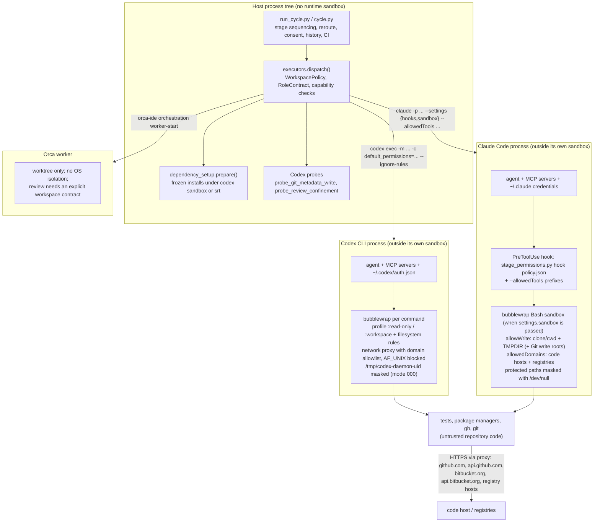
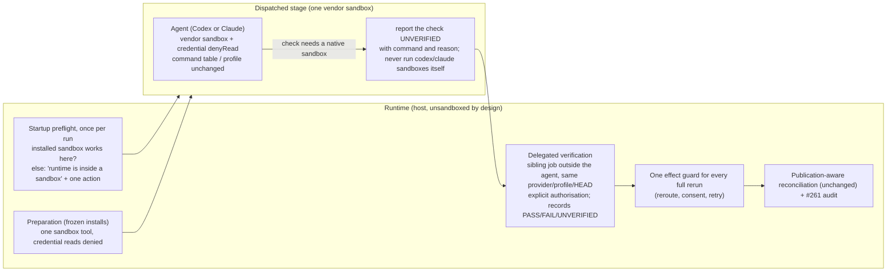

# Sandbox isolation audit: executors, boundaries and recovery (consolidated)

**Repository:** `datacas/code-cycle-toolkit`  
**Audit date:** 2026-10-20  
**Baseline:** `main` at `310d7067864ac9d09a864a46bb4a62d8e78a0eb2` (`feat(runtime): prepare Node stages and honor project tool choices (#287)`), clean tree except the untracked `docs/research/` directory.  
**Host:** Ubuntu 22.04.5 on WSL2 (kernel 6.18.33.2), uid 1000, unprivileged user namespaces available (`user.max_user_namespaces` 79955). Codex CLI 0.163.0, Claude Code 2.1.304, `@anthropic-ai/sandbox-runtime` (`srt`) 0.0.81, bubblewrap 0.9.0, socat 1.7.4.1, ripgrep 15.2.0, Node 22.23.2 / npm 10.9.8, Python 3.10.12. Orca (`orca-ide`) is not installed on this host.

This document consolidates two independent audits of the same question, both run on 2026-10-20 against the same commit: one from an unsandboxed host shell (Claude Code session), one from inside a Codex session's own command sandbox. The two reached the same substantive recommendation; each could verify things the other could not. Their original texts and raw evidence are kept under `docs/research/evidence/isolation-audit-2026-10-20/` (`sources/`, `host-session/`, `codex-session/`). Nothing in the repository was modified, committed, branched, published or installed by either audit; the only lasting side effect is preparation evidence and an npm cache under `~/.local/state/code-cycle-toolkit/preparation/`, the runtime's ordinary location, written by the host-side experiment E5.

**Naming.** In this repository "Orca" is the optional `orca-ide` executor (`OrcaAdapter`, `scripts/executors.py:2717`). It launches workers in Orca-managed worktrees, provides no OS-level isolation, and Orca's own documentation says a worktree is not a security sandbox. The component that dispatches stages, applies policy and recovers from failures is the runtime (`scripts/run_cycle.py`, `scripts/cycle.py`, `scripts/executors.py`). "Runtime" below is what the audit request called "Orca".

**Evidence classes used.** *Observed*: executed on this host today, output quoted. *Implementation*: read in the baseline code, with symbol and 1-based line. *Historical*: issue, PR or session-log text. *Inferred*: documentation plus adjacent evidence; marked as such.

---

## A. Executive summary

The premise under investigation was that the toolkit stacks a runtime sandbox on top of the native Codex and Claude sandboxes, and that this double isolation is what breaks nested Codex, dependency preparation and the Claude review suite. Code and experiments do not support it.

**There is no runtime OS sandbox.** Every dispatched command runs under exactly one OS-enforced sandbox: the executor's own (Codex's bubblewrap permission profile, or Claude Code's bubblewrap Bash sandbox). The runtime adds policy, not isolation: a per-stage command table and `PreToolUse` hook for Claude, permission-profile arguments and `--ignore-rules` for Codex, a disposable detached clone for read-only stages, a per-dispatch `TMPDIR`, before/after fingerprints, publication-aware reroute reconciliation, and person-only sensitive grants. Each carries a guarantee no vendor sandbox provides; removing one removes a guarantee, not a redundancy.

**Nested vendor sandboxes fail in every combination, and the toolkit never nests them itself.** From a plain host shell, `codex sandbox -- codex sandbox -- true` fails because Codex overmounts `/tmp/codex-daemon-<uid>` with a read-only mode-000 tmpfs for the commands it runs (E1, E2; upstream `bwrap.rs` applies that mask deliberately). Codex inside Claude's sandbox, Codex inside `srt`, and `srt` inside anything also fail, each for a different reason (E3, E4). So a nested native verification is not an option under any candidate architecture. Nesting only occurs when a dispatched agent runs a vendor sandbox as part of its task, or when the whole runtime is started from inside a sandboxed agent session. The only work items that have ever required it are this toolkit validating itself (#142, #268, #279/#288).

**The `srt` prerequisite is toolkit-made.** PR #287 made Claude-side dependency preparation call the standalone `srt` binary (`scripts/dependency_setup.py:103-105`). Claude Code's built-in Bash sandbox needs only bubblewrap and socat; the #274 reproduction ran it on 2026-10-19, before `srt` existed on this host. The prerequisite is legitimate and already covered by the owner's #288 decision (install `srt` and `rg` user-locally without confirmation). On the host, `dependency_setup.prepare` completes for both executors (E5).

**Two recovery defects were confirmed in code**, independent of any sandbox: after a consent answer the same executor reruns without the publication reconciliation gate (AR-004), and persistent grants are consulted only after the first blocked attempt (AR-005).

**Credential reads are open in every stage sandbox** (SSH private keys, `~/.config/gh/hosts.yml`, `~/.codex/auth.json`, `~/.claude/.credentials.json`), while publishing and review profiles allow HTTPS to `github.com` and `api.github.com` (E3, E4, E7). The `gh` token exposure is documented and accepted; the SSH and agent credentials are not needed by any sandboxed command, and both sandboxes can deny them (verified: Codex `=none` rules, `srt` `denyRead`; documented: Claude `denyRead`). This is the one place isolation is weaker than it needs to be, and it is a configuration gap inside the existing layers.

**Verdict: KEEP, with targeted corrections.** Keep both native sandboxes and all runtime policy layers. Fix #274 in the tests. Add a single effect guard to every full stage rerun (AR-004) and hydrate stored grants before the first dispatch (AR-005). Implement `UNVERIFIED` as a durable per-check status and run native campaigns as sibling jobs from the runtime, never from inside an agent. Add credential read-denial to every stage and preparation sandbox. Then specify #289 on the existing consent store. Do not build a runtime-owned sandbox: it would re-implement, for two moving vendor CLIs, what those vendors maintain today, move trusted processes into the untrusted zone, and still not make nesting work.

---

## B. Current architecture

### B.1 Process tree and trust boundaries

Boundaries, from most to least trusted:

1. **Runtime** (`run_cycle.py`): trusted; holds cycle state, consent store and policy; runs with the user's permissions. It must run *outside* any vendor sandbox because its own probes and preparation spawn `codex sandbox` and `srt` (F-08).
2. **Executor agent process** (`codex`, `claude`): trusted with the user's API credentials, MCP servers, plugins and hooks. These run outside the command sandbox on both vendors (`docs/role-workspace-policy.md:26`), which is why the runtime reports pre-approved MCP tools instead of confining them.
3. **Sandboxed commands**: untrusted. PR code, tests, package-manager hooks and `gh` run here. The OS sandbox is the only boundary between repository content and the host. Reach today: read almost everything, write cwd/clone/TMPDIR (+ Git write roots for writers), network to the allowlisted hosts.
4. **Remote code host**: writes are bounded by the stage command table (Claude) or by the prompt plus post-hoc reconciliation (Codex, which has no command table: `docs/host-permissions.md`, "Limitations").

### B.2 Stage inventory

The driver automates five functional roles; the CLI resumes at `implement`, `review`, `resolve`, `rereview`; `issue_review` is inserted by the readiness mode. Five more role contracts exist for auxiliary calls. Contracts: `scripts/cycle.py:103-128`.

| Role | Initiator, profile | Workspace policy | Publication permitted by contract | Isolation actually applied |
|---|---|---|---|---|
| `issue_review` | driver; reviewer / senior_reviewer, one escalation | READ_ONLY | none, not even an issue comment | Codex: `code_cycle_review_read` or registry profile; Claude: detached clone + hook (no Bash sandbox unless registry domains) |
| `implement` | driver; cheap_coder / deep_coder | WORKSPACE_WRITE | comment, create PR, push branch | Codex: `code_cycle_publish_write` after `probe_git_metadata_write`; Claude: `acceptEdits` + table + hook (+ Bash sandbox when registry domains) |
| `review` | driver; reviewer / senior_reviewer | READ_ONLY (clone) | review comment only | Codex: `code_cycle_review_read` + clone after `probe_review_confinement`; Claude: clone + table + hook + Bash sandbox when it may verify |
| `resolve` | driver after findings; coder profile | WORKSPACE_WRITE | comment, push; no new PR | as `implement` |
| `rereview` | driver after resolution | READ_ONLY (clone) | comment only | as `review` |
| `security`, `bootstrap`, `coordinate` | auxiliary | READ_ONLY | none | read-only profile / clone |
| `verify`, `run` | auxiliary | DISPOSABLE | none | Codex disposable workspace |

The model behind a role comes from profiles and signals (`scripts/router.py:372`), not from the role name; on this host deep_coder maps to Codex and reviewer to Claude, which is configuration, not product.

### B.3 Nesting as observed on this host (E2, E3, E4)

| Outer \ Inner | `codex sandbox` | `srt` |
|---|---|---|
| `codex sandbox` | `app-server socket directory must be a user-owned directory with mode 0700` (socket dir masked) | `listen EPERM` on `srt-mux-*.sock` (AF_UNIX blocked) |
| Claude Code Bash sandbox | `bwrap: No permissions to creating new namespace` | `listen EPERM` on `scratch/claude-<uid>/srt-mux-*.sock` |
| `srt` | panic: `failed to resolve synthetic mount registry temp directory /tmp/claude` | `listen EPERM` on `/tmp/claude/srt-mux-*.sock` |

No cell works. Ordinary cycles never produce these situations: preparation and the agent are sequential siblings under the runtime. They arise only when an agent runs a vendor sandbox as part of its task, or when the runtime itself is started inside a sandboxed session (the Codex-session audit ran in that topology, which is why its E1, E3, E4, E5 could not execute).

### B.4 Completion, publication and resumption

`run_cycle` interprets the structured result, records findings and verification, and picks the next role; readiness escalates at most once; approval needs a clean review contract and the applicable CI policy; the end state is ready-for-manual-merge, never a merge. On resume it identifies workspace and PR, syncs history from trusted authors, keeps attempts with pending publications, and recovers missing results only from published evidence with structural verification. A per-machine SQLite lock per PR prevents two local drivers; `--continue` requires existing work and the right checkout. Cursors observe progress; they are not checkpoints of an agent command.

---

## C. Component inventory

| File / symbol | Lines | Responsibility |
|---|---|---|
| `run_cycle.main` (`scripts/run_cycle.py`) | 3941–4151 | CLI, configuration, consent broker, telemetry, run/interrupt |
| `select_workspace` | 1506–1628 | task worktree or current workspace; not a security boundary |
| `run_cycle` | 2131–3234 | functional state machine, history, dispatch, CI |
| `check_continuation`, `recovery_evidence` | 1747–1779; 1897–1982 | resume guards; recovery from trusted publications/receipts at the right HEAD |
| `_test_outcome` / `_checks` | 3528–3595; 3600–3625 | evidence of tests vs claims; code-host checks for the SHA (`checks` already holds CI counts) |
| `CycleRecorder.stage` (`scripts/cycle.py`) | 403–988 | routing, role contracts, up to three attempts, reconciliation, grants, telemetry |
| `ROLE_CONTRACTS` | 103–128 | workspace policy and publication permissions per role |
| writer probe gate | 602 | `probe_git_metadata_write` before a publishing Codex writer |
| blocker and reroute gate | 819–870; `reroute_gate` 763–775 | agent-reported blocker or hook-denied Docker → `environment_restricted`; one reroute after `reroute.reconcile` |
| consent rerun | 895–938 | rerun after a grant answer; reconciles only when the target changed (AR-004) |
| `executors.dispatch` (`scripts/executors.py`) | 2969–3251 | readiness, capability checks, workspace policy, isolation selection (read-only routing 3184–3215) |
| `NativeAdapter.dispatch` | 1122–1316 | policy preflight, dependency preparation, scratch `TMPDIR`, run, classification |
| `_native_review_scratch` | 132–193 | per-dispatch `code-cycle-tmp-*` outside the checkout; Codex rule or `--add-dir`; `TMPDIR` |
| `CodexAdapter` | 1482–1987 | `argv` 1799–1876 (profiles `code_cycle_publish_*`, `code_cycle_registry_*`, `code_cycle_review_read`, `code_cycle_write`; `features.network_proxy`; domain allowlists; Git common-dir protections #229; `--ignore-rules`; Unix sockets only under `docker_host`); `probe_git_metadata_write` 1603–1757; `probe_review_confinement` 1878–1946 |
| `ClaudeAdapter` | 2389–2683 | `policy_preflight` 2434–2461; `policy_files` 2476–2531 (hook + `review_sandbox_settings` when verifying or registries); `argv` 2592–2643 (`acceptEdits`/`default`, `--allowedTools`) |
| `_isolated_review_dispatch` | 2239–2386 | detached clone without remotes at reviewed HEAD; before/after HEAD, status, remote refs; `read_only_mode` `detected`/`enforced` |
| `_publication_preflight` | 680–728 | credentials and `git push --dry-run`; does not prove transport from inside the sandbox (#284) |
| `OrcaAdapter` | 2717–2915 | async worker receipt; `enforces_read_only = False` (2730) |
| `StagePolicy` / `check` (`scripts/stage_permissions.py`) | 108–190; 399–421 | immutable per-stage policy; command syntax/argument/redirect validation |
| `_check_words` | 477–511 | Git/gh/Docker invariants before user-chosen tools |
| `allowed_tool_patterns`, `hook_settings`, `prompt_note` | 1109–1156; 1171–1176; 1179–1211 | first barrier patterns; `PreToolUse` hook block; agent guidance (#279 search fallback) |
| `SANDBOX_WIDENING_KEYS`, `sandbox_override` | 1322; 1329–1342 | refuse dispatch when settings widen the sandbox |
| `REVIEW_SANDBOX_DOMAINS`, `review_sandbox_settings` | 1467; 1470–1484 | Claude Bash sandbox: `failIfUnavailable`, no unsandboxed fallback, clone+TMPDIR writable, code hosts + registries |
| `dependency_setup.sandbox_command` / `prepare` | 79–116; 226–388 | Codex profile or `srt` JSON (only the `srt` branch denies credential reads); frozen install in a staged copy, cache, evidence |
| `environment_recovery` | guidance 19–55; `sandbox_blocker` 57–90 | prompt text naming the nested-Codex limit; strict parser for `environment_blocker`, never a grant |
| `grants.py` | `DOCKER_HOST` 94–125; `ConsentStore` 163–215; `ConsentBroker` 270–358 | person-only grants, `cycle`/`persistent`/`deny`, scope fingerprint, `permission_required` stop; `granted()` reads memory only (AR-005) |
| `reroute.effect_snapshot` / `reconcile` | 47–127 | stops on `evidence_unavailable`, `dirty_workspace`, `workspace_changed`, `remote_changed`, `publication_changed` (own-account publications, #277) |
| `user_choices.load` | 15–42 | validated `tools`, `commands`, `integrations`, `registry_domains` carried into every stage |
| `cycle_history.acquire`, `expect_publication` | 234–258; 524–571 | per-PR local lock; pending publication record (idempotent record, not exactly-once execution) |
| `issue_review.assess` | 368–406 | READY only with coherent result, evidence and identity |

---

## D. Confirmed findings

Severity reflects impact on the architectural decision and on security.

**F-01 · High · One OS sandbox per process; the runtime adds policy only.** *Implementation.* `CodexAdapter.argv` and `ClaudeAdapter.argv` pass vendor flags and settings; `_native_review_scratch` adds the scratch directory to the vendor's own rules; `OrcaAdapter.enforces_read_only = False`. The runtime invokes a sandbox binary itself only in its probes and in `dependency_setup`, on the host. The "double sandbox" premise does not describe the normal path.

**F-02 · High · Vendor sandboxes cannot nest, in any pair, and the causes differ.** *Observed* (B.3). No single workaround exists and none is caused by the runtime. Any design asking a sandboxed agent to run another vendor sandbox is infeasible; native verification must be delegated to a process outside the agent's sandbox. The runtime already has that pattern and it works on the host (E1, E5).

**F-03 · High · Codex masks `/tmp/codex-daemon-<uid>` deliberately; `TMPDIR` and profiles are not involved.** *Observed* (E1): inside `codex sandbox` the directory is `d---------` on a `tmpfs rw,mode=000` read-only mount, while `$TMPDIR` and the rest of `/tmp` are visible; on the host it is `drwx------`. *Upstream*: `codex-rs/linux-sandbox/src/bwrap.rs` (`append_daemon_socket_masks`) and `codex-rs/uds` (reserved 0700 directory, fixed under `/tmp` by uid, independent of HOME/TMPDIR/CODEX_HOME). Consequence: chmod, another `TMPDIR`, `CODEX_HOME`, `--no-daemon` or a Unix-socket grant cannot fix it (#268 Q-002 rules widening out anyway). #288 acceptance criterion 3 is satisfied by this evidence; its 0700-directory remedy was already dropped.

**F-04 · Medium · The `srt` prerequisite belongs to `dependency_setup`, not to Claude Code.** *Implementation*: `sandbox_command` raises without `srt`. *Documentation*: Claude's built-in sandbox needs bubblewrap and socat; `ripgrep` is bundled by Claude Code and resolved from PATH only by the standalone runtime. *Historical*: #274's reproduction ran the Claude sandbox on 2026-10-19; #288 reports `srt` absent on 2026-10-20. Detect, install user-locally and report it, as decided; it is not evidence of a layering conflict.

**F-05 · High (security) · Sandboxed commands can read credential stores in every stage; publishing and review profiles reach GitHub.** *Observed*: under `codex sandbox` the probe read the first byte of `~/.ssh/asgard_dev_deploy`, `~/.config/gh/hosts.yml`, `~/.codex/auth.json`, `~/.claude/.credentials.json` (E7); under Claude's review sandbox the same stores tested readable and `api.github.com` returned 200 while `example.com` was denied (E4); under `srt` with the preparation `denyRead` list, `~/.ssh` and `~/.config/gh` were denied but the two agent credential files stayed readable (E3). `docs/host-permissions.md` ("Reviewers verify in a confined clone") accepts the `gh` exposure. Consequence: untrusted verification code has an exfiltration channel (read a key, send it in an authenticated GitHub API call). SSH keys and the two agent credential files are not needed by any sandboxed command: the agent processes read their own credentials outside the sandbox; pushes use HTTPS with the `gh` helper; raw SSH is not proxied (H-03, #284). Both sandboxes can deny them: Codex `permissions.
.filesystem={"/home/u/.ssh"="none"}` hid the directory and denied `hosts.yml` (E7); `srt` `denyRead` did the same (E3); Claude documents `sandbox.filesystem.denyRead`. Not an exploit demonstration: no credential content was exfiltrated.

**F-06 · Medium · #274 is Claude's protected-path masking plus a test that copies the whole clone.** *Observed* (E4): `.claude/agents`, `commands`, `hooks`, `launch.json`, `.bashrc`, `.gitconfig`, `.mcp.json` appear as `crw-rw-rw- nobody nogroup 1, 3` (character devices bound from `/dev/null`); `cat .claude/settings.json` → EACCES. The Codex-session audit reproduced the copy failure synthetically with `ValidatePackageTests.copy_package` (`tests/test_validate_package.py:22-31`) against an unreadable `settings.local.json`. The second failing test (`tests/test_executors.py:2810-2818`) assumes another writable temp parent exists. Fix the tests (copy tracked entries only; test-controlled temp parent); do not change `review_sandbox_settings`.

**F-07 · Medium · Preparation has two sandbox code paths with asymmetric protection.** *Implementation*: `sandbox_command` builds a Codex profile string for Codex and an `srt` JSON for Claude; only the `srt` branch denies credential reads; the Codex branch repeats profile logic that `CodexAdapter.argv` also has. The step that runs package managers on PR-controlled lockfiles is better protected under Claude than under Codex for no security reason.

**F-08 · Medium · No preflight detects a runtime started inside a vendor sandbox.** *Implementation*: `run_cycle.py` is launched by the orchestrator skill from the user's session; its probes and `prepare` spawn `codex sandbox` and `srt`, which fail inside any sandbox (F-02). *Observed*: the Codex-session audit's `environment.json` shows exactly that topology (`codex` as PID 1 of a PID namespace, `NoNewPrivs:1`, `Seccomp:2`, daemon directory masked). PR #277 records the Codex-session case as residual risk; the Claude-session case (`sandbox.enabled` in user settings, currently `false` here per `claude sandbox status`) is undocumented. The failure would surface mid-cycle as `precondition` or `environment_restricted` instead of a one-line startup diagnosis.

**AR-004 · High · A rerun after a consent answer skips the publication reconciliation when the executor is unchanged.** *Implementation*: `scripts/cycle.py:905-938`: `safe` is computed from process exit, non-asynchronous and no human action; `reroute_gate()` is called only when `consent_decision is not decision`. *Observed* (Codex-session E8, fake adapter, snapshots `CLEAN → publication changed`): two dispatches, the second with `docker_host`, despite the changed publication; no real executor, grant or publication involved. A stage that published before the grant can be repeated blind. This violates the #268 invariant through a path #277 did not cover.

**AR-005 · Medium · Persistent grants are hydrated too late to avoid the first failed attempt.** *Implementation*: `ConsentBroker.granted()` (`scripts/grants.py:290`) reads `granted_ids` only; the store, pre-authorisation and `--grant` answers are consulted inside `request()`, after a blocker. *Observed* (Codex-session E9, temporary store): `granted('codex')` is empty before `request()`, `persistent` on request, then `['docker_host']`. A stored grant avoids the second question but not the first failure and full rerun (#289).

**AR-007 · Medium · Reconciliation of retries is not the post-stage publication audit of #261.** *Implementation*: `reroute.effect_snapshot`/`reconcile` serve retry decisions; nothing checks after every successful publishing stage that the PR is not merged or closed, that the branch advanced fast-forward only, and that no protected ref was deleted. `_publication_preflight`'s dry-run checks readiness, not effects. Keep #261 separate; no automatic rollback.

**AR-008 · Medium · Current recovery differs from the #288/#289 decisions, and #288's illustrative contract collides with an existing field.** *Implementation*: `scripts/cycle.py:833-870` may reroute an `environment_restricted` attempt to the fallback executor; `executors.dispatch` 3191–3215 stops a whole review when confinement is unproven; `checks` at the result root already carries CI counts consumed by `_checks` (`run_cycle.py:3600`). #289 decision 2 forbids executor switches for sandbox limits; #288 decision 2 says degrade to `UNVERIFIED` first. `UNVERIFIED` does not exist in runtime code (`grep -lw UNVERIFIED scripts/*.py` → none); the result vocabulary has `not_verified`. Per-check status needs an additive field (for example under `tests`), not the `checks` key and not a new cycle state.

**F-09 · Low · Sandbox-restriction detection is runtime-observed for Claude and agent-reported for Codex.** *Implementation*: `ClaudeAdapter.extra_artifacts` collects `permission_denials` and hook denials; `denied_docker_blocker` turns a hook denial into a grant request without trusting the agent. For Codex only the agent's `environment_blocker` JSON exists, validated for shape and treated as a hint. #289's detection step needs a runtime-observed signal for Codex (`_session_events` already reads rollouts).

---

## E. Unconfirmed hypotheses

| ID | Hypothesis | Status | Test that would settle it |
|---|---|---|---|
| H-01 | Codex can run as an agent inside a runtime-owned `srt` sandbox using its `ExternalSandbox` policy (basis for Architecture C). | Not tested. The policy exists in `codex-rs/protocol`; `--dangerously-bypass-approvals-and-sandbox` is documented for externally sandboxed environments; but `codex exec` is a different interface from the App Server `externalSandbox`, and the daemon needs an AF_UNIX socket that `srt` blocked in E3. | `srt --settings <allow /tmp/codex-daemon-<uid> write; allow api.openai.com, chatgpt.com> -- codex exec --dangerously-bypass-approvals-and-sandbox 'print ok'`; one model call. |
| H-02 | Claude Code's built-in Bash sandbox works with no `srt` on PATH. | Inferred from vendor docs and the dated #274 reproduction. | Run E4 with `srt`'s directory removed from PATH. |
| H-03 | Raw SSH never works from inside a stage sandbox, so denying `~/.ssh` reads loses nothing. | Supported by #284 and the proxy design (HTTP(S)/SOCKS5 only); not executed. | `ssh -T git@github.com` under a publishing profile; expect failure. Repositories with SSH remotes need HTTPS + `gh` helper first. |
| H-04 | If the runtime posted review comments on the agent's behalf, review sandboxes could deny `~/.config/gh` and all network except registries, and #261 would simplify. | Design question. | Prototype: stage writes `$TMPDIR/pr-comment.md`; runtime publishes after exit and reconciles. |
| H-05 | Codex's unreadable (`=none`) rule behaves identically under `codex exec` profiles and `codex sandbox`. | Verified only via `codex sandbox` (E7). | A Codex `issue_review` stage whose task reads a key under the rule; one model call. |
| H-06 | A concrete Orca installation adds a container or sandbox around workers. | Not shown; Orca docs say the worktree is not a sandbox; `orca-ide` absent here. | Inspect a real installation's receipt, launch arguments and mount namespaces. |
| H-07 | The `listen EPERM` of nested `srt` comes from the outer seccomp AF_UNIX filter rather than another restriction. | Compatible with the documented policy; not traced per syscall. | `strace`-style probe in a lab sandbox. |
| H-08 | Permission decisions behave the same on macOS (Seatbelt) and Windows. | Only WSL2 observed. | Platform matrix of E1, E3, E7. |
| H-09 | `.claude/.cc-writes`, seen inside the review clone during E4, is Claude Code sandbox bookkeeping, not toolkit output. | `grep cc-writes scripts/*.py` → none. | Run the sandbox on an empty directory. |

---

## F. Security matrix

A = keep current; B = native-only (drop runtime policy layers); C = runtime-owned sandbox, vendor sandboxes off; D = adaptive hybrid. The runtime and explicit user decisions are the trusted base; repository content never gains authority by appearing in a prompt or file.

| Threat | Current control and limit | Residual risk today | A | B | C | D |
|---|---|---|---|---|---|---|
| Malicious PR code run as a test | vendor OS sandbox per command; writes limited to clone/cwd/TMPDIR; network allowlist | reads credentials (F-05); exfiltration via allowed hosts | keep; add read-denial | same sandbox, same gap | equivalent only if `srt` is configured identically; new maintenance surface | same as A |
| Malicious instructions in repository files | command table + hook (Claude); profile + `--ignore-rules` (Codex); clone discarded; publication reconciliation | Codex has no command table; MCP tools run outside | keep | loses table and reconciliation | unchanged (prompt-level) | same as A |
| Dependency install scripts | frozen installs, lifecycle scripts disabled, staged copy, reduced env/HOME, registry-only network | Codex branch lacks read-denial (F-07) | keep; align or unify | agents would install ad hoc inside their stage | same step | same as A |
| SSH keys, `gh`, Codex and Claude credentials | none for reads in stage sandboxes; `srt` preparation denies three stores | readable (F-05) | deny in every profile | same gap | same if configured; agent credentials move inside | same as A |
| Reads outside the workspace | vendor default: read everywhere | accepted for sources; secrets as above | optional narrowing | same | same | same |
| Writes outside authorised paths | `--ro-bind / /` with explicit binds; Git common dir read-only (#229); Claude protected paths | none observed (E3, E4, E7) | keep | keep | must be re-implemented | keep |
| Local network / internal services | network namespace removed; proxy with allowlist; `allowLocalBinding=false`; local IP literals blocked unless allowlisted | none observed | keep | keep | re-implemented via `srt` proxy | keep |
| Outbound exfiltration | allowlist; `example.com` denied in all three sandboxes | allowed hosts are exfiltration-capable with the `gh` token | keep; H-04 would close it for reviews | same | same | same |
| Docker daemon | `docker_host` grant, person-only; Codex Linux opens *all* AF_UNIX sockets; Claude limits to `docker compose up/down/ps/logs/build` | wide Codex scope, stated in the question | keep | keep | `srt` can allow single sockets | keep |
| Privileged Unix sockets, privilege escalation | AF_UNIX blocked in proxy mode; daemon mask; `PR_SET_NO_NEW_PRIVS` + seccomp; `--unshare-user/pid`; caps dropped | none observed | keep | keep | `srt` equivalent | keep |
| Unauthorised merge / force-push / ref deletion | Claude: table + hook; Codex: prompt + reconciliation; #261 pending | Codex writers can publish anything within allowed hosts; executed code/MCP can bypass the table | keep; complete #261 | loses hook and reconciliation | unchanged | keep |
| Duplicate publication after a retry | snapshots, history, receipts | AR-004 gap on consent reruns | fix the guard | fix | a container does not help | fix |
| Interference between concurrent cycles | per-dispatch `TMPDIR`, disposable clones, fingerprints, per-PR lock | not cross-host | keep | partially lost | keep | keep |
| Re-use of authorisations across stages | `ConsentStore` by repo and scope fingerprint; `user_choices` per project | #289 lifecycle incomplete; AR-005 | keep; specify #289 | — | — | keep |
| False PASS / wrong commit | structured contracts, evidence, full SHA, CI/receipts | agent evidence is self-reported | keep | keep | a sandbox proves nothing about results | per-check command/exit/HEAD; absence never passes |

Constraint respected: no recommendation weakens isolation against untrusted code; the only isolation change tightens it.

---

## G. Architecture comparison

### G.1 The four options

**A. Keep the current isolation.** One vendor OS sandbox per process, runtime policy around it, host-side probes and preparation. Required corrections: F-05, F-06, F-07, F-08, AR-004, AR-005, AR-008. Nothing in the known failures requires removing a layer.

**B. Isolation exclusively native.** Drops the command table and hook, the clone and fingerprints, the reconciliation and the grants. Claude has no read-only mode and no per-command network policy beyond the settings the runtime passes; Codex has no command table, so publication control would be prompt-only; duplicate publications would be undetectable. Lowers guarantees; rejected.

**C. Isolation centralised in the runtime.** The runtime starts each agent inside its own `srt`/bubblewrap sandbox and disables the native one (Claude: `sandbox.enabled=false` + `--dangerously-skip-permissions`, a documented path via `npx @anthropic-ai/sandbox-runtime claude`; Codex: `--dangerously-bypass-approvals-and-sandbox` or `ExternalSandbox`, present but not CLI-documented, H-01). Effects: the agent process, its credentials, MCP servers, plugins and hooks move inside the sandbox and their credentials must be readable by sandboxed commands; Codex's per-command profile switching and Git protections and Claude's protected-path masking would be re-expressed as one static `srt` policy per stage maintained by the toolkit; nesting is not solved (E3: `codex sandbox` inside `srt` panics); every host needs `srt`, `rg`, bubblewrap, socat and daemon-socket allowances. Rejected: more toolkit-owned isolation, no fewer problems.

**D. Adaptive hybrid.** Uniform runtime contracts with the compatible mechanism per executor, verification delegated to a separate process when the agent cannot run it, preparation owned by the runtime, explicit handling of extra permissions, no silent degradation. This describes the code that exists plus the two delegation patterns already present. The additions that are not there yet (`UNVERIFIED` as a check status, runtime-run native campaigns, consistent credential denial, the shared rerun guard) are corrections to A, not a different architecture. A hybrid that probed combinations, relaxed restrictions on failure or switched executors opportunistically would add complexity and contradict #289; that variant is rejected.

### G.2 Assessment

Qualitative (strong / adequate / weak); "n/e" = no evidence either way.

| Dimension | A (keep + fixes) | B (native only) | C (runtime-owned) | D (= A + delegation) |
|---|---|---|---|---|
| Security vs untrusted code | adequate → strong after F-05 | weak (no publication control) | adequate; moves credentials inside | same as A |
| Compatibility (Codex, Claude, future) | strong: vendor flags only | strong | weak: Codex `ExternalSandbox` untested | same as A |
| Reliability | adequate; observed failures were dogfooding, fixtures, recovery defects | n/e | weak initially | adequate → strong with delegation |
| Autonomy | adequate; improves with #288/#289 | lower | n/e | strong |
| Simplicity | 1 OS layer + 11 policy mechanisms | fewer mechanisms, fewer guarantees | +1 toolkit OS layer, −2 vendor layers, same policy mechanisms | A + 1 status field + 1 delegated runner |
| Maintainability | adequate: vendor changes surface as flag changes | adequate | weak: bwrap/proxy semantics tracked per vendor | same as A |
| Portability | strong: vendors cover Seatbelt and Windows | strong | weak: `srt` Windows needs elevated install | same as A |
| Performance | one sandbox start per command (vendor); no end-to-end benchmark exists | same | one long-lived sandbox per stage | same as A |
| Recovery | adequate; AR-004/AR-005 to fix | weak | n/e | strong with `UNVERIFIED` + delegated reruns |
| Testability | strong: probes exercise the installed sandbox; 193 policy/recovery test methods in seven files | weaker | weak until an equivalence suite exists | same as A |
| Extensibility | adequate: `user_choices` into tables and profiles | adequate | adequate | same |
| Migration risk | low | high | high | low |

### G.3 Complexity measurement

AST counts on the baseline (`evidence/.../codex-session/complexity.json`):

| Module | Lines | Functions | `if` | `try` |
|---|---:|---:|---:|---:|
| cycle.py | 1262 | 23 | 110 | 6 |
| executors.py | 3251 | 110 | 310 | 48 |
| run_cycle.py | 4155 | 128 | 426 | 57 |
| reroute.py | 127 | 7 | 16 | 0 |
| environment_recovery.py | 155 | 6 | 9 | 2 |
| grants.py | 397 | 22 | 31 | 3 |
| stage_permissions.py | 1540 | 62 | 227 | 9 |
| dependency_setup.py | 388 | 15 | 38 | 4 |
| user_choices.py | 42 | 1 | 7 | 0 |
| issue_review.py | 406 | 12 | 55 | 1 |
| **Total** | **11723** | **386** | **1229** | **130** |

`CycleRecorder.stage` alone is 586 lines with 70 `if`; `run_cycle` 1104 lines with 130 `if`. Much of that is routing, effort/model handling, telemetry and functional state, not sandboxing; removing a sandbox would not remove it.

| Measure | Value |
|---|---|
| OS isolation layers per dispatched command | 1 |
| Runtime-owned sandbox call sites | 3 (`probe_git_metadata_write`, `probe_review_confinement`, `dependency_setup.sandbox_command` with 2 branches) |
| Policy mechanisms | 11: Codex profiles; Codex `--ignore-rules`; Claude `--allowedTools`; Claude `PreToolUse` hook; Claude `--settings sandbox`; Claude `--permission-mode`; `grants.py` consent; `user_choices`; `host_permissions.py` (interactive sessions only); `TMPDIR` helper rules; disposable clone + fingerprints. Six decision families: role contract, tool table, argument/edit validation, OS filesystem/network rules, sensitive consent, effect reconciliation |
| Reroute/stop reason tokens | 11 in `reroute`/`cycle`: `evidence_unavailable`, `dirty_workspace`, `workspace_changed`, `remote_changed`, `publication_changed`, `retry_exhausted`, `calibration`, `no_fallback`, `fallback_unavailable`, `permission_required`, `environment_restricted`; plus `exit_unproven`, `human_action`, `not_started`, `no_effects`, `permission_answered` in the gate |
| Executor-specific adaptations | Codex: profiles, Git write roots (#229), Unix-socket grant, `--ignore-rules`, session-event fallback. Claude: hook, patterns, sandbox settings, widening check, `claude-<uid>` TMPDIR subdirectory (#280) |
| Special-case references in `scripts/` | `#229` 5, `docker_host` 17, `unix_sockets` 5, `nested` 6, `codex-daemon` 1, `srt` 6, `bubblewrap` 2 |
| Stops possible before the model runs | 6: policy preflight (hook override, tool-check mods, sandbox widening), Codex writer probe, Codex review-confinement probe, clone preparation, no scratch parent, dependency preparation error (non-fatal) |
| Tests touching sandbox terms | 13 of 45 files, 13,155 lines; 193 test methods in the seven core regression files (recovery 19, reroute 10, grants 17, permissions 73, preparation 19, dispatch 32, Git sandbox 23) |
| Cost of a new native executor | one `NativeAdapter` subclass (`argv`, `publication_access`, `auth_evidence`, markers), optional probes, one entry per grant-options map, one `sandbox_command` branch (zero after unifying preparation), stage-table patterns if it has a hook mechanism; `RoleContract`/`StagePolicy` reused |

Necessary complexity: isolation of repository code, exact SHA, informed permissions, proven exit, non-duplication, scratch, evidence. Accidental complexity demonstrated: a confined job supervising another sandbox (nesting), fixtures that copy masks, failing once before applying a known grant, the consent rerun outside the shared guard, duplicated profile construction between `CodexAdapter` and `dependency_setup`. Justified consolidation: one guard for every full rerun; one preparation sandbox tool; `grants.py` and history reused for pending checks. Not justified: deleting adapters, a new policy engine, or claimed maintenance savings without a prototype.

---

## H. Experimental results

Tool versions as in the header. "Observed" outputs are quoted in `evidence/isolation-audit-2026-10-20/host-session/experiments.md` (host session) and the `E*.json` files under `codex-session/` (Codex session, with full argv, cwd, exit, stdout/stderr and SHA-256 manifest).

| ID | Purpose | Host session (unsandboxed) | Codex session (inside its sandbox) |
|---|---|---|---|
| E1 | Codex sandbox, minimal operation | **Executed.** `codex sandbox --permission-profile p -c 'permissions.p.extends=":read-only"' -- /usr/bin/true` → exit 0. Inside: `/tmp/codex-daemon-1000` is `d---------` on `tmpfs rw,mode=000` read-only; `$TMPDIR` and `/tmp` otherwise visible. | Not executable (would be E2). Procedure for an external runner recorded. |
| E2 | Nested Codex | **Executed.** `codex sandbox -- codex sandbox -- /usr/bin/true` and the profile variant → `error building bubblewrap command: app-server socket directory must be a user-owned directory with mode 0700`, exit 1. | **Executed.** Same error; `environment.json` shows two mask entries over the path after binds. |
| E3 | Claude runtime (`srt`) and prerequisites | **Executed.** `srt` with the preparation shape: scratch writable, clone and HOME denied, `example.com` → 403 from proxy, `api.github.com` → 200, Docker socket refused. Nesting: Codex in `srt` panics (`/tmp/claude` synthetic-mount dir missing); `srt` in Codex and `srt` in `srt` → `listen EPERM`. | **Partial.** `srt` cannot create its mux socket inside the outer Codex sandbox (`listen EPERM`); dependency presence verified; no Claude session started. |
| E4 | Claude review sandbox, masked files | **Executed** (one `claude-haiku-5-5` call with `review_sandbox_settings`). Sandbox started; protected paths are `/dev/null` character devices; `cat .claude/settings.json` → EACCES; credentials readable; TMPDIR and clone writable, HOME denied; `example.com` denied (`sandbox_violations`), `api.github.com` 200; nested `codex sandbox` → no user namespaces; nested `srt` → `listen EPERM`. | **Synthetic.** `copy_package()` fails with Permission denied when a mode-000 `settings.local.json` is planted in a temporary clone; validator suite (70 tests) and 511 targeted tests pass in a Git clone outside the Claude sandbox. |
| E5 | Dependency preparation | **Executed.** `dependency_setup.prepare` on a throwaway npm project: `status prepared` for `codex` (via `codex sandbox` + network proxy) and for `claude` (via `srt`); `npm ci --ignore-scripts ...` exit 0 in both. | **Executed, failed by topology.** Both executors `incomplete` before `npm --version`: Codex cannot reserve proxy listeners, `srt` cannot create its socket, inside the outer sandbox. Fixture tests for preparation pass. |
| E6 | Delegated verification | **Design confirmed by E1/E5**: the runtime's probe and preparation form (`codex sandbox ... -- python -c ...`, `srt -- ...`) succeeds on the host where the nested form fails. Full `tests/native_dependency_campaign.py` not run. | **Capability analysis.** A confined session cannot delegate out of itself; procedure for an authorised external coordinator recorded (same provider, profile, HEAD, scratch; no publication rights). |
| E7 | Negative controls | **Executed (OS level).** Under `codex sandbox`: HOME, cwd, `/tmp`, `.git` writes denied; DNS fails; Docker socket refused; credential stores readable. With `=none` rules: `~/.ssh` hidden, `hosts.yml` denied. Under `srt` `denyRead`: same. | **Executed (policy level).** `StagePolicy(review, tools=(futurefmt,))`: `futurefmt --check src` and `git status` allowed; force-push, merge, Docker without grant, redirect outside TMPDIR, generic `printenv`, unauthorised `curl` denied (8 decisions). |
| E8 | Consent rerun after publication change | — | **Executed** (fake adapter, no effects): two dispatches, second with `docker_host`, despite `pulls changed`. → AR-004. |
| E9 | Persistent grant before first dispatch | — | **Executed** (temporary store): empty before `request()`, `persistent` on request, grant afterwards. → AR-005. |

Not executed anywhere: H-01, H-02, H-03, H-05, H-07, H-08; a full cycle on a host without `srt`; `tests/native_dependency_campaign.py` from the host; any end-to-end cycle with models. Lab mistakes excluded from findings (Codex session): a first file copy without `.git` (19 failures, repeated in a Git clone and passed), a profile serialised as JSON instead of TOML (rejected by the parser), and the obsolete `codex sandbox linux` subcommand.

---

## I. Recommended architecture

Keep the single-OS-sandbox-per-process model and make the delegation that already exists explicit.

Why it is preferable: it changes no boundary that protects the host from repository code and tightens the one that was looser than necessary; it removes the nesting class of failures by never nesting, the only option the experiments leave open; it keeps vendor-maintained isolation where the vendors maintain it; it needs no new state machine (`UNVERIFIED` is a check status inside a stage result). "One effective owner of isolation per workload" means the runtime chooses a sufficient boundary, records who applies it, and never adds another incompatible sandbox builder from inside; authorisation and publication controls stay because they protect different properties.

States and situations (existing vocabulary only):

| Situation | Conduct |
|---|---|
| Executed test fails | `FAIL` of the check; keep logs and HEAD; not a model problem |
| Binary or prerequisite missing | environment diagnosis; routine authorised preparation when applicable; otherwise check `UNVERIFIED` |
| Invalid configuration or credentials | real failure; never inferred as a sandbox limit, never invented |
| Confirmed filesystem/network/socket restriction | no executor switch by itself; authorised equivalent or sibling job |
| `connection refused` | not proof of isolation; check the service and the network view first |
| Timeout, transport, quota | bounded retries; availability fallback per #289 with proven exit and reconciled effects |
| Missing authorisation | no widening; pending or denied request; the check stays `UNVERIFIED` |
| Review cannot verify confined | recover prerequisites; otherwise static review only in a safe read environment; else `BLOCKED` |
| Mandatory criterion without evidence | stays open; approval and closure withheld; progress kept, stage not repeated |
| Ambiguous issue | `NEEDS_REFINEMENT` (readiness only) |
| A human decision is indispensable | `HUMAN_INTERVENTION` at cycle level; not for every pending optional check |

Known drawbacks: credential read-denial can break SSH-only remotes or tests that read credential files (documented opt-out via project configuration, not a silent exception); delegated verification runs on the host under the runtime's permissions and must remain opt-in per check with the exact command shown, never reachable from an agent's report alone; the toolkit's own acceptance campaigns always need the delegated path or a person.

---

## J. Implementation plan

Phases are independent unless stated; isolation, permissions, publication, reroute and states are never changed in the same phase.

| Phase | Objective and components | Dependencies | Risks | Regression and acceptance | Rollback and advance condition |
|---|---|---|---|---|---|
| 0 · Boundary preflight and evidence | Run `probe_review_confinement` (cached) once at cycle start; stop with one named action when the runtime is inside a sandbox; record parent, profile, version. Extend `docs/routing.md:147` with the nesting table; extend `ENVIRONMENT_RECOVERY_GUIDANCE` with "never run `codex`/`claude` sandboxes inside a stage; report the check unverified". `run_cycle.py`, `executors.py`, `environment_recovery.py`, docs. | none | false positive where bubblewrap is genuinely missing (distinguish via `SANDBOX_UNAVAILABLE_MARKERS`); logging too much environment | fake-runner tests for probe outcomes; `codex sandbox -- python3 run_cycle.py ...` stops at startup, terminal launch proceeds; no secrets recorded | independent revert; advance when topology is distinguished from a missing binary |
| 1 · #274 and #280 fixtures | `copy_package` copies tracked entries only (or skips unreadable untracked ones); the executor test uses a test-controlled temp parent. `tests/test_validate_package.py`, `tests/test_executors.py`. | keep `review_sandbox_settings` unchanged | omitting an entry the validator needs | #274 reproduction passes in the real Claude review sandbox and on the host | revert tests only |
| 2 · Shared rerun guard and grant hydration (AR-004, AR-005) | One guard for every full stage rerun including consent reruns (`cycle.py:905-938` uses `reroute_gate()` unconditionally); hydrate applicable stored/pre-authorised grants before the first dispatch (`ConsentBroker.granted()`). | existing snapshots and store | stopping legitimate continuations; widening authority on hydration | E8 stops before the second dispatch; no effects → continue; live process/unknown remote → no rerun; E9 grant present before first attempt; scope fingerprint unchanged | fail closed when it cannot reconcile; advance after publication, workspace, timeout cases |
| 3 · `UNVERIFIED` and delegated native verification (#288) | Additive per-check status field (not `checks`); aggregation that never counts absence as PASS; runtime-run sibling job (`tests/native_dependency_campaign.py` and the Codex probes as first runners) on explicit authorisation; separate records for offer, authorisation, execution and result. `run_cycle.py`, `cycle.py`, `grants.py`, history, skills' result contract. | Phases 0 and 2 | misreporting real failures as `UNVERIFIED` (require command + observed error, as `sandbox_blocker` does); colliding with CI `checks` | #288 AC 1, 2, 4, 5, 6; fake stage reporting `UNVERIFIED` and fake host runner returning PASS/FAIL/timeout; resume compatibility | schema version bump; keep the conservative gating where capability is missing |
| 4 · Credential read-denial and one preparation sandbox (F-05, F-07) | `=none` entries in every Codex profile (after H-05); `denyRead` in `review_sandbox_settings`; preparation under one tool (`srt`) for both executors, or at least the same denials in the Codex branch; documented opt-out. `executors.py`, `stage_permissions.py`, `dependency_setup.py`. | decisions L-1, L-2; H-03, H-05 | breaking SSH remotes or credential-reading tests (surfaces as a denied read in evidence) | `probe_review_confinement` extended with read-denial checks; E7 secrets probe reports denied for all five stores in every profile; `hosts.yml` readable only in publishing roles | independent per executor |
| 5 · #289 grant lifecycle and reroute policy | list/revoke on `ConsentStore`; runtime-observed Codex denial signal (F-09); reroute on `environment_restricted` gated by decision L-3. | Phases 2–3; decisions L-1, L-3 | over-broad authority; late revocation | two issues on the same repo reuse a grant before the first attempt; revocation blocks the next stage; Codex and Claude restrictions produce a request, not a switch | unreadable store grants nothing |
| 6 · #261 publication audit | post-stage check after every successful publishing stage: PR not merged/closed, own branch fast-forward only, no protected ref deleted; Bitbucket explicitly unverified. | independent | attributing other users' actions to the cycle; false confidence | local bare remotes + fake `gh`: merge/force/delete detected, own fast-forward passes, foreign activity no false positive | no automatic rollback; keep the retry guard |

Order: 0, 1 and 6 can start now and in parallel; 2 next; 3 after 2; 4 after H-03/H-05 and L-1/L-2; 5 after L-3. A Phase-C experiment (runtime-owned backend) stays off the critical path and would need adversarial filesystem/network/socket/credential tests and a measured benefit before any adoption; never fall back to an unconfined host if such a backend fails.

---

## K. Implications for the issues

| Reference | State (read 2026-10-20) | Action |
|---|---|---|
| #268 | CLOSED by PR #277 (`f036774`) | Keep closed; cause now reproduced without agent logs (E1, E2). Add the cross-vendor nesting table to `docs/routing.md:147` (Phase 0). Do not read the closure as support for nested Codex. |
| #274 | OPEN | Fix in tests (Phase 1); no sandbox widening; validate on the current HEAD in the real Claude review sandbox. Not blocked on architecture. |
| #279 | CLOSED by PR #287 (= baseline) | Keep the delivered design; E5 shows it works on the host. Residues: the `srt` prerequisite (to #288) and the asymmetric denial in `sandbox_command` (Phase 4). The cold native campaign still needs a run from an external runner with logs and HEAD. |
| #288 | OPEN; decisions updated 2026-10-20 | Refine, then implement (Phases 0 and 3): drop the Codex socket directory as a host prerequisite (nothing on the host can satisfy it) in favour of the startup probe and the no-nesting rule; AC3 met by this report; keep `srt`/`rg` detection and user-local install; `UNVERIFIED` as an additive per-check field, not the `checks` key and not a cycle state. No architectural decision needed first. |
| #289 | OPEN | Build on `grants.py` and `user_choices`; fix AR-005; specify runtime-observed Codex detection (F-09); settle L-1 and L-3 first; resuming an operation is not repeating the stage. |
| #261 | OPEN | Resolve separately (Phase 6); update its context: the Claude table/hook now restricts commands, but the post-stage audit is missing and executed code can bypass the table. H-04 would simplify it. |
| PR #239, PR #266 / #141 | MERGED | Keep the informed Unix-socket consent (Codex Linux opens all sockets, not only Docker) and the per-dispatch `TMPDIR`; neither is a remedy for the reserved daemon directory. |
| #229, #253, #265, #267, #280, #284, #285 | as read | Unaffected by the verdict; #280 is bundled with Phase 1; #284's SSH transport evidence supports H-03. |

Order: #274 and #288 individually; AR-004/AR-005 as their own small change; #289 after L-1/L-3; #261 in parallel; #268 and #279 stay closed. The only architectural decision that must precede implementation is minimal: who starts a native campaign and from which boundary (answer: the runtime on the host, as a sibling job).

---

## L. Pending decisions (product or security authority)

- **L-1 · Deny credential reads in all stage and preparation sandboxes** (Phase 4). Tightens security; costs compatibility for SSH-only remotes and tests that read credential files. Recommendation: yes, with a documented per-project opt-out.
- **L-2 · Run dependency preparation under one tool (`srt`) for both executors**, making `srt` a runtime prerequisite the toolkit installs user-locally, versus keeping two paths and adding denials to the Codex path. Recommendation: one tool; it removes duplicated profile logic and the asymmetry, and #288 already authorises the install.
- **L-3 · Reroute on `environment_restricted`.** Today the runtime may switch executor once; #289 says never for sandbox limits; #288 says degrade first. Recommendation: degrade to `UNVERIFIED` and request a grant first; keep the single reroute for `capacity`, `transport`, `timeout`, `quota` only.
- **L-4 · Persistence of a host-execution authorisation across new code.** #289 wants reuse across issues; #288 forbids extending it automatically to new untrusted code. Recommendation: tool choices persist; a host check on untrusted code is bound to operation, inputs and trust context, never inherited as a licence for arbitrary future commands; an identical, valid authorisation is not asked again.
- **L-5 · Runtime-side publication of review comments** (H-04). Would allow review sandboxes with no `gh` credentials and no network beyond registries and would simplify #261. Larger change; not required by any open issue. Recommendation: evaluate after Phases 0–4.

---

## M. Final verdict

**KEEP.** Maintain the current layering and correct specific defects.

The audit found one OS isolation layer per process, not two. The failures attributed to "layer conflicts" are: nesting, which no combination of the available sandboxes supports and which only toolkit self-validation or a sandboxed runtime launch triggers; a toolkit-introduced `srt` prerequisite the owner has already decided how to handle; a test-suite incompatibility with a documented Claude feature; two recovery defects unrelated to isolation (AR-004, AR-005); and a credential-read gap fixed by configuration inside the existing layers. SIMPLIFY would remove guarantees rather than redundancy; HYBRID describes the design that already exists, and its one missing piece (relocating native campaigns to a sibling job) is a correction, not a different architecture; REDESIGN (Architecture C) adds toolkit-owned isolation without solving nesting and moves trusted processes into the untrusted zone. The evidence is sufficient for this verdict; the open hypotheses affect Phase 4 details and the optional L-5, not the verdict.

**Imprescindible:** AR-004 guard; #274 fixtures; keep isolation of reviewed code; respect #288/#289 without falsifying evidence; #261 in its own change.  
**Recommended simplifications:** native campaigns as runtime sibling jobs, never from a confined agent; one preparation sandbox tool; grants applied before the first dispatch; continue an identified check instead of repeating a stage; credential read-denial in every profile.  
**Optional, conditional:** runtime-side publication (L-5); platform matrix (H-08); a measured Architecture-C prototype off the critical path.  
**Rejected:** disabling native sandboxes; treating a worktree as an OS boundary; enabling all Unix sockets to "repair" nested Codex; `TMPDIR`/`CODEX_HOME` variants for the reserved directory; rerouting Codex→Claude for sandbox limits; automatic host installs or tests; a second consent system; replacing `user_choices` with another allowlist; rewriting components that work.

Surface reviewed in execution: Codex and `srt` sandboxes from the host, Claude's review sandbox with one model call, preparation for both executors, OS and policy negative controls, fake-adapter recovery paths. Not validated in execution: an Orca installation, macOS/Windows, a cold campaign with external dependencies through a full cycle, Codex under an external sandbox, a full end-to-end cycle with models.

---

## Final question

**Is CodeCycleToolkit using more isolation layers than necessary and, if so, what is the minimal simplification that removes the current incompatibilities without weakening its guarantees?**

No, not in the ordinary path: each dispatched command runs under exactly one OS sandbox, the executor's own, and the runtime's layers are policy, each carrying a guarantee no vendor sandbox provides. Yes, in one specific location: when a command that is already confined builds another vendor sandbox, which happens only in the toolkit's self-validation campaigns or when the runtime is started from inside a sandboxed session. The minimal simplification is a relocation, not a removal: the runtime, on the host, launches preparation and native verification as sibling jobs, each under its own native sandbox and profile, and a dispatched agent never runs `codex sandbox`, `codex exec` or `srt` itself; checks it cannot run are reported `UNVERIFIED` and completed by that sibling job on explicit authorisation. Everything else must stay: the daemon mask, the person-only socket grant, the filesystem and network rules, the command table and hook, the clones and `TMPDIR`, the publication invariants. Alongside that relocation, four corrections inside the existing layers remove the remaining operational friction: the #274 fixtures, the shared rerun guard (AR-004), grant hydration before dispatch (AR-005), and credential read-denial in every sandbox profile. The evidence does not support retiring any native sandbox today, nor replacing them with a runtime-owned boundary.

---

## Sources and evidence index

- Repository code at `310d706`, symbols and 1-based lines as cited.
- GitHub (retrieved 2026-10-20): issues #141, #142, #229, #253, #261, #265, #267, #268, #274, #279, #280, #284, #285, #288, #289; PRs #239, #266, #277, #283, #287 and the linked PRs #153, #222, #252, #255, #256, #269, #271, #273.
- Codex CLI 0.163.0: `codex --help`, `codex exec --help`, `codex sandbox --help`; upstream `codex-rs/linux-sandbox/README.md` and `src/bwrap.rs` (daemon socket masks, proxy mode, AF_UNIX blocking, seccomp), `codex-rs/uds` (0700 reserved directory), `codex-rs/protocol` (`SandboxPolicy::ExternalSandbox`), `codex-rs/config` (`sandbox_workspace_write`, permission profiles), `codex-rs/network-proxy/README.md`.
- Claude Code 2.1.304: `claude --help`, `claude sandbox status`; docs "Sandboxing" (protected paths, placeholders, `denyRead`/`allowRead`, `enableWeakerNestedSandbox`, Linux prerequisites), "Settings reference", "Sandbox environments" (`srt` launch, `ripgrep`).
- `@anthropic-ai/sandbox-runtime` 0.0.81 README (dual isolation model, Linux Unix-socket proxy bridge).
- Orca documentation (`stablyai/orca`, supported agents): worktrees are not a security sandbox.
- Evidence: `docs/research/evidence/isolation-audit-2026-10-20/host-session/experiments.md` (host transcript), `codex-session/` (scripts, `E*.json`, `environment.json`, `complexity.json`, `evidence-manifest.json` with SHA-256), `sources/` (the two original reports).
