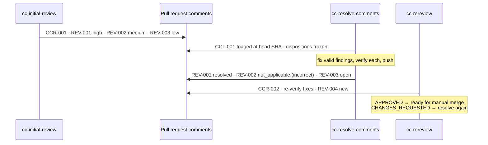
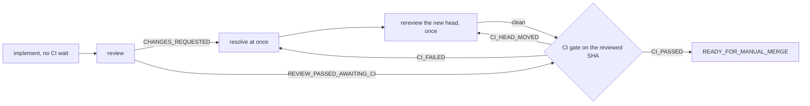

# Review lifecycle

How findings are created, tracked across rounds, and closed, and why the pull-request comment is the record the next run reads back.

**On this page:** [Issue review before implementation](#issue-review-before-implementation) · [The loop](#the-loop) · [CI policy](#ci-policy) · [Anatomy of a review comment](#anatomy-of-a-review-comment) · [Finding fields](#finding-fields) · [Trusted authors](#trusted-authors) · [Security triage](#security-triage) · [Structured result](#the-structured-result-is-opt-in) · [Exit conditions](#exit-conditions)

## Issue review before implementation

Before any code work, `run_cycle.py`, `cc-orchestrator`, and `cc-orca-orchestrator` can ask [`cc-issue-review`](skills.md#cc-issue-review) whether the work item is ready. It is a gate on the specification, not on code: it does not repeat the implementer's diagnosis (reproduction, mechanism, fix shape), and it cannot catch what only the diff will show.

| Setting | Behaviour |
|---|---|
| `auto` (default) | A new cycle reviews its work item first, except a task declared trivial and not security-sensitive (`--difficulty 1` without `--security-sensitive`). The default difficulty is 2, so an unclassified task is reviewed. |
| `off` | The original `implement → review → resolve → rereview` flow. |

Set it with `code_cycle.issue_review.mode`, or for one run with `--issue-review` or the orchestrators' `issue_review=auto|off`; the override wins. A cycle resumed with `--from review|resolve|rereview`, or an orchestrator that resumes an existing change request, never runs it. The orchestrators stop as `HUMAN_INTERVENTION` where the runtime reports `needs_refinement` or `readiness_unconfirmed`, as `BLOCKED` on `BLOCKED`, and as `FAILED` on an unreadable result or a changed workspace.

| Result | What the cycle does |
|---|---|
| `READY` with `high` or `medium` confidence and no unresolved material uncertainty | dispatches `implement` |
| `READY` with `low` confidence or an unresolved material uncertainty | reviews once more on `senior_reviewer`; stops as `readiness_unconfirmed` when that pass does not confirm it, or when the first pass already ran on `senior_reviewer` |
| `NEEDS_REFINEMENT` | stops as `needs_refinement` before `implement`, prints one `decisions` line and only the first question, and names a decisions record (`details:`) holding every question in asking order with the findings, evidence, and proposed issue edits |
| `BLOCKED`, a missing block, a block outside the contract, or a result whose `issue_id` names another work item | stops before `implement` (`stage_not_completed`) |

Confidence is a category for evidence quality, never a calibrated probability. The stage is `read_only`, has no publication permission, and never edits, comments on, labels, or closes the work item: its proposed edits are printed for a person, and applying them needs separate authorization. Its findings are `IR-NNN`, with no `REV-xxx` identity, `status`, or `disposition`, so they never enter the change-request contract below.

### Asking for decisions

A stop that needs a person — `NEEDS_REFINEMENT`, a decision behind `HUMAN_INTERVENTION` or `BLOCKED`, a missing provider value, a `needs_clarification` finding — does not end with everything at once. Every cycle skill and `cc-provider-bootstrap` share one *Asking the user* section: one summary line with the number of decisions, then the questions **one at a time**, the one that settles the most first. Each has one or two sentences of context, two to four options with the recommended one first, and a free-text answer. The host's interactive question tool is used when it has one (`AskUserQuestion` in Claude Code, the coordinator's question channel in an orchestrated run); otherwise one numbered question per message. Findings, evidence, and proposed edits stay available on request. `run_cycle.py` is not interactive, so it prints the first question only and writes the rest to `decisions/decisions-<stamp>-<pid>.json` beside the telemetry database, readable by its owner only; the coordinator reads the next question and the details from there.

A delegated stage returns its questions as a `questions` list in its structured result, so the coordinator asks them without re-deriving them from prose:

```json
{ "id": "Q-001", "prompt": "…", "options": ["…", "…"], "recommended": "…", "blocks": ["IR-001", "IU-001"] }
```

`recommended` is `null` or the first option; `blocks` names what the answer settles, and in an issue-review result only its own `IR-NNN` and `IU-NNN` identifiers. `stop_questions.questions_errors` is the executable definition, and the validator checks the shared section's example against it. Answers go back to the resumed stage as explicit input; an edit to the work item is shown and applied only after confirmation.

## The loop



1. **Initial review** reads the whole diff from the merge base, runs its delegated passes, and publishes one comment with findings `REV-001`, `REV-002`, and so on.
2. **Resolution** first classifies *every* finding against one commit, then edits. Valid findings are fixed and verified. Rejected ones get a reasoned reply.
3. **Rereview** reads the whole accumulated diff again and reproduces each claimed fix. It classifies each previous finding and numbers new ones after the highest existing ID.
4. Repeat until approved, or until an orchestrator's iteration limit, no-progress guard, or repeated-findings ladder stops it (see [Exit conditions](#exit-conditions)).

Initial review and rereview always cover the **accumulated diff from the merge base to the current head**. Under `parallel`, resolution's internal code-review pass covers only its fix delta; this does not narrow the subsequent rereview.

## CI policy

A cycle runs under one of two CI policies, set by `ci.policy` in `.code-cycle.yml`, by `--ci-policy` for one `run_cycle.py` run, or by `ci_policy=` for one orchestrator invocation. The override wins.

| Policy | Behaviour |
|---|---|
| `strict` (default) | The original serial flow. The implementation and each resolution wait for their pushed head's checks before returning, and a review reports `APPROVED` only once every required check passed. |
| `parallel` | The review starts as soon as the implementation is published, while its checks run. Approval needs a clean review **and** a CI pass of the same SHA, decided by the runtime's one CI gate. GitHub only; another code host keeps `strict`. |

Parallel mode never disables CI. It moves the wait to where it is useful: after the review, and only when the review found nothing to fix.

Under `parallel`, resolution keeps local verification, then reads the pushed
head's checks once with pending counts and returns without CI fix rounds or a
remote wait. `RESOLVED` can carry pending or failed checks; the CI gate's
`CI_FAILED` path handles them. Under `strict`, resolution keeps its existing
wait and check rules.

Resolution's internal review uses the `head_sha` of the latest completed,
trusted `review` or `rereview` receipt for this change request as its delta
base. `run_cycle.py` passes it in the prompt; a manual orchestrator recovers
the same boundary from provider-authenticated trusted comments. When the base
cannot be recovered or is not an ancestor of the new head, resolution reviews
the accumulated diff instead. It records the chosen base or fallback in its
summary. Rereview always judges the accumulated diff and final approval remains
scoped to that reviewed head and its required CI checks.



### The awaiting state

`REVIEW_PASSED_AWAITING_CI` means the review completed on the change request's current head, found nothing that blocks approval, and the required checks of that head have not all passed yet. It is **not** an approval. The review reports it instead of waiting, with `reviewed_head_sha` equal to `head_sha` and an empty `blocking_findings` list, and its schema-2 receipt in the PR comment carries the same status for that SHA. That receipt is the record of the awaiting state: the runtime reads it and never edits it, and a retried review reuses its own comment. Local SQLite and telemetry only mirror it. A clean status without those fields, or without its receipt, is a stage that did not complete.

Under `parallel` a review never turns a check's state into a finding; the CI gate does. A review that finds something blocking reports `CHANGES_REQUESTED`, and resolution starts at once, whatever the checks are doing. Under `strict` no gate waits for the checks, so a review that reports `REVIEW_PASSED_AWAITING_CI` stops the cycle as a stage that did not complete.

### The CI gate

`scripts/ci_gate.py` is the cycle's only wait on checks. `run_cycle.py` calls it after a clean review, and both orchestrators run its command line. No stage and no model polls: the implementation and the reviews read the checks once and return.

- **Required checks** are the ones the base branch's classic protection and active rulesets declare. When they declare none, every check reported on the SHA is required, identified by name and source app. Repeated runs count once, as their latest run, so a failed attempt does not block a successful retry.
- **Only `success` passes.** `failure`, `cancelled`, `timed_out` and every other unsuccessful conclusion fail; `skipped` and `neutral` do not pass either. A declared check that has not reported yet is pending until the deadline, and missing after it.
- **The SHA must still be the head.** Every read first confirms it. A pass is confirmed by one more read of the head and then of the clean review's receipt, with nothing published after it.

| Gate result | What the cycle does |
|---|---|
| `CI_PASSED` | `READY_FOR_MANUAL_MERGE`, once the receipt still holds |
| `CI_FAILED` | one resolution round, told the SHA and the number of failed checks, never their names, which the change under review writes; a resolution that leaves the head unchanged stops as `no_progress` |
| `CI_HEAD_MOVED` | the clean review is not reused: the runtime fast-forwards a clean worktree to the open pull request head and starts one fresh rereview; a dirty worktree stops as `BLOCKED` with `worktree_dirty`, a diverged branch stops as `BLOCKED` with `worktree_diverged`, and a second head move stops as `head_moved` |
| `CI_SKIPPED`, `NO_CI_CHECKS_FOUND` | `HUMAN_INTERVENTION`, recorded as `ci_not_passing` |
| `CI_TIMEOUT`, after `ci.timeout` (default 900 s) | `BLOCKED`, recorded as `ci_timeout`; the clean review stays valid for that SHA |
| `CI_UNREADABLE` | `BLOCKED`, recorded as `ci_unreadable` |

Before a resolution that follows `CHANGES_REQUESTED`, the runtime reads the reviewed head's checks once, without waiting: a failure already reported there reaches that resolution beside the findings. Review findings and CI failures stay separate, and neither resolves, replaces nor hides the other. Under `strict`, resolution keeps its own wait for the head it pushes. Under `parallel`, it reads that head's checks once, reports them, and returns; the CI gate owns the wait.

Before GitHub `resolve` or `rereview`, and before recovery of a published
`review`, the runtime checks the open pull request head and fast-forwards the
clean linked worktree when needed. If the checkout is already at that head, no
move is needed and the existing dispatch path is preserved, including for a
dirty checkout. Failure to query the pull request blocks the stage with
`stage_not_completed`; when a move is needed, a dirty worktree or diverged
checkout blocks with `worktree_dirty` or `worktree_diverged`. Successful moves
are recorded as `worktree_synchronized` stage events with the old and new full
SHAs; the event is attributed to the stage about to run.

### Resume while awaiting CI

`run_cycle.py --from rereview --pr <n> --ci-policy parallel` reads the change request's trusted comments first. When the latest receipt is a clean `review` or `rereview` of the PR's current head and the published findings block nothing, no review is dispatched: the cycle only runs the gate. A moved head, a later receipt from another stage, a malformed receipt, or a blocking finding reviews the current head instead, and a change request whose state cannot be read stops as `BLOCKED`. `--from review` always runs a fresh initial review.

## Anatomy of a review comment

A published comment carries three kinds of machine-readable line. Their tokens stay in English whatever language the prose uses.

```text
#### [CCR-20260918-001] · senior_reviewer · anthropic/claude-sonnet-5→claude-sonnet-5 · high · schema:2
#### [CCT-20260918-001] · cheap_coder · openai/gpt-6-luna→? · high · triaged:0123…4567 · schema:2
#### [REV-004] · medium · resolved · valid · blocks:yes — Short title
```

| Line | Written by | Tokens |
|---|---|---|
| **Review run** `CCR-…` | each review or rereview, once per run | run ID · profile · `provider/requested→resolved` model · effort · schema |
| **Triage run** `CCT-…` | each resolver, once, before editing | run ID · profile · model · effort · `triaged:<sha>` (the commit every disposition was judged against) · schema |
| **Finding** `REV-…` | every publication of a finding | ID · severity · status · disposition · blocks — title |

`model_resolved` is what the **executor** reported having launched, never what the agent believes it is. When the executor doesn't report a model (Codex never does), the line shows `?`, which means "can't know" rather than "matched". When the runtime routed the stage, the profile, requested model, and effort are copied verbatim from the routing decision.

Without runtime routing, both review and triage lines use the reserved profile
`manual`, which is not configurable and never replaces supplied routing data.
Record the host-configured provider, model selector, and effort, not the agent's
self-description. Prefer effective values exposed by the active session. If the
host does not expose them, resolve only the relevant config keys, applying the
Codex order `-m`/`--model` or `-c`/`--config` override → trusted project
`.codex/config.toml` → selected `profile = ...`/`--profile` file under
`$CODEX_HOME` → `$CODEX_HOME/config.toml` (default
`$HOME/.codex/config.toml`). Read `model_provider` from the effective host
setting or CLI override, not project config. For Claude Code, use the active
session model and effort, including current `/model` and `/effort` selections;
if not exposed, follow the key's precedence across managed settings,
per-session `--model`/`--effort` or `--settings`/environment overrides, and
active project/local/user settings. The user file is `~/.claude/settings.json`.
Keep a configured alias such as `opus` as the model selector; do not expand it
to a versioned model ID. If the host exposes only a full ID, record that ID.
Read only the model/provider/effort values needed and never
print or copy unrelated configuration. Write `unknown` independently for any
unavailable value. `model_resolved` remains `?` without an executor receipt.

A skill that republishes a comment keeps every run line it didn't write.

## Finding fields

| Field | Values | Answers |
|---|---|---|
| ID | `REV-001`, `REV-002`, … | Stable for the life of the PR. Never renumbered or reused. New IDs continue after the highest one ever seen. |
| Severity | `critical` · `high` · `medium` · `low` | How bad the impact is. Delegated passes report P0–P3, and the cycle skill maps them. |
| Status | `open` · `resolved` · `not_applicable` | What happened to the code. It keeps moving between rounds. |
| Disposition | `valid` · `debatable` · `incorrect` · `obsolete` · `needs_clarification` · `-` | What the first resolver made of the finding. `-` means not triaged yet, and reviewers always publish `-`. |
| Blocks | `blocks:yes` · `blocks:no` | Whether it prevents approval. It is set independently of severity. |

**Status and disposition are orthogonal.** `resolved` + `valid` is an accepted finding that was fixed. `not_applicable` + `incorrect` is one the resolver rejected with reasons. `open` + `debatable` is still under discussion.

**Dispositions are frozen.** The first resolver assigns them, before editing and against the triage commit. They are never recomputed later. That way a disposition measures whether the finding was right when it was written, not what the code looks like after the fix. See [Instrumentation → Dispositions are frozen](instrumentation.md#dispositions-are-frozen).

**Rereview outcomes** for a previous finding: `resolved` (verified by running it), `still_open` (still reproducible, or fixed but unverified), `not_applicable` (its scope was removed or changed). A fix that is present but can't be verified is **not** `resolved`.

**Legacy headers** with four tokens (no disposition) predate this contract and read as `-`. They never block an open PR.

Other tokens that never translate: the functional statuses (`APPROVED`, `REVIEW_PASSED_AWAITING_CI`, `CHANGES_REQUESTED`, `RESOLVED`, `PARTIALLY_RESOLVED`, `BLOCKED`, `FAILED`, `READY_FOR_MANUAL_MERGE`, `HUMAN_INTERVENTION`), the CI gate results (`CI_PASSED`, `CI_FAILED`, …), and every JSON key.

## Trusted authors

Later rounds recover findings from the PR's comment history, and a comment can be written by anyone. So recovery only folds in comments from logins listed in `review.trusted_authors`:

```yaml
code_cycle:
  review:
    trusted_authors:
      - your-login
      - your-review-bot
```

- Logins compare case-insensitively. Author identity comes from provider metadata, never from comment text.
- **No list, or an empty list, means no trusted authors.** A round that needs to recover history then stops with `BLOCKED`.
- `cc-provider-bootstrap` proposes the authenticated code-host login when the list is absent, and adds it only on confirmation. It never edits an existing list.
- The whole history is read in order. Other authors are ignored (and noted), and a malformed trusted comment is skipped rather than halting recovery.
- Ordinary discussion without contract headings starts an empty record.
- A later comment updates findings; it doesn't replace them. Leaving out an ID never deletes it. Two different titles under one ID are a collision, and recovery stops with `BLOCKED` rather than guessing.

## Missing structured result recovery

Review contract schema 2 adds an attempt receipt to the published PR summary.
Schema-1 run lines remain readable, but tokenless historical evidence cannot
automatically recover a missing result. When the runtime supplies `attempt_id`,
publish this metadata with the actual repository, PR, stage, current full head
SHA, functional status, and explicit outcomes for this attempt:

```text
<!-- code-cycle-stage {"schema":2,"repo":"owner/repository","change_request_id":"123","stage":"resolve","attempt_id":"attempt-runtime-token","head_sha":"0123456789abcdef0123456789abcdef01234567","status":"RESOLVED","finding_outcomes":[{"id":"REV-001","status":"resolved"}]} -->
```

This is evidence, not a replacement for `ORCHESTRATION_RESULT`. Finding headers
alone never establish a resolution claim. A receipt with `BLOCKED` or `FAILED`
vetoes recovery. The GitHub runtime reads the open PR and its complete paginated
comment history using `gh`, checks provider-authenticated trusted authors, and
requires exactly one receipt matching repository, PR, stage, attempt and SHA.
The checked-out SHA must also equal the PR head. Changed-SHA, stale-attempt,
ambiguous, malformed or untrusted evidence stops the cycle with a reason.

An eligible missing-result attempt remains failed. Its recovery is separately
recorded as `recovered_pending_verification`. Recovered implementation advances
to review; recovered resolution, including a comment-only resolution without a
push, advances to rereview. The verifier must execute the verification, report
the recovered head, and explicitly confirm or reopen every claimed finding ID.
Reopened findings invalidate those claims and feed the ordinary survivals ladder
and resolution limit. A recovered review or rereview is dispatched once more
for a structured verdict; another missing result stops it. Under the `parallel`
CI policy a receipt reporting `REVIEW_PASSED_AWAITING_CI` is a completed review
claim too, and the CI gate still decides approval. Recovery itself
never records `APPROVED` or reaches `READY_FOR_MANUAL_MERGE`. Only the subsequent
structured verifier result can do that. Other code hosts keep their existing
missing-result stop until a provider-specific evidence reader is available.

## Security triage

Every review and resolution round decides whether `cc-security-review` runs:

```text
security_required = deterministic_rule OR reviewer_requests_security
```

- **The rule** matches changed paths, filenames, and PR labels against `security_review.always_when` (or the built-in defaults: auth, middleware, migrations, routes, and policies directories; lockfiles; Dockerfiles; `*.env.example`; labels meaning security, auth, privacy, data, secrets, or dependencies). See [Configuration → Security review rule](configuration.md#security-review-rule).
- **The reviewer** may add an audit for anything touching sessions, tokens, validation, public APIs, uploads, personal data, CORS, cookies, headers, deployment configuration, or dependencies. It can **never remove** one the rule fired.
- Declaring the rule replaces the defaults. Leaving it out keeps them, so a missing configuration can never switch the gate off.
- The comment always says whether the audit ran and which half fired. When nothing fired, it says the audit was skipped after triage. Silence is not a triage result.

`scripts/security_gate.py` is the reference implementation.

## The structured result is opt-in

`ORCHESTRATION_RESULT`, a strict JSON block with IDs, statuses, and SHAs, is emitted only when:

- you ask for it (`--json`, `--orchestration-result`, "with the structured result");
- a worker contract requires it;
- the status is `BLOCKED` or `FAILED`, or no comment could be published.

When it is emitted alongside a published comment, it is collapsed in a `<details>` element there, not repeated in the response. Otherwise the published comment, with the headers above, is the record. See [Instrumentation → The comment is the record](instrumentation.md#the-comment-is-the-record).

## Exit conditions

An orchestrator reports `READY_FOR_MANUAL_MERGE` only when **all** of these hold on the code host:

- the last review status is `APPROVED`, or under the `parallel` [CI policy](#ci-policy) `APPROVED` or `REVIEW_PASSED_AWAITING_CI`;
- `reviewed_head_sha` equals the current head;
- no open finding has `blocks:yes`;
- required checks passed. Pending, skipped, failed, or missing checks are not success. Under `parallel` this is the CI gate's `CI_PASSED` for that SHA, never the review's own reading.

A human still owns the merge.

The loop stops early with `HUMAN_INTERVENTION`, before another resolution is dispatched, on any of these:

| Stop | When | Recorded as |
|---|---|---|
| Iteration limit | the resolve+rereview budget is spent: `max_iterations`, default `3` in `run_cycle.py` and `6` in the orchestrator skills | `iteration_limit` |
| No progress | a rereview reports the same `head_sha` and the same open finding set as the review before it | `no_progress` |
| Repeated findings | one `REV-xxx` ID survived a claimed fix twice | `repeated_findings` |

Before the loop, an [issue review](#issue-review-before-implementation) can stop a new cycle as `needs_refinement` or `readiness_unconfirmed` without implementing anything.

**A finding survives a claimed fix** when a resolution publishes its ID as `resolved` or `not_applicable` and the next review reopens it as `open` (`still_open` in a rereview's result). The claim is the status, never the disposition: a finding triaged `valid` and left `open` is no claim; one triaged `incorrect` and published `not_applicable` is one. Each claim is judged by the next review only, and within one run the last header for an ID is its position. These do not count:

| Sequence | Why not |
|---|---|
| `open@CCR → open@CCT → open@CCR` | the resolver never claimed it; the no-progress guard and the limit cover it |
| `resolved@CCT → resolved@CCR` | a confirmed fix |
| `resolved@CCT → not_applicable@CCR` | the reviewer agreed it no longer applies |
| `resolved@CCR → … → open@CCR` with no claim between | a regression, reported as one |
| a claim whose next rereview had no readable result | no rejection was observed |

The ladder has two rungs. After the **first** survival, the next resolution is told which IDs survived and must reproduce each with the reviewer's reproduction before editing, re-derive its cause, and not republish it `not_applicable` without new evidence; otherwise it reports `PARTIALLY_RESOLVED` and says the finding is contested. The **second** survival of the same ID stops the loop. Neither rung changes a model, profile, provider, or disposition.

The no-progress guard alone misses this pattern: a resolver that pushes a commit which does not fix the finding changes the head. On PR #74, `REV-001` went `open → resolved → open → not_applicable → open` across three reviews and nothing stopped it.

`review_contract.claimed_fix_survivals` is the single definition. It reads parsed trusted comments for analysis, attributing each comment to the run lines it introduces first (real comments republish earlier run lines, and one run can span several comments), and `run_cycle.py` feeds it the structured results of the current run. A resumed cycle (`--from`) does not start at zero: before its first stage, `run_cycle.py` rebuilds the claim and survival history from the change request's published comments, through `review_contract.comment_run_history`, keeping only the comments of `code_cycle.review.trusted_authors` (a trusted legacy comment with finding headers but no run line names no run and is skipped). A finding that survived once before the resume is contested on the next resolution, a second survival across runs stops with `HUMAN_INTERVENTION`, and the [max-effort escalation](#exit-conditions) follows the same history. The no-progress guard still starts empty.

An unreadable history is never an empty one. The resume stops before dispatching any stage, with the existing `stage_not_completed` stop reason and a reason that names the comment and the failure:

| History | Status |
|---|---|
| `review.trusted_authors` is empty | `HUMAN_INTERVENTION` |
| the comment fetch fails | `BLOCKED` |
| the freshness check of the change request fails | `BLOCKED` |
| another cycle on this machine holds the change request's writer lock | `BLOCKED` |
| a comment has no author metadata | `BLOCKED` |
| a trusted author's comment carries contract headings but cannot be parsed or placed in a review or triage run | `BLOCKED` |
| no review-contract comment at all, or only ordinary and other authors' comments | empty history; the resume continues |

On a GitHub code host the history comes from a local copy in the telemetry database when one remote check verifies it is current, and only the comments edited since the last sync are read otherwise; a missing or unverifiable copy is rebuilt from every comment. The comments remain the record. See [Telemetry → Cycle history](telemetry.md#cycle-history-schema-18), which also describes the publication outbox and how a conflicting writer stops the cycle as `BLOCKED`.

Both orchestrator skills describe the same ladder and the seeding, and the package validator checks that they state it.

---

[← Skills reference](skills.md) · [↑ Documentation index](README.md) · [Verification →](verification.md)
